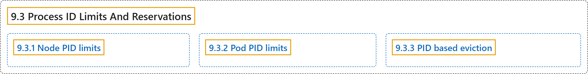

# 9.3 Process ID Limits And Reservations

## Classification

## Glossary

| Term | Definition | 中文翻译 | Source |
|---|---|---|---|
| **9.3 Process ID Limits And Reservations** 进程 ID 限制与预留 | (context) "Kubernetes allow you to **limit the number of process IDs (PIDs) that a [Pod](https://kubernetes.io/docs/concepts/workloads/pods/) can use**." | （语境）Kubernetes 允许你**限制一个 [Pod](https://kubernetes.io/docs/concepts/workloads/pods/) 可使用的进程 ID（PID）数量**。 | [The Kubernetes Authors, n.d., "Process ID Limits And Reservations", para. 1](https://kubernetes.io/docs/concepts/policy/pid-limiting/#:~:text=Kubernetes%20allow%20you%20to%20limit%20the%20number) |
| **9.3.1 Node PID limits** 节点 PID 限制 | "Kubernetes allows you to **reserve a number of process IDs for the system use**." | Kubernetes 允许你**为系统使用预留一定数量的进程 ID**。 | [The Kubernetes Authors, n.d., "Node PID limits", para. 1](https://kubernetes.io/docs/concepts/policy/pid-limiting/#:~:text=Kubernetes%20allows%20you%20to%20reserve%20a%20number) |
| **9.3.2 Pod PID limits** Pod PID 限制 | "Kubernetes allows you to **limit the number of processes running in a Pod**." | Kubernetes 允许你**限制 Pod 中运行的进程数量**。 | [The Kubernetes Authors, n.d., "Pod PID limits", para. 1](https://kubernetes.io/docs/concepts/policy/pid-limiting/#:~:text=Kubernetes%20allows%20you%20to%20limit%20the%20number) |
| **9.3.3 PID based eviction** 基于 PID 的驱逐 | "You can configure kubelet to **start terminating a Pod when it is misbehaving and consuming abnormal amount of resources**." | 你可以配置 kubelet，**在 Pod 行为异常、消耗异常多资源时开始终止它**。 | [The Kubernetes Authors, n.d., "PID based eviction", para. 1](https://kubernetes.io/docs/concepts/policy/pid-limiting/#:~:text=You%20can%20configure%20kubelet%20to%20start%20terminating) |

## References

The Kubernetes Authors. (n.d.). *Process ID Limits And Reservations*. Kubernetes Documentation. Retrieved October 31, 2026, from <https://kubernetes.io/docs/concepts/policy/pid-limiting/>
