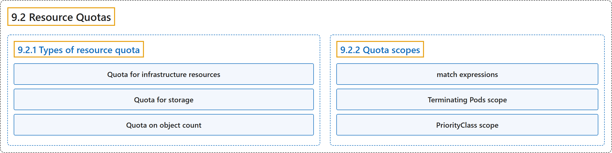

# 9.2 Resource Quotas

## Classification

## Glossary

| Term | Definition | 中文翻译 | Source |
|---|---|---|---|
| **9.2 Resource Quotas** 资源配额 | (context) "*Resource quotas* are **a tool for administrators** to **address this concern**." | （语境）*资源配额*是**管理员的一种工具**，用来**解决这一问题**。 | [The Kubernetes Authors, n.d., "Resource Quotas", para. 2](https://kubernetes.io/docs/concepts/policy/resource-quotas/#:~:text=%2AResource%20quotas%2A%20are%20a%20tool%20for%20administrators) |
| **9.2.1 Types of resource quota** 资源配额的类型 | "**The ResourceQuota mechanism** lets you **enforce different kinds of limits**." | **ResourceQuota 机制**让你**执行不同种类的限制**。 | [The Kubernetes Authors, n.d., "Types of resource quota", para. 1](https://kubernetes.io/docs/concepts/policy/resource-quotas/#:~:text=The%20ResourceQuota%20mechanism%20lets%20you%20enforce%20different) |
| **Quota for infrastructure resources** 基础设施资源配额 | "You can **limit the total sum of compute resources** that can be requested in **a given namespace**." | 你可以**限制计算资源的总和**，即可在**给定命名空间**中请求的总量。 | [The Kubernetes Authors, n.d., "Quota for infrastructure resources", para. 1](https://kubernetes.io/docs/concepts/policy/resource-quotas/#:~:text=You%20can%20limit%20the%20total%20sum%20of) |
| **Quota for storage** 存储配额 | "You can **limit the total sum of storage for volumes** that can be requested in **a given namespace**." | 你可以**限制卷的存储总和**，即可在**给定命名空间**中请求的总量。 | [The Kubernetes Authors, n.d., "Quota for storage", para. 1](https://kubernetes.io/docs/concepts/policy/resource-quotas/#:~:text=You%20can%20limit%20the%20total%20sum%20of) |
| **Quota on object count** 对象数量配额 | "You can **set quota** for ***the total number of one particular resource kind*** in the Kubernetes API" | 你可以**设置配额**，针对 Kubernetes API 中***某种特定资源类型的总数*** | [The Kubernetes Authors, n.d., "Quota on object count", para. 1](https://kubernetes.io/docs/concepts/policy/resource-quotas/#:~:text=You%20can%20set%20quota%20for%20%2Athe%20total) |
| **9.2.2 Quota scopes** 配额作用域 | "**Each quota** can have **an associated set of `scopes`**." | **每个配额**都可以有**一组关联的 `scopes`**。 | [The Kubernetes Authors, n.d., "Quota scopes", para. 1](https://kubernetes.io/docs/concepts/policy/resource-quotas/#:~:text=Each%20quota%20can%20have%20an%20associated%20set) |
| **match expressions** 匹配表达式 | "You define one or more *match expressions* that **specify an `operators`** and, if relevant, **a set of `values` to match**." | 你定义一个或多个*匹配表达式*，**指定一个 `operators`**，必要时再指定**一组要匹配的 `values`**。 | [The Kubernetes Authors, n.d., "Quota scopes", para. 13](https://kubernetes.io/docs/concepts/policy/resource-quotas/#:~:text=You%20define%20one%20or%20more%20%2Amatch%20expressions%2A) |
| **Terminating Pods scope** 终止中 Pod 作用域 | (context) "A Pod is **considered as *terminating*** if **the `.spec.activeDeadlineSeconds` field is set to any number**." | （语境）Pod **被视为*终止中***，如果 **`.spec.activeDeadlineSeconds` 字段被设为任意数值**。 | [The Kubernetes Authors, n.d., "Terminating Pods scope", para. 2](https://kubernetes.io/docs/concepts/policy/resource-quotas/#:~:text=A%20Pod%20is%20considered%20as%20%2Aterminating%2A%20if) |
| **PriorityClass scope** PriorityClass 作用域 | "**A ResourceQuota with a PriorityClass scope** only matches **Pods that have a particular priority class**" | **带有 PriorityClass 作用域的 ResourceQuota** 只匹配**具有特定优先级类的 Pod** | [The Kubernetes Authors, n.d., "PriorityClass scope", para. 1](https://kubernetes.io/docs/concepts/policy/resource-quotas/#:~:text=A%20ResourceQuota%20with%20a%20PriorityClass%20scope%20only) |

## References

The Kubernetes Authors. (n.d.). *Resource Quotas*. Kubernetes Documentation. Retrieved October 31, 2026, from <https://kubernetes.io/docs/concepts/policy/resource-quotas/>
