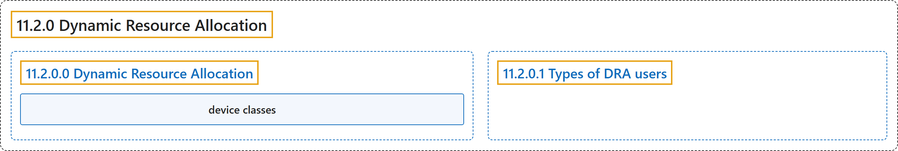

# 11.2.0 Dynamic Resource Allocation

## Classification

## Glossary

| Term | Definition | 中文翻译 | Source |
|---|---|---|---|
| **11.2.0 Dynamic Resource Allocation** 动态资源分配 | "**DRA** is **a Kubernetes feature** that lets you **request and share resources among Pods**." | **DRA** 是**一项 Kubernetes 功能**，让你**在 Pod 之间请求和共享资源**。 | [The Kubernetes Authors, n.d., "Dynamic Resource Allocation", para. 3](https://kubernetes.io/docs/concepts/resource-management/dynamic-resource-allocation/#:~:text=DRA%20is%20a%20Kubernetes%20feature%20that%20lets) |
| **11.2.0.0 Dynamic Resource Allocation** 动态资源分配 | (No definition) | （无定义） | [The Kubernetes Authors, n.d., "Dynamic Resource Allocation"](https://kubernetes.io/docs/concepts/resource-management/dynamic-resource-allocation/#dynamic-resource-allocation) |
| **device classes** 设备类 | "With DRA, **device drivers and cluster admins** define **device *classes*** that are **available to *claim* in workloads**." | 借助 DRA，**设备驱动和集群管理员**定义**设备*类***，这些类**可在工作负载中*申领***。 | [The Kubernetes Authors, n.d., "Dynamic Resource Allocation", para. 4](https://kubernetes.io/docs/concepts/resource-management/dynamic-resource-allocation/#:~:text=With%20DRA%2C%20device%20drivers%20and%20cluster%20admins) |
| **11.2.0.1 Types of DRA users** DRA 用户的类型 | "The workflow of **using DRA to allocate devices** involves **the following types of users**:" | **使用 DRA 分配设备**的工作流涉及**以下几类用户**： | [The Kubernetes Authors, n.d., "Types of DRA users", para. 1](https://kubernetes.io/docs/concepts/resource-management/dynamic-resource-allocation/#:~:text=The%20workflow%20of%20using%20DRA%20to%20allocate) |

## References

The Kubernetes Authors. (n.d.). *Dynamic Resource Allocation*. Kubernetes Documentation. Retrieved October 31, 2026, from <https://kubernetes.io/docs/concepts/resource-management/dynamic-resource-allocation/>
