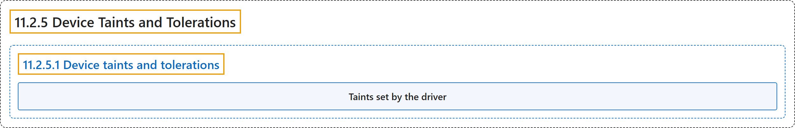

# 11.2.5 Device Taints and Tolerations

## Classification

## Glossary

| Term | Definition | 中文翻译 | Source |
|---|---|---|---|
| **11.2.5 Device Taints and Tolerations** 设备污点与容忍度 | (context) "This page describes **device taints and tolerations** in DRA, which let drivers and admins **keep Pods off specific devices**, or **evict Pods already using them**." | （语境）本页介绍 DRA 中的**设备污点与容忍度**，它们让驱动和管理员**让 Pod 远离特定设备**，或**驱逐已在使用这些设备的 Pod**。 | [The Kubernetes Authors, n.d., "Device Taints and Tolerations", para. 1](https://kubernetes.io/docs/concepts/resource-management/dynamic-resource-allocation/device-taints/#:~:text=This%20page%20describes%20device%20taints%20and%20tolerations) |
| **11.2.5.1 Device taints and tolerations** 设备污点与容忍度 | (No definition) | （无定义） | [The Kubernetes Authors, n.d., "Device taints and tolerations"](https://kubernetes.io/docs/concepts/resource-management/dynamic-resource-allocation/device-taints/#device-taints-and-tolerations) |
| **Taints set by the driver** 由驱动设置的污点 | "**A DRA driver** can **add taints to the device information** that it **publishes in ResourceSlices**." | **DRA 驱动**可以**为设备信息添加污点**，这些信息由它**发布在 ResourceSlice 中**。 | [The Kubernetes Authors, n.d., "Taints set by the driver", para. 1](https://kubernetes.io/docs/concepts/resource-management/dynamic-resource-allocation/device-taints/#:~:text=A%20DRA%20driver%20can%20add%20taints%20to) |

## References

The Kubernetes Authors. (n.d.). *Device Taints and Tolerations*. Kubernetes Documentation. Retrieved October 31, 2026, from <https://kubernetes.io/docs/concepts/resource-management/dynamic-resource-allocation/device-taints/>
