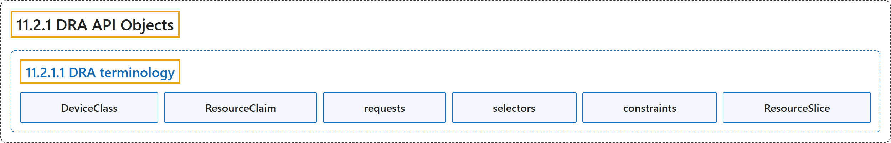

# 11.2.1 DRA API Objects

## Classification

## Glossary

| Term | Definition | 中文翻译 | Source |
|---|---|---|---|
| **11.2.1 DRA API Objects** DRA API 对象 | (context) "This page describes **the Kubernetes API kinds** that **dynamic resource allocation (DRA)** uses to **categorize, request, and allocate devices**." | （语境）本页介绍 **Kubernetes API 类型**，它们属于**动态资源分配（DRA）**，用来**分类、请求和分配设备**。 | [The Kubernetes Authors, n.d., "DRA API Objects", para. 1](https://kubernetes.io/docs/concepts/resource-management/dynamic-resource-allocation/dra-api/#:~:text=This%20page%20describes%20the%20Kubernetes%20API%20kinds) |
| **11.2.1.1 DRA terminology** DRA 术语 | "DRA uses **the following Kubernetes API kinds** to **provide the core allocation functionality**." | DRA 使用**以下 Kubernetes API 类型**来**提供核心的分配功能**。 | [The Kubernetes Authors, n.d., "DRA terminology", para. 1](https://kubernetes.io/docs/concepts/resource-management/dynamic-resource-allocation/dra-api/#:~:text=DRA%20uses%20the%20following%20Kubernetes%20API%20kinds) |
| **DeviceClass** DeviceClass | "**A DeviceClass** lets **cluster admins or device drivers** define **categories of devices in the cluster**." | **DeviceClass** 让**集群管理员或设备驱动**定义**集群中的设备类别**。 | [The Kubernetes Authors, n.d., "DeviceClass", para. 1](https://kubernetes.io/docs/concepts/resource-management/dynamic-resource-allocation/dra-api/#:~:text=A%20DeviceClass%20lets%20cluster%20admins%20or%20device) |
| **ResourceClaim** ResourceClaim | "**A ResourceClaim** defines **the resources that a workload needs**." | **ResourceClaim** 定义**工作负载所需的资源**。 | [The Kubernetes Authors, n.d., "ResourceClaims and ResourceClaimTemplates", para. 1](https://kubernetes.io/docs/concepts/resource-management/dynamic-resource-allocation/dra-api/#:~:text=A%20ResourceClaim%20defines%20the%20resources%20that%20a) |
| **requests** 请求 | "Every ResourceClaim has ***requests*** that **reference a DeviceClass** and **select devices from that DeviceClass**." | 每个 ResourceClaim 都有***请求***，它们**引用某个 DeviceClass**，并**从该 DeviceClass 中选择设备**。 | [The Kubernetes Authors, n.d., "ResourceClaims and ResourceClaimTemplates", para. 1](https://kubernetes.io/docs/concepts/resource-management/dynamic-resource-allocation/dra-api/#:~:text=Every%20ResourceClaim%20has%20%2Arequests%2A%20that%20reference%20a) |
| **selectors** 选择器 | "ResourceClaims can also use ***selectors*** to **filter for devices that meet specific requirements**, and can use *constraints* to limit the devices that can satisfy a request." | ResourceClaim 还可以用***选择器***来**筛选满足特定要求的设备**，并可用*约束*限制能满足某个请求的设备。 | [The Kubernetes Authors, n.d., "ResourceClaims and ResourceClaimTemplates", para. 1](https://kubernetes.io/docs/concepts/resource-management/dynamic-resource-allocation/dra-api/#:~:text=ResourceClaims%20can%20also%20use%20%2Aselectors%2A%20to%20filter) |
| **constraints** 约束 | "ResourceClaims can also use *selectors* to filter for devices that meet specific requirements, and can use ***constraints*** to **limit the devices that can satisfy a request**." | ResourceClaim 还可以用*选择器*筛选满足特定要求的设备，并可用***约束***来**限制能满足某个请求的设备**。 | [The Kubernetes Authors, n.d., "ResourceClaims and ResourceClaimTemplates", para. 1](https://kubernetes.io/docs/concepts/resource-management/dynamic-resource-allocation/dra-api/#:~:text=ResourceClaims%20can%20also%20use%20%2Aselectors%2A%20to%20filter) |
| **ResourceSlice** ResourceSlice | "**Each ResourceSlice** represents **one or more devices in a pool**." | **每个 ResourceSlice** 代表**一个池中的一个或多个设备**。 | [The Kubernetes Authors, n.d., "ResourceSlice", para. 1](https://kubernetes.io/docs/concepts/resource-management/dynamic-resource-allocation/dra-api/#:~:text=Each%20ResourceSlice%20represents%20one%20or%20more%20%5Bdevices%5D%28https%3A%2F%2Fkubernetes.io%2Fdocs%2Freference%2Fglossary%2F%3Fall%3Dtrue%23term-device%29) |

## References

The Kubernetes Authors. (n.d.). *DRA API Objects*. Kubernetes Documentation. Retrieved October 31, 2026, from <https://kubernetes.io/docs/concepts/resource-management/dynamic-resource-allocation/dra-api/>
