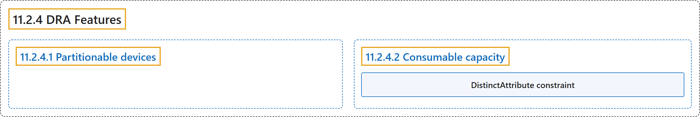

# 11.2.4 DRA Features

## Classification

## Glossary

| Term | Definition | 中文翻译 | Source |
|---|---|---|---|
| **11.2.4 DRA Features** DRA 特性 | (context) "This page describes **optional DRA features for advanced use cases**." | （语境）本页介绍**面向高级用例的可选 DRA 特性**。 | [The Kubernetes Authors, n.d., "DRA Features", para. 1](https://kubernetes.io/docs/concepts/resource-management/dynamic-resource-allocation/dra-features/#:~:text=This%20page%20describes%20optional%20DRA%20features%20for) |
| **11.2.4.1 Partitionable devices** 可分区设备 | (context) "Devices represented in DRA **don't necessarily have to be a single unit connected to a single machine**, but can also be a logical device comprised of multiple devices connected to multiple machines." | （语境）DRA 中表示的设备**不一定是连接到单台机器的单个单元**，也可以是由连接到多台机器的多个设备组成的逻辑设备。 | [The Kubernetes Authors, n.d., "Partitionable devices", para. 1](https://kubernetes.io/docs/concepts/resource-management/dynamic-resource-allocation/dra-features/#:~:text=Devices%20represented%20in%20DRA%20don%27t%20necessarily%20have) |
| **11.2.4.2 Consumable capacity** 可消耗容量 | "The consumable capacity feature **allows the same devices to be consumed by multiple independent ResourceClaims**, with the Kubernetes scheduler managing how much of the device's capacity is used up by each claim." | 可消耗容量功能**允许同一设备被多个相互独立的 ResourceClaim 消耗**，由 Kubernetes 调度器管理每个申领用掉多少设备容量。 | [The Kubernetes Authors, n.d., "Consumable capacity", para. 1](https://kubernetes.io/docs/concepts/resource-management/dynamic-resource-allocation/dra-features/#:~:text=The%20consumable%20capacity%20feature%20allows%20the%20same) |
| **DistinctAttribute constraint** DistinctAttribute 约束 | "When requesting multiple devices in a ResourceClaim, you can use the DistinctAttribute constraint to **ensure that each allocated device has a different value for a specified attribute**." | 在 ResourceClaim 中请求多个设备时，可以使用 DistinctAttribute 约束**确保每个分配到的设备在指定属性上取值各不相同**。 | [The Kubernetes Authors, n.d., "DistinctAttribute constraint", para. 1](https://kubernetes.io/docs/concepts/resource-management/dynamic-resource-allocation/dra-features/#:~:text=When%20requesting%20multiple%20devices%20in%20a%20ResourceClaim%2C) |

## References

The Kubernetes Authors. (n.d.). *DRA Features*. Kubernetes Documentation. Retrieved October 31, 2026, from <https://kubernetes.io/docs/concepts/resource-management/dynamic-resource-allocation/dra-features/>
