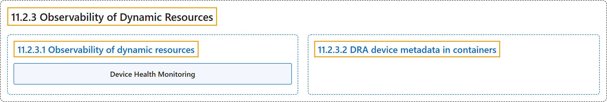

# 11.2.3 Observability of Dynamic Resources

## Classification

## Glossary

| Term | Definition | 中文翻译 | Source |
|---|---|---|---|
| **11.2.3 Observability of Dynamic Resources** 动态资源的可观测性 | (context) "This page describes **how to observe the status and health of resources that are dynamically allocated with DRA**." | （语境）本页介绍**如何观察通过 DRA 动态分配的资源的状态和健康状况**。 | [The Kubernetes Authors, n.d., "Observability of Dynamic Resources", para. 1](https://kubernetes.io/docs/concepts/resource-management/dynamic-resource-allocation/dra-observability/#:~:text=This%20page%20describes%20how%20to%20observe%20the) |
| **11.2.3.1 Observability of dynamic resources** 动态资源的可观测性 | (No definition) | （无定义） | [The Kubernetes Authors, n.d., "Observability of dynamic resources"](https://kubernetes.io/docs/concepts/resource-management/dynamic-resource-allocation/dra-observability/#observability-of-dynamic-resources) |
| **Device Health Monitoring** 设备健康监控 | "Kubernetes provides **a mechanism for monitoring and reporting the health of dynamically allocated infrastructure resources**." | Kubernetes 提供**一种监控和报告动态分配的基础设施资源健康状况的机制**。 | [The Kubernetes Authors, n.d., "Device Health Monitoring", para. 1](https://kubernetes.io/docs/concepts/resource-management/dynamic-resource-allocation/dra-observability/#:~:text=Kubernetes%20provides%20a%20mechanism%20for%20monitoring%20and) |
| **11.2.3.2 DRA device metadata in containers** 容器中的 DRA 设备元数据 | "DRA drivers can **expose device metadata such as device attributes (PCI bus addresses or mediated device UUIDs) and network configuration directly to containers as JSON files**." | DRA 驱动可以**把设备属性（PCI 总线地址或中介设备 UUID）等设备元数据和网络配置，以 JSON 文件形式直接暴露给容器**。 | [The Kubernetes Authors, n.d., "DRA device metadata in containers", para. 1](https://kubernetes.io/docs/concepts/resource-management/dynamic-resource-allocation/dra-observability/#:~:text=DRA%20drivers%20can%20expose%20device%20metadata%20such) |

## References

The Kubernetes Authors. (n.d.). *Observability of Dynamic Resources*. Kubernetes Documentation. Retrieved October 31, 2026, from <https://kubernetes.io/docs/concepts/resource-management/dynamic-resource-allocation/dra-observability/>
