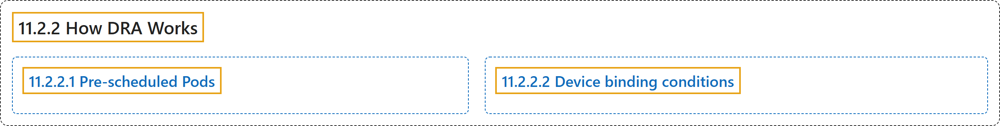

# 11.2.2 How DRA Works

## Classification

## Glossary

| Term | Definition | 中文翻译 | Source |
|---|---|---|---|
| **11.2.2 How DRA Works** DRA 的工作原理 | (context) "This page describes **how Kubernetes allocates devices to workloads with dynamic resource allocation (DRA)**, and how pre-scheduled Pods interact with the process." | （语境）本页介绍 **Kubernetes 如何通过动态资源分配（DRA）把设备分配给工作负载**，以及预调度的 Pod 如何参与这一过程。 | [The Kubernetes Authors, n.d., "How DRA Works", para. 1](https://kubernetes.io/docs/concepts/resource-management/dynamic-resource-allocation/how-dra-works/#:~:text=This%20page%20describes%20how%20Kubernetes%20allocates%20devices) |
| **11.2.2.1 Pre-scheduled Pods** 预调度的 Pod | "When you - or another API client - create a Pod with `spec.nodeName` already set, **the scheduler gets bypassed**." | 当你或其他 API 客户端创建已设置 `spec.nodeName` 的 Pod 时，**调度器会被绕过**。 | [The Kubernetes Authors, n.d., "Pre-scheduled Pods", para. 1](https://kubernetes.io/docs/concepts/resource-management/dynamic-resource-allocation/how-dra-works/#:~:text=When%20you%20-%20or%20another%20API%20client) |
| **11.2.2.2 Device binding conditions** 设备绑定条件 | "Device Binding Conditions **allow the Kubernetes scheduler to delay Pod binding until external resources**, such as fabric-attached GPUs or reprogrammable FPGAs, **are confirmed to be ready**." | 设备绑定条件**允许 Kubernetes 调度器推迟 Pod 绑定，直到外部资源**（例如通过网络结构挂接的 GPU 或可重编程 FPGA）**被确认就绪**。 | [The Kubernetes Authors, n.d., "Device binding conditions", para. 1](https://kubernetes.io/docs/concepts/resource-management/dynamic-resource-allocation/how-dra-works/#:~:text=Device%20Binding%20Conditions%20allow%20the%20Kubernetes%20scheduler) |

## References

The Kubernetes Authors. (n.d.). *How DRA Works*. Kubernetes Documentation. Retrieved October 31, 2026, from <https://kubernetes.io/docs/concepts/resource-management/dynamic-resource-allocation/how-dra-works/>
