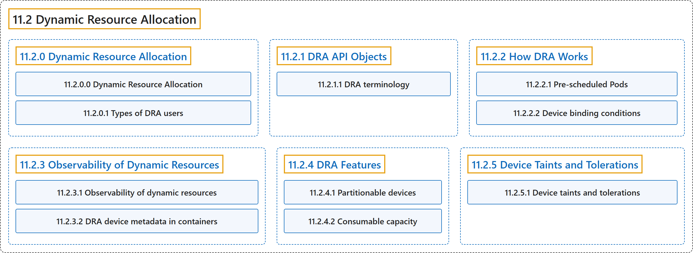

# 11.2 Dynamic Resource Allocation

## Classification

## Glossary

| Term | Definition | 中文翻译 | Source |
|---|---|---|---|
| **11.2 Dynamic Resource Allocation** 动态资源分配 | "DRA is **a Kubernetes feature that lets you request and share resources among Pods**." | DRA 是**一项 Kubernetes 功能，让你在 Pod 之间请求和共享资源**。 | [The Kubernetes Authors, n.d.-d, "Dynamic Resource Allocation", para. 3](https://kubernetes.io/docs/concepts/resource-management/dynamic-resource-allocation/#:~:text=DRA%20is%20a%20Kubernetes%20feature%20that%20lets) |
| **[11.2.0 Dynamic Resource Allocation](.md)** 动态资源分配 | "DRA is **a Kubernetes feature that lets you request and share resources among Pods**." | DRA 是**一项 Kubernetes 功能，让你在 Pod 之间请求和共享资源**。 | [The Kubernetes Authors, n.d.-d, "Dynamic Resource Allocation", para. 3](https://kubernetes.io/docs/concepts/resource-management/dynamic-resource-allocation/#:~:text=DRA%20is%20a%20Kubernetes%20feature%20that%20lets) |
| **[11.2.1 DRA API Objects](dra-api.md)** DRA API 对象 | (context) "This page describes **the Kubernetes API kinds that dynamic resource allocation (DRA) uses to categorize, request, and allocate devices**." | （语境）本页介绍**动态资源分配（DRA）用来分类、请求和分配设备的 Kubernetes API 类型**。 | [The Kubernetes Authors, n.d.-b, "DRA API Objects", para. 1](https://kubernetes.io/docs/concepts/resource-management/dynamic-resource-allocation/dra-api/#:~:text=This%20page%20describes%20the%20Kubernetes%20API%20kinds) |
| **[11.2.2 How DRA Works](how-dra-works.md)** DRA 的工作原理 | (context) "This page describes **how Kubernetes allocates devices to workloads with dynamic resource allocation (DRA)**, and how pre-scheduled Pods interact with the process." | （语境）本页介绍 **Kubernetes 如何通过动态资源分配（DRA）把设备分配给工作负载**，以及预调度的 Pod 如何参与这一过程。 | [The Kubernetes Authors, n.d.-e, "How DRA Works", para. 1](https://kubernetes.io/docs/concepts/resource-management/dynamic-resource-allocation/how-dra-works/#:~:text=This%20page%20describes%20how%20Kubernetes%20allocates%20devices) |
| **[11.2.3 Observability of Dynamic Resources](dra-observability.md)** 动态资源的可观测性 | (context) "This page describes **how to observe the status and health of resources that are dynamically allocated with DRA**." | （语境）本页介绍**如何观察通过 DRA 动态分配的资源的状态和健康状况**。 | [The Kubernetes Authors, n.d.-f, "Observability of Dynamic Resources", para. 1](https://kubernetes.io/docs/concepts/resource-management/dynamic-resource-allocation/dra-observability/#:~:text=This%20page%20describes%20how%20to%20observe%20the) |
| **[11.2.4 DRA Features](dra-features.md)** DRA 特性 | (context) "This page describes **optional DRA features for advanced use cases**." | （语境）本页介绍**面向高级用例的可选 DRA 特性**。 | [The Kubernetes Authors, n.d.-c, "DRA Features", para. 1](https://kubernetes.io/docs/concepts/resource-management/dynamic-resource-allocation/dra-features/#:~:text=This%20page%20describes%20optional%20DRA%20features%20for) |
| **[11.2.5 Device Taints and Tolerations](device-taints.md)** 设备污点与容忍度 | (context) "This page describes device taints and tolerations in DRA, which **let drivers and admins keep Pods off specific devices, or evict Pods already using them**." | （语境）本页介绍 DRA 中的设备污点与容忍度，它们**让驱动和管理员让 Pod 远离特定设备，或驱逐已在使用这些设备的 Pod**。 | [The Kubernetes Authors, n.d.-a, "Device Taints and Tolerations", para. 1](https://kubernetes.io/docs/concepts/resource-management/dynamic-resource-allocation/device-taints/#:~:text=This%20page%20describes%20device%20taints%20and%20tolerations) |

## References

The Kubernetes Authors. (n.d.-a). *Device Taints and Tolerations*. Kubernetes Documentation. Retrieved October 31, 2026, from <https://kubernetes.io/docs/concepts/resource-management/dynamic-resource-allocation/device-taints/>

The Kubernetes Authors. (n.d.-b). *DRA API Objects*. Kubernetes Documentation. Retrieved October 31, 2026, from <https://kubernetes.io/docs/concepts/resource-management/dynamic-resource-allocation/dra-api/>

The Kubernetes Authors. (n.d.-c). *DRA Features*. Kubernetes Documentation. Retrieved October 31, 2026, from <https://kubernetes.io/docs/concepts/resource-management/dynamic-resource-allocation/dra-features/>

The Kubernetes Authors. (n.d.-d). *Dynamic Resource Allocation*. Kubernetes Documentation. Retrieved October 31, 2026, from <https://kubernetes.io/docs/concepts/resource-management/dynamic-resource-allocation/>

The Kubernetes Authors. (n.d.-e). *How DRA Works*. Kubernetes Documentation. Retrieved October 31, 2026, from <https://kubernetes.io/docs/concepts/resource-management/dynamic-resource-allocation/how-dra-works/>

The Kubernetes Authors. (n.d.-f). *Observability of Dynamic Resources*. Kubernetes Documentation. Retrieved October 31, 2026, from <https://kubernetes.io/docs/concepts/resource-management/dynamic-resource-allocation/dra-observability/>
