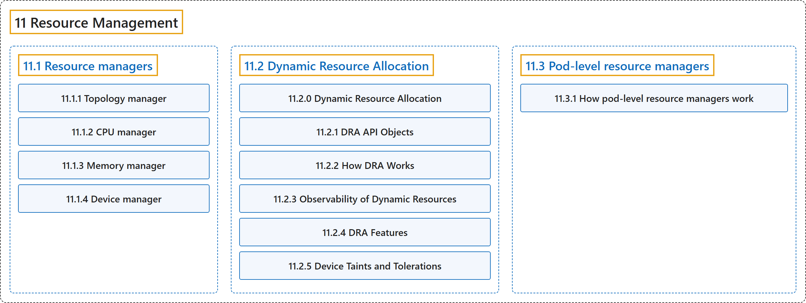

# 11 Resource Management

## Classification

## Glossary

| Term | Definition | 中文翻译 | Source |
|---|---|---|---|
| **11 Resource Management** 资源管理 | "**How Kubernetes represents, requests, allocates, and constrains the resources that workloads consume.**" | **Kubernetes 如何表示、请求、分配和约束工作负载所消耗的资源。** | [The Kubernetes Authors, n.d.-c, "Resource Management", para. 1](https://kubernetes.io/docs/concepts/resource-management/#:~:text=How%20Kubernetes%20represents%2C%20requests%2C%20allocates%2C%20and%20constrains) |
| **[11.1 Resource managers](resource-managers.md)** 资源管理器 | "In order to support latency-critical and high-throughput workloads, **Kubernetes offers a suite of Resource Managers**." | 为了支持对延迟敏感和高吞吐量的工作负载，**Kubernetes 提供了一套资源管理器**。 | [The Kubernetes Authors, n.d.-d, "Resource managers", para. 1](https://kubernetes.io/docs/concepts/resource-management/resource-managers/#:~:text=In%20order%20to%20support%20latency-critical%20and%20high-throughput) |
| **[11.2 Dynamic Resource Allocation](dynamic-resource-allocation/index.md)** 动态资源分配 | "DRA is **a Kubernetes feature that lets you request and share resources among Pods**." | DRA 是**一项 Kubernetes 功能，让你在 Pod 之间请求和共享资源**。 | [The Kubernetes Authors, n.d.-a, "Dynamic Resource Allocation", para. 3](https://kubernetes.io/docs/concepts/resource-management/dynamic-resource-allocation/#:~:text=DRA%20is%20a%20Kubernetes%20feature%20that%20lets) |
| **[11.3 Pod-level resource managers](pod-level-resource-managers.md)** Pod 级资源管理器 | (context) "When the Topology Manager scope is set to `pod`, **the `kubelet` performs a single NUMA alignment for the entire Pod** based on the resource budget defined in `.spec.resources`." | （语境）当拓扑管理器的作用域设为 `pod` 时，**`kubelet` 根据 `.spec.resources` 中定义的资源预算，为整个 Pod 执行一次 NUMA 对齐**。 | [The Kubernetes Authors, n.d.-b, "Topology manager's pod scope and pod-level resources", para. 1](https://kubernetes.io/docs/concepts/resource-management/pod-level-resource-managers/#:~:text=When%20the%20Topology%20Manager%20scope%20is%20set) |

## References

The Kubernetes Authors. (n.d.-a). *Dynamic Resource Allocation*. Kubernetes Documentation. Retrieved October 31, 2026, from <https://kubernetes.io/docs/concepts/resource-management/dynamic-resource-allocation/>

The Kubernetes Authors. (n.d.-b). *Pod-level resource managers*. Kubernetes Documentation. Retrieved October 31, 2026, from <https://kubernetes.io/docs/concepts/resource-management/pod-level-resource-managers/>

The Kubernetes Authors. (n.d.-c). *Resource Management*. Kubernetes Documentation. Retrieved October 31, 2026, from <https://kubernetes.io/docs/concepts/resource-management/>

The Kubernetes Authors. (n.d.-d). *Resource managers*. Kubernetes Documentation. Retrieved October 31, 2026, from <https://kubernetes.io/docs/concepts/resource-management/resource-managers/>
