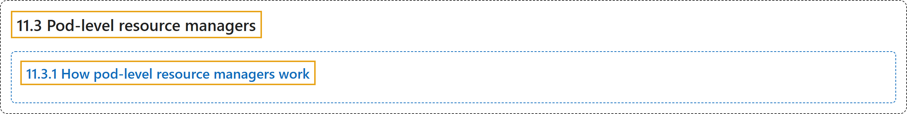

# 11.3 Pod-level resource managers

## Classification

## Glossary

| Term | Definition | 中文翻译 | Source |
|---|---|---|---|
| **11.3 Pod-level resource managers** Pod 级资源管理器 | (context) "When **the Topology Manager scope is set to `pod`**, the `kubelet` performs **a single NUMA alignment for the entire Pod** based on **the resource budget defined in `.spec.resources`**." | （语境）当**拓扑管理器的作用域设为 `pod`** 时，`kubelet` 执行**一次覆盖整个 Pod 的 NUMA 对齐**，依据的是 **`.spec.resources` 中定义的资源预算**。 | [The Kubernetes Authors, n.d., "Topology manager's pod scope and pod-level resources", para. 1](https://kubernetes.io/docs/concepts/resource-management/pod-level-resource-managers/#:~:text=When%20the%20Topology%20Manager%20scope%20is%20set) |
| **11.3.1 How pod-level resource managers work** Pod 级资源管理器的工作方式 | "**The CPU and Memory resource managers** operate differently depending on **the configured Topology Manager scope**." | **CPU 和内存资源管理器**的运行方式取决于**所配置的拓扑管理器作用域**。 | [The Kubernetes Authors, n.d., "How pod-level resource managers work", para. 1](https://kubernetes.io/docs/concepts/resource-management/pod-level-resource-managers/#:~:text=The%20CPU%20and%20Memory%20resource%20managers%20operate) |

## References

The Kubernetes Authors. (n.d.). *Pod-level resource managers*. Kubernetes Documentation. Retrieved October 31, 2026, from <https://kubernetes.io/docs/concepts/resource-management/pod-level-resource-managers/>
