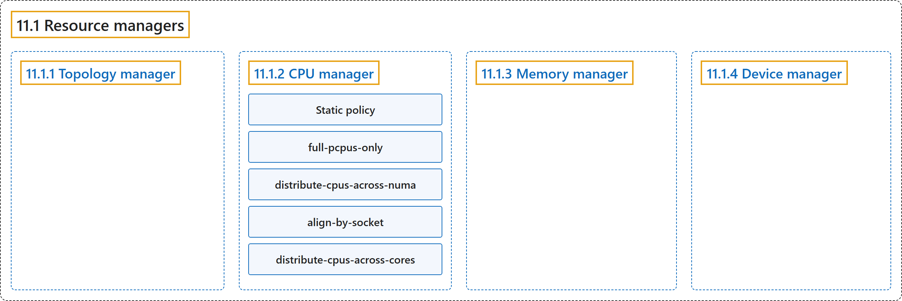

# 11.1 Resource managers

## Classification

## Glossary

| Term | Definition | 中文翻译 | Source |
|---|---|---|---|
| **11.1 Resource managers** 资源管理器 | "In order to support **latency-critical and high-throughput workloads**, Kubernetes offers **a suite of Resource Managers**." | 为了支持**对延迟敏感和高吞吐量的工作负载**，Kubernetes 提供了**一套资源管理器**。 | [The Kubernetes Authors, n.d., "Resource managers", para. 1](https://kubernetes.io/docs/concepts/resource-management/resource-managers/#:~:text=In%20order%20to%20support%20latency-critical%20and%20high-throughput) |
| **11.1.1 Topology manager** 拓扑管理器 | "***Topology Manager*** is **a kubelet component** that aims to **coordinate the set of components that are responsible for these optimizations**." | ***拓扑管理器***是**一个 kubelet 组件**，旨在**协调负责这些优化的一组组件**。 | [The Kubernetes Authors, n.d., "Topology manager", para. 2](https://kubernetes.io/docs/concepts/resource-management/resource-managers/#:~:text=%2ATopology%20Manager%2A%20is%20a%20kubelet%20component%20that) |
| **11.1.2 CPU manager** CPU 管理器 | "***CPU Manager*** is **a kubelet component** that provides **exclusive resource allocation for CPU resources**." | ***CPU 管理器***是**一个 kubelet 组件**，提供**面向 CPU 资源的独占式分配**。 | [The Kubernetes Authors, n.d., "CPU manager", para. 2](https://kubernetes.io/docs/concepts/resource-management/resource-managers/#:~:text=%2ACPU%20Manager%2A%20is%20a%20kubelet%20component%20that) |
| **Static policy** 静态策略 | "**The static policy** enables **finer-grained CPU management** and **exclusive CPU assignment**." | **静态策略**支持**更细粒度的 CPU 管理**和**独占式 CPU 分配**。 | [The Kubernetes Authors, n.d., "Static policy", para. 1](https://kubernetes.io/docs/concepts/resource-management/resource-managers/#:~:text=The%20static%20policy%20enables%20finer-grained%20CPU%20management) |
| **full-pcpus-only** full-pcpus-only | "If the **`full-pcpus-only`** policy option is specified, the static policy will **always allocate full physical cores**." | 如果指定了 **`full-pcpus-only`** 策略选项，静态策略**总是分配完整的物理核心**。 | [The Kubernetes Authors, n.d., "Static policy options", para. 20](https://kubernetes.io/docs/concepts/resource-management/resource-managers/#:~:text=If%20the%20%60full-pcpus-only%60%20policy%20option%20is%20specified%2C) |
| **distribute-cpus-across-numa** distribute-cpus-across-numa | "the static policy will **evenly distribute CPUs across NUMA nodes** in cases where **more than one NUMA node is required to satisfy the allocation**." | 静态策略会**把 CPU 均匀分布到各 NUMA 节点上**，当**需要多个 NUMA 节点才能满足分配**时。 | [The Kubernetes Authors, n.d., "Static policy options", para. 22](https://kubernetes.io/docs/concepts/resource-management/resource-managers/#:~:text=the%20static%20policy%20will%20evenly%20distribute%20CPUs) |
| **align-by-socket** align-by-socket | "If the **`align-by-socket`** policy option is specified, CPUs will be considered **aligned at the socket boundary** when deciding how to **allocate CPUs to a container**." | 如果指定了 **`align-by-socket`** 策略选项，CPU 会被视为**按插槽边界对齐**，在决定如何**为容器分配 CPU** 时。 | [The Kubernetes Authors, n.d., "Static policy options", para. 24](https://kubernetes.io/docs/concepts/resource-management/resource-managers/#:~:text=If%20the%20%60align-by-socket%60%20policy%20option%20is%20specified%2C) |
| **distribute-cpus-across-cores** distribute-cpus-across-cores | "If the **`distribute-cpus-across-cores`** policy option is specified, the static policy will attempt to **allocate virtual cores (hardware threads)** across **different physical cores**." | 如果指定了 **`distribute-cpus-across-cores`** 策略选项，静态策略会尝试**分配虚拟核心（硬件线程）**，分散到**不同的物理核心**上。 | [The Kubernetes Authors, n.d., "Static policy options", para. 26](https://kubernetes.io/docs/concepts/resource-management/resource-managers/#:~:text=If%20the%20%60distribute-cpus-across-cores%60%20policy%20option%20is%20specified%2C) |
| **11.1.3 Memory manager** 内存管理器 | "***Memory Manager*** is **a kubelet component** that provides **exclusive resource allocation for memory resources**." | ***内存管理器***是**一个 kubelet 组件**，提供**面向内存资源的独占式分配**。 | [The Kubernetes Authors, n.d., "Memory manager", para. 2](https://kubernetes.io/docs/concepts/resource-management/resource-managers/#:~:text=%2AMemory%20Manager%2A%20is%20a%20kubelet%20component%20that) |
| **11.1.4 Device manager** 设备管理器 | "***Device Manager*** is **a kubelet component** that **allocates hardware devices to pods** using **the device plugin API**." | ***设备管理器***是**一个 kubelet 组件**，**为 Pod 分配硬件设备**，使用的是**设备插件 API**。 | [The Kubernetes Authors, n.d., "Device manager", para. 1](https://kubernetes.io/docs/concepts/resource-management/resource-managers/#:~:text=%2ADevice%20Manager%2A%20is%20a%20kubelet%20component%20that) |

## References

The Kubernetes Authors. (n.d.). *Resource managers*. Kubernetes Documentation. Retrieved October 31, 2026, from <https://kubernetes.io/docs/concepts/resource-management/resource-managers/>
