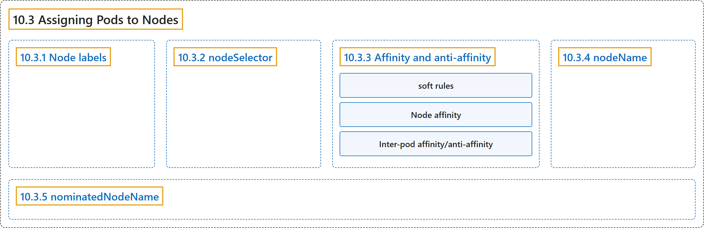

# 10.3 Assigning Pods to Nodes

## Classification

## Glossary

| Term | Definition | 中文翻译 | Source |
|---|---|---|---|
| **10.3 Assigning Pods to Nodes** 将 Pod 分配给节点 | (context) "You can constrain a Pod so that it is ***restricted* to run on particular node(s)**, or to ***prefer* to run on particular nodes**." | （语境）你可以约束一个 Pod，使它**被*限制*在特定节点上运行**，或***优先*在特定节点上运行**。 | [The Kubernetes Authors, n.d., "Assigning Pods to Nodes", para. 1](https://kubernetes.io/docs/concepts/scheduling-eviction/assign-pod-node/#:~:text=You%20can%20constrain%20a%20%5BPod%5D%28https%3A%2F%2Fkubernetes.io%2Fdocs%2Fconcepts%2Fworkloads%2Fpods%2F%29%20so%20that) |
| **10.3.1 Node labels** 节点标签 | "Like many other Kubernetes objects, **nodes** have **labels**." | 与许多其他 Kubernetes 对象一样，**节点**也有**标签**。 | [The Kubernetes Authors, n.d., "Node labels", para. 1](https://kubernetes.io/docs/concepts/scheduling-eviction/assign-pod-node/#:~:text=Like%20many%20other%20Kubernetes%20objects%2C%20nodes%20have) |
| **10.3.2 nodeSelector** nodeSelector | "`nodeSelector` is **the simplest recommended form** of **node selection constraint**." | `nodeSelector` 是**最简单的推荐形式**，属于**节点选择约束**。 | [The Kubernetes Authors, n.d., "nodeSelector", para. 1](https://kubernetes.io/docs/concepts/scheduling-eviction/assign-pod-node/#:~:text=%60nodeSelector%60%20is%20the%20simplest%20recommended%20form%20of) |
| **10.3.3 Affinity and anti-affinity** 亲和性与反亲和性 | (No definition) | （无定义） | [The Kubernetes Authors, n.d., "Affinity and anti-affinity"](https://kubernetes.io/docs/concepts/scheduling-eviction/assign-pod-node/#affinity-and-anti-affinity) |
| **soft rules** 软规则 | (context) "You can indicate that a rule is ***soft* or *preferred***, so that **the scheduler still schedules the Pod** even if it **can't find a matching node**." | （语境）你可以把一条规则标记为***软*或*首选***，这样**调度器仍会调度该 Pod**，即使它**找不到匹配的节点**。 | [The Kubernetes Authors, n.d., "Affinity and anti-affinity", para. 3](https://kubernetes.io/docs/concepts/scheduling-eviction/assign-pod-node/#:~:text=You%20can%20indicate%20that%20a%20rule%20is) |
| **Node affinity** 节点亲和性 | "***Node affinity*** functions like the `nodeSelector` field but is **more expressive** and allows you to **specify soft rules**." | ***节点亲和性***的作用类似 `nodeSelector` 字段，但**表达能力更强**，并允许你**指定软规则**。 | [The Kubernetes Authors, n.d., "Affinity and anti-affinity", para. 6](https://kubernetes.io/docs/concepts/scheduling-eviction/assign-pod-node/#:~:text=%2ANode%20affinity%2A%20functions%20like%20the%20%60nodeSelector%60%20field) |
| **Inter-pod affinity/anti-affinity** Pod 间亲和性/反亲和性 | "***Inter-pod affinity/anti-affinity*** allows you to **constrain Pods** against **labels on other Pods**." | ***Pod 间亲和性/反亲和性***让你**约束 Pod**，依据是**其他 Pod 上的标签**。 | [The Kubernetes Authors, n.d., "Affinity and anti-affinity", para. 7](https://kubernetes.io/docs/concepts/scheduling-eviction/assign-pod-node/#:~:text=%2AInter-pod%20affinity%2Fanti-affinity%2A%20allows%20you%20to%20constrain%20Pods) |
| **10.3.4 nodeName** nodeName | "`nodeName` is **a more direct form of node selection** than **affinity or `nodeSelector`**." | `nodeName` 是**更直接的节点选择形式**，相比**亲和性或 `nodeSelector`**。 | [The Kubernetes Authors, n.d., "nodeName", para. 1](https://kubernetes.io/docs/concepts/scheduling-eviction/assign-pod-node/#:~:text=%60nodeName%60%20is%20a%20more%20direct%20form%20of) |
| **10.3.5 nominatedNodeName** nominatedNodeName | "`nominatedNodeName` can be used for **external components** to **nominate node for a pending pod**." | `nominatedNodeName` 可供**外部组件**用来**为待调度的 Pod 提名节点**。 | [The Kubernetes Authors, n.d., "nominatedNodeName", para. 1](https://kubernetes.io/docs/concepts/scheduling-eviction/assign-pod-node/#:~:text=%60nominatedNodeName%60%20can%20be%20used%20for%20external%20components) |

## References

The Kubernetes Authors. (n.d.). *Assigning Pods to Nodes*. Kubernetes Documentation. Retrieved October 31, 2026, from <https://kubernetes.io/docs/concepts/scheduling-eviction/assign-pod-node/>
