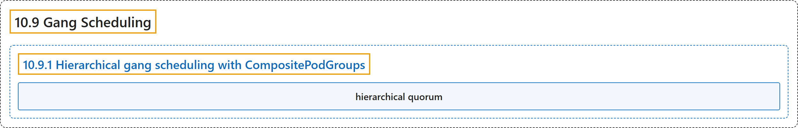

# 10.9 Gang Scheduling

## Classification

## Glossary

| Term | Definition | 中文翻译 | Source |
|---|---|---|---|
| **10.9 Gang Scheduling** 成组调度 | "Gang scheduling ensures that **a group of Pods** are scheduled on **an "all-or-nothing" basis**." | 成组调度确保**一组 Pod** 以 **“全有或全无”的方式**被调度。 | [The Kubernetes Authors, n.d., "Gang Scheduling", para. 3](https://kubernetes.io/docs/concepts/scheduling-eviction/gang-scheduling/#:~:text=Gang%20scheduling%20ensures%20that%20a%20group%20of) |
| **10.9.1 Hierarchical gang scheduling with CompositePodGroups** 基于 CompositePodGroup 的分层成组调度 | (No definition) | （无定义） | [The Kubernetes Authors, n.d., "Hierarchical gang scheduling with CompositePodGroups"](https://kubernetes.io/docs/concepts/scheduling-eviction/gang-scheduling/#hierarchical-gang-scheduling-with-compositepodgroups) |
| **hierarchical quorum** 分层法定数 | (context) "The `GangScheduling` plugin **holds the root `CompositePodGroup`** from entering the active scheduling queue in **the `PreEnqueue` phase**" | （语境）`GangScheduling` 插件**阻止根 `CompositePodGroup`** 进入活动调度队列，时机是在 **`PreEnqueue` 阶段** | [The Kubernetes Authors, n.d., "Hierarchical quorum", para. 1](https://kubernetes.io/docs/concepts/scheduling-eviction/gang-scheduling/#:~:text=The%20%60GangScheduling%60%20plugin%20holds%20the%20root%20%60CompositePodGroup%60) |

## References

The Kubernetes Authors. (n.d.). *Gang Scheduling*. Kubernetes Documentation. Retrieved October 31, 2026, from <https://kubernetes.io/docs/concepts/scheduling-eviction/gang-scheduling/>
