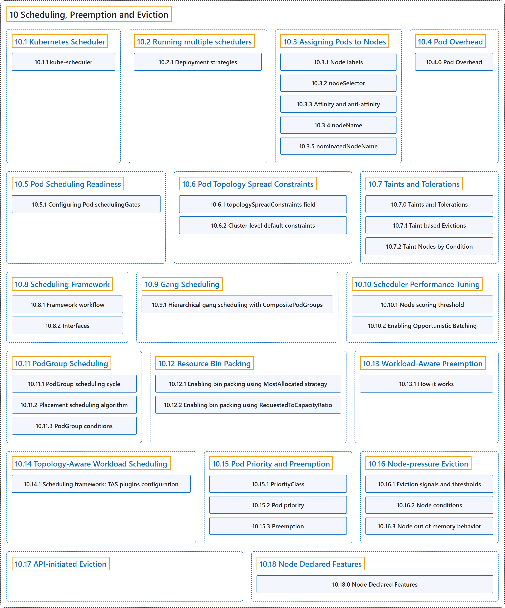

# 10 Scheduling, Preemption and Eviction

## Classification

## Glossary

| Term | Definition | 中文翻译 | Source |
|---|---|---|---|
| **10 Scheduling, Preemption and Eviction** 调度、抢占与驱逐 | (context) "In Kubernetes, scheduling refers to **making sure that [Pods](https://kubernetes.io/docs/concepts/workloads/pods/) are matched to [Nodes](https://kubernetes.io/docs/concepts/architecture/nodes/)** so that the [kubelet](https://kubernetes.io/docs/reference/command-line-tools-reference/kubelet) can run them." | （语境）在 Kubernetes 中，调度是指**确保 [Pod](https://kubernetes.io/docs/concepts/workloads/pods/) 被匹配到 [Node](https://kubernetes.io/docs/concepts/architecture/nodes/)**，以便 [kubelet](https://kubernetes.io/docs/reference/command-line-tools-reference/kubelet) 能够运行它们。 | [The Kubernetes Authors, n.d.-p, "Scheduling, Preemption and Eviction", para. 1](https://kubernetes.io/docs/concepts/scheduling-eviction/#:~:text=In%20Kubernetes%2C%20scheduling%20refers%20to%20making%20sure) |
| **[10.1 Kubernetes Scheduler](kube-scheduler.md)** Kubernetes 调度器 | "A scheduler **watches for newly created Pods that have no Node assigned**." | 调度器**监视尚未分配节点的新建 Pod**。 | [The Kubernetes Authors, n.d.-d, "Scheduling overview", para. 1](https://kubernetes.io/docs/concepts/scheduling-eviction/kube-scheduler/#:~:text=A%20scheduler%20watches%20for%20newly%20created%20Pods) |
| **[10.2 Running multiple schedulers](running-multiple-schedulers.md)** 运行多个调度器 | (context) "Kubernetes allows you to **run multiple schedulers within a single cluster**." | （语境）Kubernetes 允许你**在单个集群中运行多个调度器**。 | [The Kubernetes Authors, n.d.-m, "Running multiple schedulers", para. 1](https://kubernetes.io/docs/concepts/scheduling-eviction/running-multiple-schedulers/#:~:text=Kubernetes%20allows%20you%20to%20run%20multiple%20schedulers) |
| **[10.3 Assigning Pods to Nodes](assign-pod-node.md)** 将 Pod 分配给节点 | (context) "You can constrain a [Pod](https://kubernetes.io/docs/concepts/workloads/pods/) so that it is ***restricted* to run on particular [node(s)](https://kubernetes.io/docs/concepts/architecture/nodes/), or to *prefer* to run on particular nodes**." | （语境）你可以约束一个 [Pod](https://kubernetes.io/docs/concepts/workloads/pods/)，使它**被*限制*在特定[节点](https://kubernetes.io/docs/concepts/architecture/nodes/)上运行，或*优先*在特定节点上运行**。 | [The Kubernetes Authors, n.d.-b, "Assigning Pods to Nodes", para. 1](https://kubernetes.io/docs/concepts/scheduling-eviction/assign-pod-node/#:~:text=You%20can%20constrain%20a%20%5BPod%5D%28https%3A%2F%2Fkubernetes.io%2Fdocs%2Fconcepts%2Fworkloads%2Fpods%2F%29%20so%20that) |
| **[10.4 Pod Overhead](pod-overhead.md)** Pod 开销 | (context) "When you run a Pod on a Node, **the Pod itself takes an amount of system resources**." | （语境）在节点上运行 Pod 时，**Pod 本身会占用一定的系统资源**。 | [The Kubernetes Authors, n.d.-g, "Pod Overhead", para. 1](https://kubernetes.io/docs/concepts/scheduling-eviction/pod-overhead/#:~:text=When%20you%20run%20a%20Pod%20on%20a) |
| **[10.5 Pod Scheduling Readiness](pod-scheduling-readiness.md)** Pod 调度就绪 | (context) "**Pods were considered ready for scheduling once created.**" | （语境）**过去，Pod 一经创建就被视为可以调度。** | [The Kubernetes Authors, n.d.-i, "Pod Scheduling Readiness", para. 1](https://kubernetes.io/docs/concepts/scheduling-eviction/pod-scheduling-readiness/#:~:text=Pods%20were%20considered%20ready%20for%20scheduling%20once) |
| **[10.6 Pod Topology Spread Constraints](topology-spread-constraints.md)** Pod 拓扑分布约束 | "You can use *topology spread constraints* to **control how [Pods](https://kubernetes.io/docs/concepts/workloads/pods/) are spread across your cluster among failure-domains** such as regions, zones, nodes, and other user-defined topology domains." | 你可以使用*拓扑分布约束*来**控制 [Pod](https://kubernetes.io/docs/concepts/workloads/pods/) 如何在集群的各故障域之间分布**，例如区域、可用区、节点以及其他用户定义的拓扑域。 | [The Kubernetes Authors, n.d.-j, "Pod Topology Spread Constraints", para. 1](https://kubernetes.io/docs/concepts/scheduling-eviction/topology-spread-constraints/#:~:text=You%20can%20use%20%2Atopology%20spread%20constraints%2A%20to) |
| **[10.7 Taints and Tolerations](taint-and-toleration.md)** 污点与容忍度 | (context) "*Tolerations* are **applied to pods**." | （语境）*容忍度* **应用于 Pod**。 | [The Kubernetes Authors, n.d.-q, "Taints and Tolerations", para. 2](https://kubernetes.io/docs/concepts/scheduling-eviction/taint-and-toleration/#:~:text=%2ATolerations%2A%20are%20applied%20to%20pods.) |
| **[10.8 Scheduling Framework](scheduling-framework.md)** 调度框架 | "The *scheduling framework* is **a pluggable architecture for the Kubernetes scheduler**." | *调度框架*是 **Kubernetes 调度器的一种可插拔架构**。 | [The Kubernetes Authors, n.d.-o, "Scheduling Framework", para. 1](https://kubernetes.io/docs/concepts/scheduling-eviction/scheduling-framework/#:~:text=The%20%2Ascheduling%20framework%2A%20is%20a%20pluggable%20architecture) |
| **[10.9 Gang Scheduling](gang-scheduling.md)** 成组调度 | "Gang scheduling **ensures that a group of Pods are scheduled on an "all-or-nothing" basis**." | 成组调度**确保一组 Pod 以“全有或全无”的方式被调度**。 | [The Kubernetes Authors, n.d.-c, "Gang Scheduling", para. 3](https://kubernetes.io/docs/concepts/scheduling-eviction/gang-scheduling/#:~:text=Gang%20scheduling%20ensures%20that%20a%20group%20of) |
| **[10.10 Scheduler Performance Tuning](scheduler-perf-tuning.md)** 调度器性能调优 | (context) "[kube-scheduler](https://kubernetes.io/docs/concepts/scheduling-eviction/kube-scheduler/#kube-scheduler) is **the Kubernetes default scheduler**." | （语境）[kube-scheduler](https://kubernetes.io/docs/concepts/scheduling-eviction/kube-scheduler/#kube-scheduler) 是 **Kubernetes 的默认调度器**。 | [The Kubernetes Authors, n.d.-n, "Scheduler Performance Tuning", para. 1](https://kubernetes.io/docs/concepts/scheduling-eviction/scheduler-perf-tuning/#:~:text=%5Bkube-scheduler%5D%28https%3A%2F%2Fkubernetes.io%2Fdocs%2Fconcepts%2Fscheduling-eviction%2Fkube-scheduler%2F%23kube-scheduler%29%20is%20the%20Kubernetes%20default%20scheduler.) |
| **[10.11 PodGroup Scheduling](podgroup-scheduling.md)** PodGroup 调度 | (context) "The placement scheduling algorithm is **an alternative PodGroup scheduling algorithm**, which uses [scheduling plugins](https://kubernetes.io/docs/reference/scheduling/config/#scheduling-plugins) to find the optimal placement for the considered PodGroup." | （语境）放置调度算法是**另一种 PodGroup 调度算法**，它使用[调度插件](https://kubernetes.io/docs/reference/scheduling/config/#scheduling-plugins)为所考虑的 PodGroup 找到最优放置。 | [The Kubernetes Authors, n.d.-k, "Placement scheduling algorithm", para. 3](https://kubernetes.io/docs/concepts/scheduling-eviction/podgroup-scheduling/#:~:text=The%20placement%20scheduling%20algorithm%20is%20an%20alternative) |
| **[10.12 Resource Bin Packing](resource-bin-packing.md)** 资源装箱 | (context) "In the [scheduling-plugin](https://kubernetes.io/docs/reference/scheduling/config/#scheduling-plugins) `NodeResourcesFit` of kube-scheduler, **there are two scoring strategies that support the bin packing of resources**:" | （语境）在 kube-scheduler 的[调度插件](https://kubernetes.io/docs/reference/scheduling/config/#scheduling-plugins) `NodeResourcesFit` 中，**有两种支持资源装箱的打分策略**： | [The Kubernetes Authors, n.d.-l, "Note:", para. 2](https://kubernetes.io/docs/concepts/scheduling-eviction/resource-bin-packing/#:~:text=In%20the%20%5Bscheduling-plugin%5D%28https%3A%2F%2Fkubernetes.io%2Fdocs%2Freference%2Fscheduling%2Fconfig%2F%23scheduling-plugins%29%20%60NodeResourcesFit%60%20of%20kube-scheduler%2C%20there) |
| **[10.13 Workload-Aware Preemption](workload-aware-preemption.md)** 工作负载感知抢占 | (context) "When this feature is enabled, **the scheduler treats the PodGroup as a single preemptor unit**, rather than evaluating individual pods from a PodGroup in isolation." | （语境）启用此功能后，**调度器把 PodGroup 视为单个抢占单元**，而不是孤立地评估 PodGroup 中的各个 Pod。 | [The Kubernetes Authors, n.d.-s, "Note:", para. 3](https://kubernetes.io/docs/concepts/scheduling-eviction/workload-aware-preemption/#:~:text=When%20this%20feature%20is%20enabled%2C%20the%20scheduler) |
| **[10.14 Topology-Aware Workload Scheduling](topology-aware-scheduling.md)** 拓扑感知工作负载调度 | "*Topology-Aware Scheduling* (TAS) is **a [placement scheduling algorithm](https://kubernetes.io/docs/concepts/scheduling-eviction/podgroup-scheduling/#placement-scheduling-algorithm) that allows finding the optimal placement for the considered PodGroup**" | *拓扑感知调度*（TAS）是**一种[放置调度算法](https://kubernetes.io/docs/concepts/scheduling-eviction/podgroup-scheduling/#placement-scheduling-algorithm)，能为所考虑的 PodGroup 找到最优放置** | [The Kubernetes Authors, n.d.-r, "Topology-Aware Workload Scheduling", para. 3](https://kubernetes.io/docs/concepts/scheduling-eviction/topology-aware-scheduling/#:~:text=%2ATopology-Aware%20Scheduling%2A%20%28TAS%29%20is%20a%20%5Bplacement%20scheduling) |
| **[10.15 Pod Priority and Preemption](pod-priority-preemption.md)** Pod 优先级与抢占 | (context) "[Pods](https://kubernetes.io/docs/concepts/workloads/pods/) **can have *priority***." | （语境）[Pod](https://kubernetes.io/docs/concepts/workloads/pods/) **可以有*优先级***。 | [The Kubernetes Authors, n.d.-h, "Pod Priority and Preemption", para. 1](https://kubernetes.io/docs/concepts/scheduling-eviction/pod-priority-preemption/#:~:text=%5BPods%5D%28https%3A%2F%2Fkubernetes.io%2Fdocs%2Fconcepts%2Fworkloads%2Fpods%2F%29%20can%20have%20%2Apriority%2A.) |
| **[10.16 Node-pressure Eviction](node-pressure-eviction.md)** 节点压力驱逐 | "Node-pressure eviction is **the process by which the [kubelet](https://kubernetes.io/docs/reference/command-line-tools-reference/kubelet) proactively terminates pods to reclaim [resource](https://kubernetes.io/docs/reference/glossary/?all=true#term-infrastructure-resource) on nodes**." | 节点压力驱逐是 **[kubelet](https://kubernetes.io/docs/reference/command-line-tools-reference/kubelet) 主动终止 Pod 以回收节点上[资源](https://kubernetes.io/docs/reference/glossary/?all=true#term-infrastructure-resource)的过程**。 | [The Kubernetes Authors, n.d.-f, "Node-pressure Eviction", para. 1](https://kubernetes.io/docs/concepts/scheduling-eviction/node-pressure-eviction/#:~:text=Node-pressure%20eviction%20is%20the%20process%20by%20which) |
| **[10.17 API-initiated Eviction](api-eviction.md)** API 发起的驱逐 | "API-initiated eviction is **the process by which you use the [Eviction API](https://kubernetes.io/docs/reference/generated/kubernetes-api/v1.37/#create-eviction-pod-v1-core) to create an `Eviction` object that triggers graceful pod termination**." | API 发起的驱逐是**你使用 [Eviction API](https://kubernetes.io/docs/reference/generated/kubernetes-api/v1.37/#create-eviction-pod-v1-core) 创建一个 `Eviction` 对象、从而触发 Pod 体面终止的过程**。 | [The Kubernetes Authors, n.d.-a, "API-initiated Eviction", para. 1](https://kubernetes.io/docs/concepts/scheduling-eviction/api-eviction/#:~:text=API-initiated%20eviction%20is%20the%20process%20by%20which) |
| **[10.18 Node Declared Features](node-declared-features.md)** 节点声明的特性 | "A declared feature is **a string that a node lists in the `.status.declaredFeatures` field of the Node object**." | 声明的特性是**节点在 Node 对象的 `.status.declaredFeatures` 字段中列出的一个字符串**。 | [The Kubernetes Authors, n.d.-e, "How it works", para. 1](https://kubernetes.io/docs/concepts/scheduling-eviction/node-declared-features/#:~:text=A%20declared%20feature%20is%20a%20string%20that) |

## References

The Kubernetes Authors. (n.d.-a). *API-initiated Eviction*. Kubernetes Documentation. Retrieved October 31, 2026, from <https://kubernetes.io/docs/concepts/scheduling-eviction/api-eviction/>

The Kubernetes Authors. (n.d.-b). *Assigning Pods to Nodes*. Kubernetes Documentation. Retrieved October 31, 2026, from <https://kubernetes.io/docs/concepts/scheduling-eviction/assign-pod-node/>

The Kubernetes Authors. (n.d.-c). *Gang Scheduling*. Kubernetes Documentation. Retrieved October 31, 2026, from <https://kubernetes.io/docs/concepts/scheduling-eviction/gang-scheduling/>

The Kubernetes Authors. (n.d.-d). *Kubernetes Scheduler*. Kubernetes Documentation. Retrieved October 31, 2026, from <https://kubernetes.io/docs/concepts/scheduling-eviction/kube-scheduler/>

The Kubernetes Authors. (n.d.-e). *Node Declared Features*. Kubernetes Documentation. Retrieved October 31, 2026, from <https://kubernetes.io/docs/concepts/scheduling-eviction/node-declared-features/>

The Kubernetes Authors. (n.d.-f). *Node-pressure Eviction*. Kubernetes Documentation. Retrieved October 31, 2026, from <https://kubernetes.io/docs/concepts/scheduling-eviction/node-pressure-eviction/>

The Kubernetes Authors. (n.d.-g). *Pod Overhead*. Kubernetes Documentation. Retrieved October 31, 2026, from <https://kubernetes.io/docs/concepts/scheduling-eviction/pod-overhead/>

The Kubernetes Authors. (n.d.-h). *Pod Priority and Preemption*. Kubernetes Documentation. Retrieved October 31, 2026, from <https://kubernetes.io/docs/concepts/scheduling-eviction/pod-priority-preemption/>

The Kubernetes Authors. (n.d.-i). *Pod Scheduling Readiness*. Kubernetes Documentation. Retrieved October 31, 2026, from <https://kubernetes.io/docs/concepts/scheduling-eviction/pod-scheduling-readiness/>

The Kubernetes Authors. (n.d.-j). *Pod Topology Spread Constraints*. Kubernetes Documentation. Retrieved October 31, 2026, from <https://kubernetes.io/docs/concepts/scheduling-eviction/topology-spread-constraints/>

The Kubernetes Authors. (n.d.-k). *PodGroup Scheduling*. Kubernetes Documentation. Retrieved October 31, 2026, from <https://kubernetes.io/docs/concepts/scheduling-eviction/podgroup-scheduling/>

The Kubernetes Authors. (n.d.-l). *Resource Bin Packing*. Kubernetes Documentation. Retrieved October 31, 2026, from <https://kubernetes.io/docs/concepts/scheduling-eviction/resource-bin-packing/>

The Kubernetes Authors. (n.d.-m). *Running multiple schedulers*. Kubernetes Documentation. Retrieved October 31, 2026, from <https://kubernetes.io/docs/concepts/scheduling-eviction/running-multiple-schedulers/>

The Kubernetes Authors. (n.d.-n). *Scheduler Performance Tuning*. Kubernetes Documentation. Retrieved October 31, 2026, from <https://kubernetes.io/docs/concepts/scheduling-eviction/scheduler-perf-tuning/>

The Kubernetes Authors. (n.d.-o). *Scheduling Framework*. Kubernetes Documentation. Retrieved October 31, 2026, from <https://kubernetes.io/docs/concepts/scheduling-eviction/scheduling-framework/>

The Kubernetes Authors. (n.d.-p). *Scheduling, Preemption and Eviction*. Kubernetes Documentation. Retrieved October 31, 2026, from <https://kubernetes.io/docs/concepts/scheduling-eviction/>

The Kubernetes Authors. (n.d.-q). *Taints and Tolerations*. Kubernetes Documentation. Retrieved October 31, 2026, from <https://kubernetes.io/docs/concepts/scheduling-eviction/taint-and-toleration/>

The Kubernetes Authors. (n.d.-r). *Topology-Aware Workload Scheduling*. Kubernetes Documentation. Retrieved October 31, 2026, from <https://kubernetes.io/docs/concepts/scheduling-eviction/topology-aware-scheduling/>

The Kubernetes Authors. (n.d.-s). *Workload-Aware Preemption*. Kubernetes Documentation. Retrieved October 31, 2026, from <https://kubernetes.io/docs/concepts/scheduling-eviction/workload-aware-preemption/>
