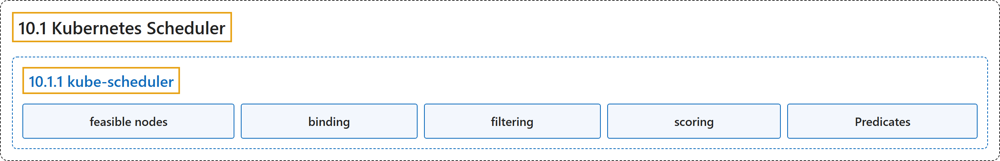

# 10.1 Kubernetes Scheduler

## Classification

## Glossary

| Term | Definition | 中文翻译 | Source |
|---|---|---|---|
| **10.1 Kubernetes Scheduler** Kubernetes 调度器 | "**A scheduler** watches for **newly created Pods that have no Node assigned**." | **调度器**监视**尚未分配节点的新建 Pod**。 | [The Kubernetes Authors, n.d., "Scheduling overview", para. 1](https://kubernetes.io/docs/concepts/scheduling-eviction/kube-scheduler/#:~:text=A%20scheduler%20watches%20for%20newly%20created%20Pods) |
| **10.1.1 kube-scheduler** kube-scheduler | "kube-scheduler is **the default scheduler for Kubernetes** and runs as **part of the control plane**." | kube-scheduler 是 **Kubernetes 的默认调度器**，作为**控制平面的一部分**运行。 | [The Kubernetes Authors, n.d., "kube-scheduler", para. 1](https://kubernetes.io/docs/concepts/scheduling-eviction/kube-scheduler/#:~:text=%5Bkube-scheduler%5D%28https%3A%2F%2Fkubernetes.io%2Fdocs%2Freference%2Fcommand-line-tools-reference%2Fkube-scheduler%2F%29%20is%20the%20default%20scheduler%20for%20Kubernetes) |
| **feasible nodes** 可行节点 | "In a cluster, **Nodes that meet the scheduling requirements for a Pod** are called ***feasible* nodes**." | 在集群中，**满足某个 Pod 调度要求的节点**称为***可行*节点**。 | [The Kubernetes Authors, n.d., "kube-scheduler", para. 3](https://kubernetes.io/docs/concepts/scheduling-eviction/kube-scheduler/#:~:text=In%20a%20cluster%2C%20Nodes%20that%20meet%20the) |
| **binding** 绑定 | "The scheduler then **notifies the API server about this decision** in a process called ***binding***." | 随后调度器**把这一决定通知 API 服务器**，这个过程称为***绑定***。 | [The Kubernetes Authors, n.d., "kube-scheduler", para. 4](https://kubernetes.io/docs/concepts/scheduling-eviction/kube-scheduler/#:~:text=The%20scheduler%20then%20notifies%20the%20API%20server) |
| **filtering** 过滤 | "**The *filtering* step** finds **the set of Nodes where it's feasible to schedule the Pod**." | ***过滤*步骤**找出**可以调度该 Pod 的节点集合**。 | [The Kubernetes Authors, n.d., "Node selection in kube-scheduler", para. 4](https://kubernetes.io/docs/concepts/scheduling-eviction/kube-scheduler/#:~:text=The%20%2Afiltering%2A%20step%20finds%20the%20set%20of) |
| **scoring** 打分 | "In **the *scoring* step**, the scheduler **ranks the remaining nodes** to choose **the most suitable Pod placement**." | 在***打分*步骤**中，调度器**对剩下的节点排序**，以选择**最合适的 Pod 放置**。 | [The Kubernetes Authors, n.d., "Node selection in kube-scheduler", para. 5](https://kubernetes.io/docs/concepts/scheduling-eviction/kube-scheduler/#:~:text=In%20the%20%2Ascoring%2A%20step%2C%20the%20scheduler%20ranks) |
| **Predicates** 断言 | (context) "Scheduling Policies allow you to configure ***Predicates* for filtering** and ***Priorities* for scoring**." | （语境）调度策略让你配置**用于过滤的*断言***和**用于打分的*优先级***。 | [The Kubernetes Authors, n.d., "Node selection in kube-scheduler", para. 8](https://kubernetes.io/docs/concepts/scheduling-eviction/kube-scheduler/#:~:text=%5BScheduling%20Policies%5D%28https%3A%2F%2Fkubernetes.io%2Fdocs%2Freference%2Fscheduling%2Fpolicies%2F%29%20allow%20you%20to%20configure%20%2APredicates%2A) |

## References

The Kubernetes Authors. (n.d.). *Kubernetes Scheduler*. Kubernetes Documentation. Retrieved October 31, 2026, from <https://kubernetes.io/docs/concepts/scheduling-eviction/kube-scheduler/>
