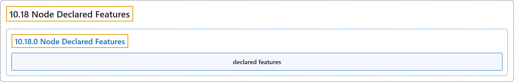

# 10.18 Node Declared Features

## Classification

## Glossary

| Term | Definition | 中文翻译 | Source |
|---|---|---|---|
| **10.18 Node Declared Features** 节点声明的特性 | "A declared feature is **a string that a node lists** in **the `.status.declaredFeatures` field of the Node object**." | 声明的特性是**节点列出的一个字符串**，位于 **Node 对象的 `.status.declaredFeatures` 字段**中。 | [The Kubernetes Authors, n.d., "How it works", para. 1](https://kubernetes.io/docs/concepts/scheduling-eviction/node-declared-features/#:~:text=A%20declared%20feature%20is%20a%20string%20that) |
| **10.18.0 Node Declared Features** 节点声明的特性 | (No definition) | （无定义） | [The Kubernetes Authors, n.d., "Node Declared Features"](https://kubernetes.io/docs/concepts/scheduling-eviction/node-declared-features/#node-declared-features) |
| **declared features** 声明的特性 | "Kubernetes nodes use ***declared features*** to **report the availability of specific features** that are **new or feature-gated**." | Kubernetes 节点使用***声明的特性***来**报告特定功能是否可用**，这些功能是**新的或受特性门控的**。 | [The Kubernetes Authors, n.d., "Node Declared Features", para. 2](https://kubernetes.io/docs/concepts/scheduling-eviction/node-declared-features/#:~:text=Kubernetes%20nodes%20use%20%2Adeclared%20features%2A%20to%20report) |

## References

The Kubernetes Authors. (n.d.). *Node Declared Features*. Kubernetes Documentation. Retrieved October 31, 2026, from <https://kubernetes.io/docs/concepts/scheduling-eviction/node-declared-features/>
