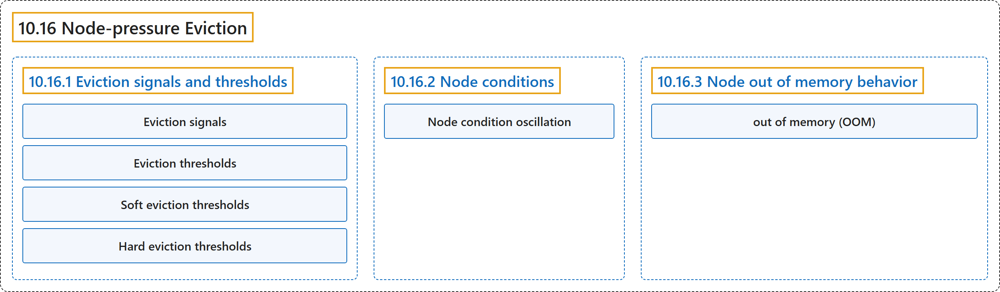

# 10.16 Node-pressure Eviction

## Classification

## Glossary

| Term | Definition | 中文翻译 | Source |
|---|---|---|---|
| **10.16 Node-pressure Eviction** 节点压力驱逐 | "Node-pressure eviction is **the process by which the [kubelet](https://kubernetes.io/docs/reference/command-line-tools-reference/kubelet) proactively terminates pods to reclaim [resource](https://kubernetes.io/docs/reference/glossary/?all=true#term-infrastructure-resource) on nodes**." | 节点压力驱逐是 **[kubelet](https://kubernetes.io/docs/reference/command-line-tools-reference/kubelet) 主动终止 Pod 以回收节点上[资源](https://kubernetes.io/docs/reference/glossary/?all=true#term-infrastructure-resource)的过程**。 | [The Kubernetes Authors, n.d., "Node-pressure Eviction", para. 1](https://kubernetes.io/docs/concepts/scheduling-eviction/node-pressure-eviction/#:~:text=Node-pressure%20eviction%20is%20the%20process%20by%20which) |
| **10.16.1 Eviction signals and thresholds** 驱逐信号与阈值 | (No definition) | （无定义） | [The Kubernetes Authors, n.d., "Eviction signals and thresholds"](https://kubernetes.io/docs/concepts/scheduling-eviction/node-pressure-eviction/#eviction-signals-and-thresholds) |
| **Eviction signals** 驱逐信号 | "Eviction signals are **the current state of a particular resource at a specific point in time**." | 驱逐信号是**某种资源在特定时间点的当前状态**。 | [The Kubernetes Authors, n.d., "Eviction signals", para. 1](https://kubernetes.io/docs/concepts/scheduling-eviction/node-pressure-eviction/#:~:text=Eviction%20signals%20are%20the%20current%20state%20of) |
| **Eviction thresholds** 驱逐阈值 | (context) "You can **specify custom eviction thresholds for the kubelet to use when it makes eviction decisions**." | （语境）你可以**为 kubelet 指定做驱逐决策时使用的自定义驱逐阈值**。 | [The Kubernetes Authors, n.d., "Eviction thresholds", para. 1](https://kubernetes.io/docs/concepts/scheduling-eviction/node-pressure-eviction/#:~:text=You%20can%20specify%20custom%20eviction%20thresholds%20for) |
| **Soft eviction thresholds** 软驱逐阈值 | "A soft eviction threshold **pairs an eviction threshold with a required administrator-specified grace period**." | 软驱逐阈值**把驱逐阈值与一个由管理员指定的必需宽限期配对**。 | [The Kubernetes Authors, n.d., "Soft eviction thresholds", para. 1](https://kubernetes.io/docs/concepts/scheduling-eviction/node-pressure-eviction/#:~:text=A%20soft%20eviction%20threshold%20pairs%20an%20eviction) |
| **Hard eviction thresholds** 硬驱逐阈值 | "A hard eviction threshold **has no grace period**." | 硬驱逐阈值**没有宽限期**。 | [The Kubernetes Authors, n.d., "Hard eviction thresholds", para. 1](https://kubernetes.io/docs/concepts/scheduling-eviction/node-pressure-eviction/#:~:text=A%20hard%20eviction%20threshold%20has%20no%20grace) |
| **10.16.2 Node conditions** 节点状况 | "The kubelet reports [node conditions](https://kubernetes.io/docs/concepts/architecture/nodes/#condition) to **reflect that the node is under pressure because hard or soft eviction threshold is met**, independent of configured grace periods." | kubelet 报告[节点状况](https://kubernetes.io/docs/concepts/architecture/nodes/#condition)，**以反映节点因达到硬或软驱逐阈值而处于压力之下**，与所配置的宽限期无关。 | [The Kubernetes Authors, n.d., "Node conditions", para. 1](https://kubernetes.io/docs/concepts/scheduling-eviction/node-pressure-eviction/#:~:text=The%20kubelet%20reports%20%5Bnode%20conditions%5D%28https%3A%2F%2Fkubernetes.io%2Fdocs%2Fconcepts%2Farchitecture%2Fnodes%2F%23condition%29%20to%20reflect) |
| **Node condition oscillation** 节点状况振荡 | (context) "In some cases, **nodes oscillate above and below soft eviction thresholds without holding for the defined grace periods**." | （语境）在某些情况下，**节点在软驱逐阈值上下振荡，而没有持续到所定义的宽限期**。 | [The Kubernetes Authors, n.d., "Node condition oscillation", para. 1](https://kubernetes.io/docs/concepts/scheduling-eviction/node-pressure-eviction/#:~:text=In%20some%20cases%2C%20nodes%20oscillate%20above%20and) |
| **10.16.3 Node out of memory behavior** 节点内存不足时的行为 | (No definition) | （无定义） | [The Kubernetes Authors, n.d., "Node out of memory behavior"](https://kubernetes.io/docs/concepts/scheduling-eviction/node-pressure-eviction/#node-out-of-memory-behavior) |
| **out of memory (OOM)** 内存不足（OOM） | "If the node experiences an *out of memory* (OOM) event prior to the kubelet being able to reclaim memory, **the node depends on the [oom_killer](https://lwn.net/Articles/391222/) to respond**." | 如果节点在 kubelet 回收内存之前发生*内存不足*（OOM）事件，**节点依靠 [oom_killer](https://lwn.net/Articles/391222/) 来响应**。 | [The Kubernetes Authors, n.d., "Node out of memory behavior", para. 1](https://kubernetes.io/docs/concepts/scheduling-eviction/node-pressure-eviction/#:~:text=If%20the%20node%20experiences%20an%20%2Aout%20of) |

## References

The Kubernetes Authors. (n.d.). *Node-pressure Eviction*. Kubernetes Documentation. Retrieved October 31, 2026, from <https://kubernetes.io/docs/concepts/scheduling-eviction/node-pressure-eviction/>
