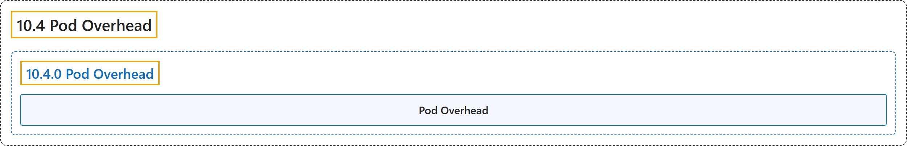

# 10.4 Pod Overhead

## Classification

## Glossary

| Term | Definition | 中文翻译 | Source |
|---|---|---|---|
| **10.4 Pod Overhead** Pod 开销 | (context) "When you run a Pod on a Node, **the Pod itself takes an amount of system resources**." | （语境）在节点上运行 Pod 时，**Pod 本身会占用一定的系统资源**。 | [The Kubernetes Authors, n.d., "Pod Overhead", para. 1](https://kubernetes.io/docs/concepts/scheduling-eviction/pod-overhead/#:~:text=When%20you%20run%20a%20Pod%20on%20a) |
| **10.4.0 Pod Overhead** Pod 开销 | (No definition) | （无定义） | [The Kubernetes Authors, n.d., "Pod Overhead"](https://kubernetes.io/docs/concepts/scheduling-eviction/pod-overhead/#pod-overhead) |
| **Pod Overhead** Pod 开销 | "In Kubernetes, *Pod Overhead* is **a way to account for the resources consumed by the Pod infrastructure on top of the container requests & limits**." | 在 Kubernetes 中，*Pod 开销*是**在容器请求和限制之外，计入 Pod 基础设施所消耗资源的一种方式**。 | [The Kubernetes Authors, n.d., "Pod Overhead", para. 1](https://kubernetes.io/docs/concepts/scheduling-eviction/pod-overhead/#:~:text=In%20Kubernetes%2C%20%2APod%20Overhead%2A%20is%20a%20way) |

## References

The Kubernetes Authors. (n.d.). *Pod Overhead*. Kubernetes Documentation. Retrieved October 31, 2026, from <https://kubernetes.io/docs/concepts/scheduling-eviction/pod-overhead/>
