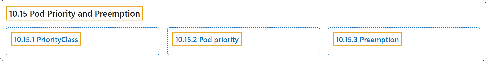

# 10.15 Pod Priority and Preemption

## Classification

## Glossary

| Term | Definition | 中文翻译 | Source |
|---|---|---|---|
| **10.15 Pod Priority and Preemption** Pod 优先级与抢占 | (context) "**Pods** can have ***priority***." | （语境）**Pod** 可以有***优先级***。 | [The Kubernetes Authors, n.d., "Pod Priority and Preemption", para. 1](https://kubernetes.io/docs/concepts/scheduling-eviction/pod-priority-preemption/#:~:text=%5BPods%5D%28https%3A%2F%2Fkubernetes.io%2Fdocs%2Fconcepts%2Fworkloads%2Fpods%2F%29%20can%20have%20%2Apriority%2A.) |
| **10.15.1 PriorityClass** PriorityClass | "A PriorityClass is **a non-namespaced object** that defines **a mapping from a priority class name to the integer value of the priority**." | PriorityClass 是**一个不属于命名空间的对象**，定义**从优先级类名到优先级整数值的映射**。 | [The Kubernetes Authors, n.d., "PriorityClass", para. 1](https://kubernetes.io/docs/concepts/scheduling-eviction/pod-priority-preemption/#:~:text=A%20PriorityClass%20is%20a%20non-namespaced%20object%20that) |
| **10.15.2 Pod priority** Pod 优先级 | (context) "After you have one or more PriorityClasses, you can **create Pods** that **specify one of those PriorityClass names in their specifications**." | （语境）有了一个或多个 PriorityClass 之后，你就可以**创建 Pod**，让它们**在规约中指定其中某个 PriorityClass 名称**。 | [The Kubernetes Authors, n.d., "Pod priority", para. 1](https://kubernetes.io/docs/concepts/scheduling-eviction/pod-priority-preemption/#:~:text=After%20you%20have%20one%20or%20more%20PriorityClasses%2C) |
| **10.15.3 Preemption** 抢占 | (context) "When **Pods are created**, they **go to a queue and wait to be scheduled**." | （语境）**Pod 被创建**后，**会进入队列等待调度**。 | [The Kubernetes Authors, n.d., "Preemption", para. 1](https://kubernetes.io/docs/concepts/scheduling-eviction/pod-priority-preemption/#:~:text=When%20Pods%20are%20created%2C%20they%20go%20to) |

## References

The Kubernetes Authors. (n.d.). *Pod Priority and Preemption*. Kubernetes Documentation. Retrieved October 31, 2026, from <https://kubernetes.io/docs/concepts/scheduling-eviction/pod-priority-preemption/>
