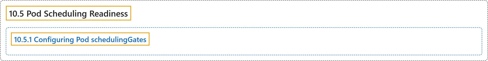

# 10.5 Pod Scheduling Readiness

## Classification

## Glossary

| Term | Definition | 中文翻译 | Source |
|---|---|---|---|
| **10.5 Pod Scheduling Readiness** Pod 调度就绪 | (context) "**Pods** were considered **ready for scheduling once created**." | （语境）过去，**Pod** 被视为**一经创建就可以调度**。 | [The Kubernetes Authors, n.d., "Pod Scheduling Readiness", para. 1](https://kubernetes.io/docs/concepts/scheduling-eviction/pod-scheduling-readiness/#:~:text=Pods%20were%20considered%20ready%20for%20scheduling%20once) |
| **10.5.1 Configuring Pod schedulingGates** 配置 Pod 的 schedulingGates | "**The `schedulingGates` field** contains **a list of strings**, and each string literal is perceived as **a criteria that Pod should be satisfied before considered schedulable**." | **`schedulingGates` 字段**包含**一个字符串列表**，每个字符串字面量都被视为 **Pod 在被认为可调度之前必须满足的条件**。 | [The Kubernetes Authors, n.d., "Configuring Pod schedulingGates", para. 1](https://kubernetes.io/docs/concepts/scheduling-eviction/pod-scheduling-readiness/#:~:text=The%20%60schedulingGates%60%20field%20contains%20a%20list%20of) |

## References

The Kubernetes Authors. (n.d.). *Pod Scheduling Readiness*. Kubernetes Documentation. Retrieved October 31, 2026, from <https://kubernetes.io/docs/concepts/scheduling-eviction/pod-scheduling-readiness/>
