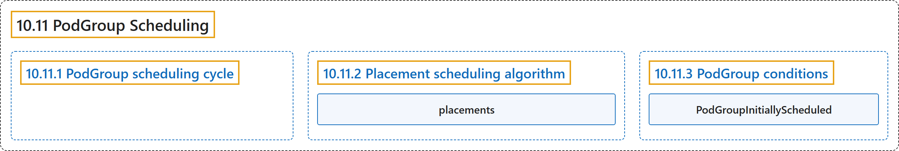

# 10.11 PodGroup Scheduling

## Classification

## Glossary

| Term | Definition | 中文翻译 | Source |
|---|---|---|---|
| **10.11 PodGroup Scheduling** PodGroup 调度 | (context) "**The placement scheduling algorithm** is **an alternative PodGroup scheduling algorithm**, which uses scheduling plugins to find **the optimal placement** for the considered PodGroup." | （语境）**放置调度算法**是**另一种 PodGroup 调度算法**，它使用调度插件为所考虑的 PodGroup 找到**最优放置**。 | [The Kubernetes Authors, n.d., "Placement scheduling algorithm", para. 3](https://kubernetes.io/docs/concepts/scheduling-eviction/podgroup-scheduling/#:~:text=The%20placement%20scheduling%20algorithm%20is%20an%20alternative) |
| **10.11.1 PodGroup scheduling cycle** PodGroup 调度周期 | (No definition) | （无定义） | [The Kubernetes Authors, n.d., "PodGroup scheduling cycle"](https://kubernetes.io/docs/concepts/scheduling-eviction/podgroup-scheduling/#podgroup-scheduling-cycle) |
| **10.11.2 Placement scheduling algorithm** 放置调度算法 | (No definition) | （无定义） | [The Kubernetes Authors, n.d., "Placement scheduling algorithm"](https://kubernetes.io/docs/concepts/scheduling-eviction/podgroup-scheduling/#placement-scheduling-algorithm) |
| **placements** 放置 | "**Generates candidate *placements*** (subsets of nodes, that are **theoretically feasible for PodGroup assignment**)" | **生成候选*放置***（节点子集，它们**理论上可用于 PodGroup 分配**） | [The Kubernetes Authors, n.d., "Phase 1: Candidate placement generation", para. 1](https://kubernetes.io/docs/concepts/scheduling-eviction/podgroup-scheduling/#:~:text=Generates%20candidate%20%2Aplacements%2A%20%28subsets%20of%20nodes%2C%20that) |
| **10.11.3 PodGroup conditions** PodGroup 状况 | (No definition) | （无定义） | [The Kubernetes Authors, n.d., "PodGroup conditions"](https://kubernetes.io/docs/concepts/scheduling-eviction/podgroup-scheduling/#podgroup-conditions) |
| **PodGroupInitiallyScheduled** PodGroupInitiallyScheduled | (context) "When the scheduling cycle succeeds, **the condition is set to `True`** with **reason `Scheduled`**." | （语境）调度周期成功时，**该状况被设为 `True`**，并带有**原因 `Scheduled`**。 | [The Kubernetes Authors, n.d., "PodGroupInitiallyScheduled", para. 1](https://kubernetes.io/docs/concepts/scheduling-eviction/podgroup-scheduling/#:~:text=When%20the%20scheduling%20cycle%20succeeds%2C%20the%20condition) |

## References

The Kubernetes Authors. (n.d.). *PodGroup Scheduling*. Kubernetes Documentation. Retrieved October 31, 2026, from <https://kubernetes.io/docs/concepts/scheduling-eviction/podgroup-scheduling/>
