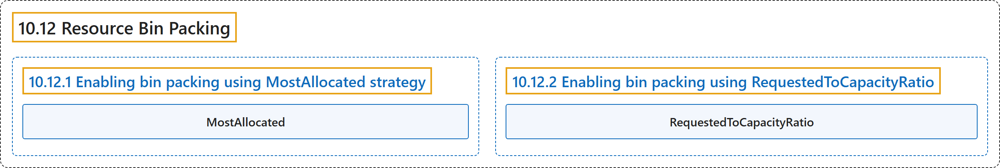

# 10.12 Resource Bin Packing

## Classification

## Glossary

| Term | Definition | 中文翻译 | Source |
|---|---|---|---|
| **10.12 Resource Bin Packing** 资源装箱 | (context) "In the scheduling-plugin `NodeResourcesFit` of kube-scheduler, there are **two scoring strategies** that support **the bin packing of resources**:" | （语境）在 kube-scheduler 的调度插件 `NodeResourcesFit` 中，有**两种打分策略**支持**资源装箱**： | [The Kubernetes Authors, n.d., "Note:", para. 2](https://kubernetes.io/docs/concepts/scheduling-eviction/resource-bin-packing/#:~:text=In%20the%20%5Bscheduling-plugin%5D%28https%3A%2F%2Fkubernetes.io%2Fdocs%2Freference%2Fscheduling%2Fconfig%2F%23scheduling-plugins%29%20%60NodeResourcesFit%60%20of%20kube-scheduler%2C%20there) |
| **10.12.1 Enabling bin packing using MostAllocated strategy** 使用 MostAllocated 策略启用装箱 | (No definition) | （无定义） | [The Kubernetes Authors, n.d., "Enabling bin packing using MostAllocated strategy"](https://kubernetes.io/docs/concepts/scheduling-eviction/resource-bin-packing/#enabling-bin-packing-using-mostallocated-strategy) |
| **MostAllocated** MostAllocated | "The `MostAllocated` strategy **scores the nodes based on the utilization of resources**, favoring the ones with **higher allocation**." | `MostAllocated` 策略**根据资源利用率给节点打分**，偏向**分配率更高**的节点。 | [The Kubernetes Authors, n.d., "Enabling bin packing using MostAllocated strategy", para. 1](https://kubernetes.io/docs/concepts/scheduling-eviction/resource-bin-packing/#:~:text=The%20%60MostAllocated%60%20strategy%20scores%20the%20nodes%20based) |
| **10.12.2 Enabling bin packing using RequestedToCapacityRatio** 使用 RequestedToCapacityRatio 启用装箱 | (No definition) | （无定义） | [The Kubernetes Authors, n.d., "Enabling bin packing using RequestedToCapacityRatio"](https://kubernetes.io/docs/concepts/scheduling-eviction/resource-bin-packing/#enabling-bin-packing-using-requestedtocapacityratio) |
| **RequestedToCapacityRatio** RequestedToCapacityRatio | "The `RequestedToCapacityRatio` strategy allows the users to **specify the resources along with weights for each resource** to **score nodes based on the request to capacity ratio**." | `RequestedToCapacityRatio` 策略允许用户**指定资源及各资源的权重**，以**根据请求与容量之比给节点打分**。 | [The Kubernetes Authors, n.d., "Enabling bin packing using RequestedToCapacityRatio", para. 1](https://kubernetes.io/docs/concepts/scheduling-eviction/resource-bin-packing/#:~:text=The%20%60RequestedToCapacityRatio%60%20strategy%20allows%20the%20users%20to) |

## References

The Kubernetes Authors. (n.d.). *Resource Bin Packing*. Kubernetes Documentation. Retrieved October 31, 2026, from <https://kubernetes.io/docs/concepts/scheduling-eviction/resource-bin-packing/>
