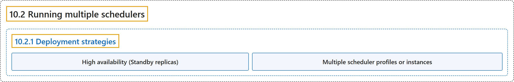

# 10.2 Running multiple schedulers

## Classification

## Glossary

| Term | Definition | 中文翻译 | Source |
|---|---|---|---|
| **10.2 Running multiple schedulers** 运行多个调度器 | (context) "Kubernetes allows you to **run multiple schedulers** within **a single cluster**." | （语境）Kubernetes 允许你**运行多个调度器**，在**单个集群**之内。 | [The Kubernetes Authors, n.d., "Running multiple schedulers", para. 1](https://kubernetes.io/docs/concepts/scheduling-eviction/running-multiple-schedulers/#:~:text=Kubernetes%20allows%20you%20to%20run%20multiple%20schedulers) |
| **10.2.1 Deployment strategies** 部署策略 | (No definition) | （无定义） | [The Kubernetes Authors, n.d., "Deployment strategies"](https://kubernetes.io/docs/concepts/scheduling-eviction/running-multiple-schedulers/#deployment-strategies) |
| **High availability (Standby replicas)** 高可用（备用副本） | (context) "If you want to run **a single logical scheduler** (such as `kube-scheduler`) but ensure it **remains available if a failure occurs**, you should run **multiple replicas of the scheduler**" | （语境）如果你想运行**单个逻辑调度器**（例如 `kube-scheduler`），又要确保它**在发生故障时仍然可用**，就应运行**多个调度器副本** | [The Kubernetes Authors, n.d., "High availability (Standby replicas)", para. 1](https://kubernetes.io/docs/concepts/scheduling-eviction/running-multiple-schedulers/#:~:text=If%20you%20want%20to%20run%20a%20single) |
| **Multiple scheduler profiles or instances** 多个调度配置文件或实例 | (context) "If you want to use **different configurations or scheduling rules for different workloads**, you can either configure **a single `kube-scheduler` instance with multiple scheduling profiles**, or run **several separate instances of `kube-scheduler`**." | （语境）如果你想**为不同工作负载使用不同的配置或调度规则**，可以配置**带多个调度配置文件的单个 `kube-scheduler` 实例**，或运行**多个独立的 `kube-scheduler` 实例**。 | [The Kubernetes Authors, n.d., "Multiple scheduler profiles or instances", para. 1](https://kubernetes.io/docs/concepts/scheduling-eviction/running-multiple-schedulers/#:~:text=If%20you%20want%20to%20use%20different%20configurations) |

## References

The Kubernetes Authors. (n.d.). *Running multiple schedulers*. Kubernetes Documentation. Retrieved October 31, 2026, from <https://kubernetes.io/docs/concepts/scheduling-eviction/running-multiple-schedulers/>
