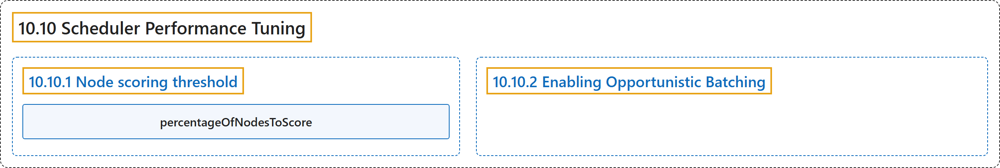

# 10.10 Scheduler Performance Tuning

## Classification

## Glossary

| Term | Definition | 中文翻译 | Source |
|---|---|---|---|
| **10.10 Scheduler Performance Tuning** 调度器性能调优 | (context) "**kube-scheduler** is **the Kubernetes default scheduler**." | （语境）**kube-scheduler** 是 **Kubernetes 的默认调度器**。 | [The Kubernetes Authors, n.d., "Scheduler Performance Tuning", para. 1](https://kubernetes.io/docs/concepts/scheduling-eviction/scheduler-perf-tuning/#:~:text=%5Bkube-scheduler%5D%28https%3A%2F%2Fkubernetes.io%2Fdocs%2Fconcepts%2Fscheduling-eviction%2Fkube-scheduler%2F%23kube-scheduler%29%20is%20the%20Kubernetes%20default%20scheduler.) |
| **10.10.1 Node scoring threshold** 节点打分阈值 | "To improve scheduling performance, the kube-scheduler can **stop looking for feasible nodes** once it has **found enough of them**." | 为了提升调度性能，kube-scheduler 可以**停止查找可行节点**，一旦它**找到了足够多的可行节点**。 | [The Kubernetes Authors, n.d., "Node scoring threshold", para. 1](https://kubernetes.io/docs/concepts/scheduling-eviction/scheduler-perf-tuning/#:~:text=To%20improve%20scheduling%20performance%2C%20the%20kube-scheduler%20can) |
| **percentageOfNodesToScore** percentageOfNodesToScore | "**`percentageOfNodesToScore`** must be **a value between 1 and 100** with the default value being **calculated based on the cluster size**." | **`percentageOfNodesToScore`** 必须是 **1 到 100 之间的值**，默认值**根据集群规模计算**。 | [The Kubernetes Authors, n.d., "Tuning percentageOfNodesToScore", para. 1](https://kubernetes.io/docs/concepts/scheduling-eviction/scheduler-perf-tuning/#:~:text=%60percentageOfNodesToScore%60%20must%20be%20a%20value%20between%201) |
| **10.10.2 Enabling Opportunistic Batching** 启用机会式批处理 | (context) "When scheduling large workloads, **Pods often have equivalent scheduling constraints** and require the scheduler to **perform the same operations over and over again**." | （语境）调度大型工作负载时，**Pod 往往有等价的调度约束**，需要调度器**一遍遍执行相同的操作**。 | [The Kubernetes Authors, n.d., "Enabling Opportunistic Batching", para. 1](https://kubernetes.io/docs/concepts/scheduling-eviction/scheduler-perf-tuning/#:~:text=When%20scheduling%20large%20workloads%2C%20Pods%20often%20have) |

## References

The Kubernetes Authors. (n.d.). *Scheduler Performance Tuning*. Kubernetes Documentation. Retrieved October 31, 2026, from <https://kubernetes.io/docs/concepts/scheduling-eviction/scheduler-perf-tuning/>
