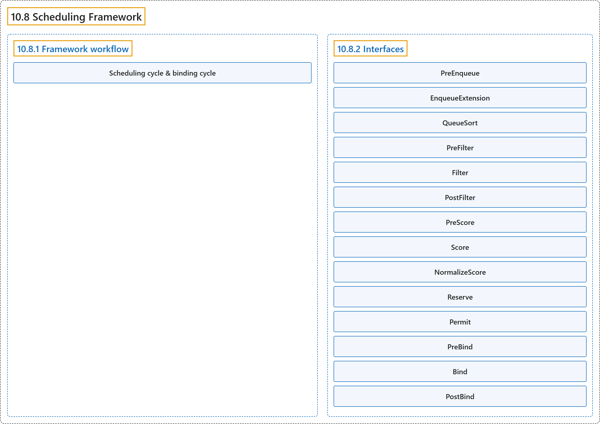

# 10.8 Scheduling Framework

## Classification

## Glossary

| Term | Definition | 中文翻译 | Source |
|---|---|---|---|
| **10.8 Scheduling Framework** 调度框架 | "The *scheduling framework* is **a pluggable architecture for the Kubernetes scheduler**." | *调度框架*是 **Kubernetes 调度器的一种可插拔架构**。 | [The Kubernetes Authors, n.d., "Scheduling Framework", para. 1](https://kubernetes.io/docs/concepts/scheduling-eviction/scheduling-framework/#:~:text=The%20%2Ascheduling%20framework%2A%20is%20a%20pluggable%20architecture) |
| **10.8.1 Framework workflow** 框架工作流 | "The Scheduling Framework **defines a few extension points**." | 调度框架**定义了若干扩展点**。 | [The Kubernetes Authors, n.d., "Framework workflow", para. 1](https://kubernetes.io/docs/concepts/scheduling-eviction/scheduling-framework/#:~:text=The%20Scheduling%20Framework%20defines%20a%20few%20extension) |
| **Scheduling cycle & binding cycle** 调度周期与绑定周期 | "The scheduling cycle **selects a node for the Pod**, and the binding cycle **applies that decision to the cluster**." | 调度周期**为 Pod 选择节点**，绑定周期**把这一决定应用到集群**。 | [The Kubernetes Authors, n.d., "Scheduling cycle & binding cycle", para. 1](https://kubernetes.io/docs/concepts/scheduling-eviction/scheduling-framework/#:~:text=The%20scheduling%20cycle%20selects%20a%20node%20for) |
| **10.8.2 Interfaces** 接口 | (No definition) | （无定义） | [The Kubernetes Authors, n.d., "Interfaces"](https://kubernetes.io/docs/concepts/scheduling-eviction/scheduling-framework/#interfaces) |
| **PreEnqueue** PreEnqueue | "These plugins are **called prior to adding Pods to the internal active queue**, where Pods are marked as ready for scheduling." | 这些插件**在把 Pod 加入内部活动队列之前调用**，Pod 在该队列中被标记为可调度。 | [The Kubernetes Authors, n.d., "PreEnqueue", para. 1](https://kubernetes.io/docs/concepts/scheduling-eviction/scheduling-framework/#:~:text=These%20plugins%20are%20called%20prior%20to%20adding) |
| **EnqueueExtension** EnqueueExtension | "EnqueueExtension is **the interface where the plugin can control whether to retry scheduling of Pods rejected by this plugin**, based on changes in the cluster." | EnqueueExtension 是**插件根据集群变化，控制是否重试调度被本插件拒绝的 Pod 的接口**。 | [The Kubernetes Authors, n.d., "EnqueueExtension", para. 1](https://kubernetes.io/docs/concepts/scheduling-eviction/scheduling-framework/#:~:text=EnqueueExtension%20is%20the%20interface%20where%20the%20plugin) |
| **QueueSort** QueueSort | "These plugins are **used to sort Pods in the scheduling queue**." | 这些插件**用于对调度队列中的 Pod 排序**。 | [The Kubernetes Authors, n.d., "QueueSort", para. 1](https://kubernetes.io/docs/concepts/scheduling-eviction/scheduling-framework/#:~:text=These%20plugins%20are%20used%20to%20sort%20Pods) |
| **PreFilter** PreFilter | "These plugins are **used to pre-process info about the Pod, or to check certain conditions that the cluster or the Pod must meet**." | 这些插件**用于预处理 Pod 的信息，或检查集群或 Pod 必须满足的某些条件**。 | [The Kubernetes Authors, n.d., "PreFilter", para. 1](https://kubernetes.io/docs/concepts/scheduling-eviction/scheduling-framework/#:~:text=These%20plugins%20are%20used%20to%20pre-process%20info) |
| **Filter** Filter | "These plugins are **used to filter out nodes that cannot run the Pod**." | 这些插件**用于过滤掉无法运行该 Pod 的节点**。 | [The Kubernetes Authors, n.d., "Filter", para. 1](https://kubernetes.io/docs/concepts/scheduling-eviction/scheduling-framework/#:~:text=These%20plugins%20are%20used%20to%20filter%20out) |
| **PostFilter** PostFilter | "These plugins are **called after the Filter phase, but only when no feasible nodes were found for the pod**." | 这些插件**在 Filter 阶段之后调用，但仅当没有为该 Pod 找到可行节点时**。 | [The Kubernetes Authors, n.d., "PostFilter", para. 1](https://kubernetes.io/docs/concepts/scheduling-eviction/scheduling-framework/#:~:text=These%20plugins%20are%20called%20after%20the%20Filter) |
| **PreScore** PreScore | "These plugins are **used to perform "pre-scoring" work, which generates a sharable state for Score plugins to use**." | 这些插件**用于执行“预打分”工作，生成可供 Score 插件共享使用的状态**。 | [The Kubernetes Authors, n.d., "PreScore", para. 1](https://kubernetes.io/docs/concepts/scheduling-eviction/scheduling-framework/#:~:text=These%20plugins%20are%20used%20to%20perform%20%22pre-scoring%22) |
| **Score** Score | "These plugins are **used to rank nodes that have passed the filtering phase**." | 这些插件**用于对通过过滤阶段的节点排序**。 | [The Kubernetes Authors, n.d., "Score", para. 1](https://kubernetes.io/docs/concepts/scheduling-eviction/scheduling-framework/#:~:text=These%20plugins%20are%20used%20to%20rank%20nodes) |
| **NormalizeScore** NormalizeScore | "These plugins are **used to modify scores before the scheduler computes a final ranking of Nodes**." | 这些插件**用于在调度器计算节点最终排名之前修改分数**。 | [The Kubernetes Authors, n.d., "NormalizeScore", para. 1](https://kubernetes.io/docs/concepts/scheduling-eviction/scheduling-framework/#:~:text=These%20plugins%20are%20used%20to%20modify%20scores) |
| **Reserve** Reserve | "A plugin that implements the Reserve interface **has two methods, namely `Reserve` and `Unreserve`**" | 实现 Reserve 接口的插件**有两个方法，即 `Reserve` 和 `Unreserve`** | [The Kubernetes Authors, n.d., "Reserve", para. 1](https://kubernetes.io/docs/concepts/scheduling-eviction/scheduling-framework/#:~:text=A%20plugin%20that%20implements%20the%20Reserve%20interface) |
| **Permit** Permit | "*Permit* plugins are **invoked at the end of the scheduling cycle for each Pod, to prevent or delay the binding to the candidate node**." | *Permit* 插件**在每个 Pod 的调度周期结束时调用，用于阻止或推迟绑定到候选节点**。 | [The Kubernetes Authors, n.d., "Permit", para. 1](https://kubernetes.io/docs/concepts/scheduling-eviction/scheduling-framework/#:~:text=%2APermit%2A%20plugins%20are%20invoked%20at%20the%20end) |
| **PreBind** PreBind | "These plugins are **used to perform any work required before a Pod is bound**." | 这些插件**用于执行 Pod 绑定之前需要完成的任何工作**。 | [The Kubernetes Authors, n.d., "PreBind", para. 1](https://kubernetes.io/docs/concepts/scheduling-eviction/scheduling-framework/#:~:text=These%20plugins%20are%20used%20to%20perform%20any) |
| **Bind** Bind | "These plugins are **used to bind a Pod to a Node**." | 这些插件**用于把 Pod 绑定到节点**。 | [The Kubernetes Authors, n.d., "Bind", para. 1](https://kubernetes.io/docs/concepts/scheduling-eviction/scheduling-framework/#:~:text=These%20plugins%20are%20used%20to%20bind%20a) |
| **PostBind** PostBind | "This is **an informational interface**." | 这是**一个信息性接口**。 | [The Kubernetes Authors, n.d., "PostBind", para. 1](https://kubernetes.io/docs/concepts/scheduling-eviction/scheduling-framework/#:~:text=This%20is%20an%20informational%20interface.) |

## References

The Kubernetes Authors. (n.d.). *Scheduling Framework*. Kubernetes Documentation. Retrieved October 31, 2026, from <https://kubernetes.io/docs/concepts/scheduling-eviction/scheduling-framework/>
