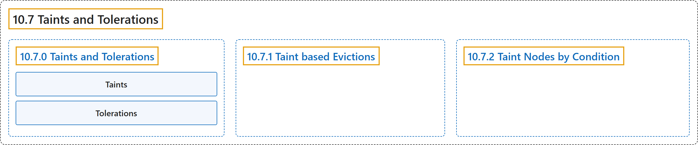

# 10.7 Taints and Tolerations

## Classification

## Glossary

| Term | Definition | 中文翻译 | Source |
|---|---|---|---|
| **10.7 Taints and Tolerations** 污点与容忍度 | (context) "***Tolerations*** are **applied to pods**." | （语境）***容忍度***会**应用于 Pod**。 | [The Kubernetes Authors, n.d., "Taints and Tolerations", para. 2](https://kubernetes.io/docs/concepts/scheduling-eviction/taint-and-toleration/#:~:text=%2ATolerations%2A%20are%20applied%20to%20pods.) |
| **10.7.0 Taints and Tolerations** 污点与容忍度 | (No definition) | （无定义） | [The Kubernetes Authors, n.d., "Taints and Tolerations"](https://kubernetes.io/docs/concepts/scheduling-eviction/taint-and-toleration/#taints-and-tolerations) |
| **Taints** 污点 | "***Taints*** are the opposite -- they **allow a node to repel a set of pods**." | ***污点***正好相反，它**让节点排斥一组 Pod**。 | [The Kubernetes Authors, n.d., "Taints and Tolerations", para. 1](https://kubernetes.io/docs/concepts/scheduling-eviction/taint-and-toleration/#:~:text=%2ATaints%2A%20are%20the%20opposite%20--%20they%20allow) |
| **Tolerations** 容忍度 | "***Tolerations*** are **applied to pods**." | ***容忍度***会**应用于 Pod**。 | [The Kubernetes Authors, n.d., "Taints and Tolerations", para. 2](https://kubernetes.io/docs/concepts/scheduling-eviction/taint-and-toleration/#:~:text=%2ATolerations%2A%20are%20applied%20to%20pods.) |
| **10.7.1 Taint based Evictions** 基于污点的驱逐 | "The node controller **automatically taints a Node** when **certain conditions are true**." | 节点控制器会**自动给节点加上污点**，当**某些条件为真**时。 | [The Kubernetes Authors, n.d., "Taint based Evictions", para. 1](https://kubernetes.io/docs/concepts/scheduling-eviction/taint-and-toleration/#:~:text=The%20node%20controller%20automatically%20taints%20a%20Node) |
| **10.7.2 Taint Nodes by Condition** 按状况给节点加污点 | "The control plane, using the node controller, **automatically creates taints with a `NoSchedule` effect** for **node conditions**." | 控制平面借助节点控制器，**自动创建 `NoSchedule` 效果的污点**，针对**节点状况**。 | [The Kubernetes Authors, n.d., "Taint Nodes by Condition", para. 1](https://kubernetes.io/docs/concepts/scheduling-eviction/taint-and-toleration/#:~:text=The%20control%20plane%2C%20using%20the%20node%20%5Bcontroller%5D%28https%3A%2F%2Fkubernetes.io%2Fdocs%2Fconcepts%2Farchitecture%2Fcontroller%2F%29%2C) |

## References

The Kubernetes Authors. (n.d.). *Taints and Tolerations*. Kubernetes Documentation. Retrieved October 31, 2026, from <https://kubernetes.io/docs/concepts/scheduling-eviction/taint-and-toleration/>
