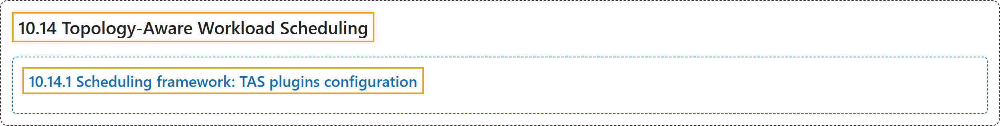

# 10.14 Topology-Aware Workload Scheduling

## Classification

## Glossary

| Term | Definition | 中文翻译 | Source |
|---|---|---|---|
| **10.14 Topology-Aware Workload Scheduling** 拓扑感知工作负载调度 | "***Topology-Aware Scheduling* (TAS)** is **a placement scheduling algorithm** that allows finding **the optimal placement for the considered PodGroup**" | ***拓扑感知调度***（TAS）是**一种放置调度算法**，能找到**所考虑的 PodGroup 的最优放置** | [The Kubernetes Authors, n.d., "Topology-Aware Workload Scheduling", para. 3](https://kubernetes.io/docs/concepts/scheduling-eviction/topology-aware-scheduling/#:~:text=%2ATopology-Aware%20Scheduling%2A%20%28TAS%29%20is%20a%20%5Bplacement%20scheduling) |
| **10.14.1 Scheduling framework: TAS plugins configuration** 调度框架：TAS 插件配置 | "The scheduler includes **new and extended in-tree plugins** that **implement the TAS extension points**:" | 调度器包含**新增和扩展的树内插件**，它们**实现 TAS 扩展点**： | [The Kubernetes Authors, n.d., "Scheduling framework: TAS plugins configuration", para. 1](https://kubernetes.io/docs/concepts/scheduling-eviction/topology-aware-scheduling/#:~:text=The%20scheduler%20includes%20new%20and%20extended%20in-tree) |

## References

The Kubernetes Authors. (n.d.). *Topology-Aware Workload Scheduling*. Kubernetes Documentation. Retrieved October 31, 2026, from <https://kubernetes.io/docs/concepts/scheduling-eviction/topology-aware-scheduling/>
