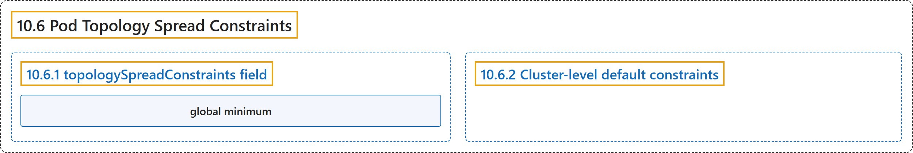

# 10.6 Pod Topology Spread Constraints

## Classification

## Glossary

| Term | Definition | 中文翻译 | Source |
|---|---|---|---|
| **10.6 Pod Topology Spread Constraints** Pod 拓扑分布约束 | "You can use *topology spread constraints* to **control how [Pods](https://kubernetes.io/docs/concepts/workloads/pods/) are spread across your cluster among failure-domains** such as regions, zones, nodes, and other user-defined topology domains." | 你可以使用*拓扑分布约束*来**控制 [Pod](https://kubernetes.io/docs/concepts/workloads/pods/) 如何在集群的各故障域之间分布**，例如区域、可用区、节点以及其他用户定义的拓扑域。 | [The Kubernetes Authors, n.d., "Pod Topology Spread Constraints", para. 1](https://kubernetes.io/docs/concepts/scheduling-eviction/topology-spread-constraints/#:~:text=You%20can%20use%20%2Atopology%20spread%20constraints%2A%20to) |
| **10.6.1 topologySpreadConstraints field** topologySpreadConstraints 字段 | (No definition) | （无定义） | [The Kubernetes Authors, n.d., "topologySpreadConstraints field"](https://kubernetes.io/docs/concepts/scheduling-eviction/topology-spread-constraints/#topologyspreadconstraints-field) |
| **global minimum** 全局最小值 | (context) "`maxSkew` defines the maximum permitted difference between the number of matching pods in the target topology and the *global minimum* (**the minimum number of matching pods in an eligible domain**" | （语境）`maxSkew` 定义了目标拓扑中匹配 Pod 数与*全局最小值*（**符合条件的域中匹配 Pod 的最小数量** | [The Kubernetes Authors, n.d., "Spread constraint definition", para. 2](https://kubernetes.io/docs/concepts/scheduling-eviction/topology-spread-constraints/#:~:text=%60maxSkew%60%20defines%20the%20maximum%20permitted%20difference%20between) |
| **10.6.2 Cluster-level default constraints** 集群级默认约束 | "It is possible to **set default topology spread constraints for a cluster**." | 可以**为集群设置默认的拓扑分布约束**。 | [The Kubernetes Authors, n.d., "Cluster-level default constraints", para. 1](https://kubernetes.io/docs/concepts/scheduling-eviction/topology-spread-constraints/#:~:text=It%20is%20possible%20to%20set%20default%20topology) |

## References

The Kubernetes Authors. (n.d.). *Pod Topology Spread Constraints*. Kubernetes Documentation. Retrieved October 31, 2026, from <https://kubernetes.io/docs/concepts/scheduling-eviction/topology-spread-constraints/>
