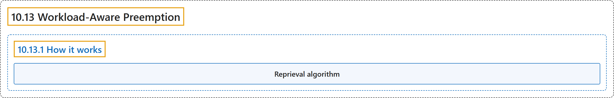

# 10.13 Workload-Aware Preemption

## Classification

## Glossary

| Term | Definition | 中文翻译 | Source |
|---|---|---|---|
| **10.13 Workload-Aware Preemption** 工作负载感知抢占 | (context) "When this feature is enabled, **the scheduler treats the PodGroup** as **a single preemptor unit**, rather than evaluating individual pods from a PodGroup in isolation." | （语境）启用此功能后，**调度器把 PodGroup 视作**一个**单一的抢占单元**，而不是孤立地评估 PodGroup 中的各个 Pod。 | [The Kubernetes Authors, n.d., "Note:", para. 3](https://kubernetes.io/docs/concepts/scheduling-eviction/workload-aware-preemption/#:~:text=When%20this%20feature%20is%20enabled%2C%20the%20scheduler) |
| **10.13.1 How it works** 工作原理 | "The workload-aware preemption process follows **the same principles as default preemption** with **a few differences**:" | 工作负载感知抢占过程遵循**与默认抢占相同的原则**，只有**少数差异**： | [The Kubernetes Authors, n.d., "How it works", para. 1](https://kubernetes.io/docs/concepts/scheduling-eviction/workload-aware-preemption/#:~:text=The%20workload-aware%20preemption%20process%20follows%20the%20same) |
| **Reprieval algorithm** 赦免算法 | (context) "When running workload-aware preemption, the scheduler **runs the simulation** where it **removes potential preemption victims** and **runs the pod group scheduling algorithm**." | （语境）执行工作负载感知抢占时，调度器**运行一次模拟**，在模拟中**移除可能的抢占牺牲者**，再**运行 Pod 组调度算法**。 | [The Kubernetes Authors, n.d., "Reprieval algorithm", para. 1](https://kubernetes.io/docs/concepts/scheduling-eviction/workload-aware-preemption/#:~:text=When%20running%20workload-aware%20preemption%2C%20the%20scheduler%20runs) |

## References

The Kubernetes Authors. (n.d.). *Workload-Aware Preemption*. Kubernetes Documentation. Retrieved October 31, 2026, from <https://kubernetes.io/docs/concepts/scheduling-eviction/workload-aware-preemption/>
