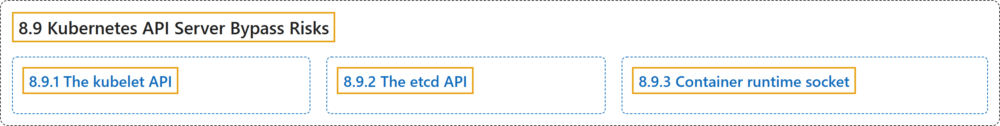

# 8.9 Kubernetes API Server Bypass Risks

## Classification

## Glossary

| Term | Definition | 中文翻译 | Source |
|---|---|---|---|
| **8.9 Kubernetes API Server Bypass Risks** Kubernetes API 服务器旁路风险 | (context) "**The Kubernetes API server** is **the main point of entry to a cluster** for **external parties (users and services)** interacting with it." | （语境）**Kubernetes API 服务器**是**集群的主要入口**，供与之交互的**外部各方（用户和服务）**。 | [The Kubernetes Authors, n.d., "Kubernetes API Server Bypass Risks", para. 2](https://kubernetes.io/docs/concepts/security/api-server-bypass-risks/#:~:text=The%20Kubernetes%20API%20server%20is%20the%20main) |
| **8.9.1 The kubelet API** kubelet API | "**The kubelet provides an HTTP API** that is **typically exposed on TCP port 10250** on **cluster worker nodes**." | **kubelet 提供一个 HTTP API**，**通常暴露在 TCP 10250 端口**，位于**集群工作节点**上。 | [The Kubernetes Authors, n.d., "The kubelet API", para. 1](https://kubernetes.io/docs/concepts/security/api-server-bypass-risks/#:~:text=The%20kubelet%20provides%20an%20HTTP%20API%20that) |
| **8.9.2 The etcd API** etcd API | (context) "**Kubernetes clusters** use **etcd as a datastore**." | （语境）**Kubernetes 集群**使用 **etcd 作为数据存储**。 | [The Kubernetes Authors, n.d., "The etcd API", para. 1](https://kubernetes.io/docs/concepts/security/api-server-bypass-risks/#:~:text=Kubernetes%20clusters%20use%20etcd%20as%20a%20datastore.) |
| **8.9.3 Container runtime socket** 容器运行时套接字 | (context) "On each node in a Kubernetes cluster, **access to interact with containers** is **controlled by the container runtime**" | （语境）在 Kubernetes 集群的每个节点上，**与容器交互的访问权**由**容器运行时控制** | [The Kubernetes Authors, n.d., "Container runtime socket", para. 1](https://kubernetes.io/docs/concepts/security/api-server-bypass-risks/#:~:text=On%20each%20node%20in%20a%20Kubernetes%20cluster%2C) |

## References

The Kubernetes Authors. (n.d.). *Kubernetes API Server Bypass Risks*. Kubernetes Documentation. Retrieved October 31, 2026, from <https://kubernetes.io/docs/concepts/security/api-server-bypass-risks/>
