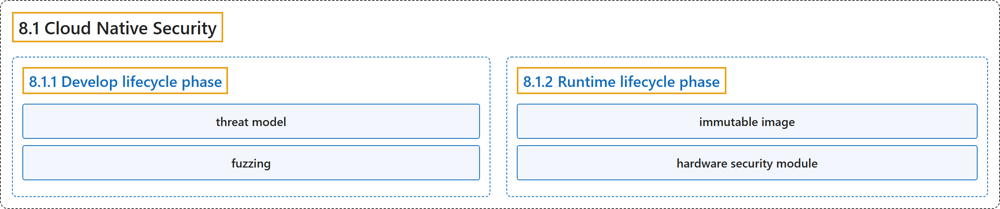

# 8.1 Cloud Native Security

## Classification

## Glossary

| Term | Definition | 中文翻译 | Source |
|---|---|---|---|
| **8.1 Cloud Native Security** 云原生安全 | (context) "**Concepts** for **keeping your cloud native workload secure**." | （语境）一组**概念**，用于**保障云原生工作负载安全**。 | [The Kubernetes Authors, n.d., "Cloud Native Security", para. 1](https://kubernetes.io/docs/concepts/security/cloud-native-security/#:~:text=Concepts%20for%20keeping%20your%20cloud%20native%20workload) |
| **8.1.1 Develop lifecycle phase** 开发生命周期阶段 | (No definition) | （无定义） | [The Kubernetes Authors, n.d., "Develop lifecycle phase"](https://kubernetes.io/docs/concepts/security/cloud-native-security/#develop-lifecycle-phase) |
| **threat model** 威胁模型 | (context) "**Build a *threat model*** of your system or application that **identifies trust boundaries**." | （语境）**建立一个*威胁模型*来描述你的系统或应用**，并**识别信任边界**。 | [The Kubernetes Authors, n.d., "Develop lifecycle phase", para. 7](https://kubernetes.io/docs/concepts/security/cloud-native-security/#:~:text=Build%20a%20%2Athreat%20model%2A%20of%20your%20system) |
| **fuzzing** 模糊测试 | (context) "**Incorporate advanced security automation**, such as ***fuzzing* and security chaos engineering**, where it's justified." | （语境）在合理的情况下，**引入高级安全自动化**，例如**模糊测试（*fuzzing*）和安全混沌工程**。 | [The Kubernetes Authors, n.d., "Develop lifecycle phase", para. 8](https://kubernetes.io/docs/concepts/security/cloud-native-security/#:~:text=Incorporate%20advanced%20security%20automation%2C%20such%20as%20%2Afuzzing%2A) |
| **8.1.2 Runtime lifecycle phase** 运行时生命周期阶段 | "**The Runtime phase** comprises **three critical areas**:" | **运行时阶段**包括**三个关键领域**： | [The Kubernetes Authors, n.d., "Runtime lifecycle phase", para. 1](https://kubernetes.io/docs/concepts/security/cloud-native-security/#:~:text=The%20Runtime%20phase%20comprises%20three%20critical%20areas%3A) |
| **immutable image** 不可变镜像 | (context) "This is typically based on **a read-only operating system (*immutable image*)** that **provides only the services essential for running containers**." | （语境）这通常基于**一个只读操作系统（*不可变镜像*）**，它**只提供运行容器所需的基本服务**。 | [The Kubernetes Authors, n.d., "Runtime protection: compute", para. 5](https://kubernetes.io/docs/concepts/security/cloud-native-security/#:~:text=This%20is%20typically%20based%20on%20a%20read-only) |
| **hardware security module** 硬件安全模块 | "**A *hardware security module*** can let you **perform cryptographic operations** without allowing **the security key to be copied elsewhere**." | 借助**一个*硬件安全模块*（HSM）**，你可以**执行加密操作**，而不允许**安全密钥被复制到别处**。 | [The Kubernetes Authors, n.d., "Runtime protection: storage", para. 7](https://kubernetes.io/docs/concepts/security/cloud-native-security/#:~:text=A%20%2Ahardware%20security%20module%2A%20can%20let%20you) |

## References

The Kubernetes Authors. (n.d.). *Cloud Native Security*. Kubernetes Documentation. Retrieved October 31, 2026, from <https://kubernetes.io/docs/concepts/security/cloud-native-security/>
