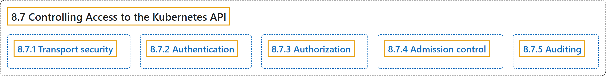

# 8.7 Controlling Access to the Kubernetes API

## Classification

## Glossary

| Term | Definition | 中文翻译 | Source |
|---|---|---|---|
| **8.7 Controlling Access to the Kubernetes API** 控制对 Kubernetes API 的访问 | (context) "**Users access the Kubernetes API** using **`kubectl`, client libraries, or by making REST requests**." | （语境）**用户访问 Kubernetes API**，方式是 **`kubectl`、客户端库或发送 REST 请求**。 | [The Kubernetes Authors, n.d., "Controlling Access to the Kubernetes API", para. 2](https://kubernetes.io/docs/concepts/security/controlling-access/#:~:text=Users%20access%20the%20%5BKubernetes%20API%5D%28https%3A%2F%2Fkubernetes.io%2Fdocs%2Fconcepts%2Foverview%2Fkubernetes-api%2F%29%20using%20%60kubectl%60%2C) |
| **8.7.1 Transport security** 传输安全 | "By default, **the Kubernetes API server listens on port 6443** on the **first non-localhost network interface**, protected by **TLS**." | 默认情况下，**Kubernetes API 服务器在 6443 端口上监听**，位于**第一个非 localhost 网络接口**，受 **TLS** 保护。 | [The Kubernetes Authors, n.d., "Transport security", para. 1](https://kubernetes.io/docs/concepts/security/controlling-access/#:~:text=By%20default%2C%20the%20Kubernetes%20API%20server%20listens) |
| **8.7.2 Authentication** 认证 | (context) "Once **TLS** is established, **the HTTP request moves** to **the Authentication step**." | （语境）**TLS** 建立之后，**HTTP 请求进入**到**认证步骤**。 | [The Kubernetes Authors, n.d., "Authentication", para. 1](https://kubernetes.io/docs/concepts/security/controlling-access/#:~:text=Once%20TLS%20is%20established%2C%20the%20HTTP%20request) |
| **8.7.3 Authorization** 鉴权 | (context) "After **the request is authenticated** as **coming from a specific user**, the request **must be authorized**." | （语境）**请求被认证**为**来自特定用户**之后，还**必须经过鉴权**。 | [The Kubernetes Authors, n.d., "Authorization", para. 1](https://kubernetes.io/docs/concepts/security/controlling-access/#:~:text=After%20the%20request%20is%20authenticated%20as%20coming) |
| **8.7.4 Admission control** 准入控制 | "**Admission Control modules** are **software modules** that can **modify or reject requests**." | **准入控制模块**是**软件模块**，可以**修改或拒绝请求**。 | [The Kubernetes Authors, n.d., "Admission control", para. 1](https://kubernetes.io/docs/concepts/security/controlling-access/#:~:text=Admission%20Control%20modules%20are%20software%20modules%20that) |
| **8.7.5 Auditing** 审计 | "**Kubernetes auditing** provides **a security-relevant, chronological set of records** documenting **the sequence of actions in a cluster**." | **Kubernetes 审计**提供**一组与安全相关、按时间顺序排列的记录**，记录**集群中的操作序列**。 | [The Kubernetes Authors, n.d., "Auditing", para. 1](https://kubernetes.io/docs/concepts/security/controlling-access/#:~:text=Kubernetes%20auditing%20provides%20a%20security-relevant%2C%20chronological%20set) |

## References

The Kubernetes Authors. (n.d.). *Controlling Access to the Kubernetes API*. Kubernetes Documentation. Retrieved October 31, 2026, from <https://kubernetes.io/docs/concepts/security/controlling-access/>
