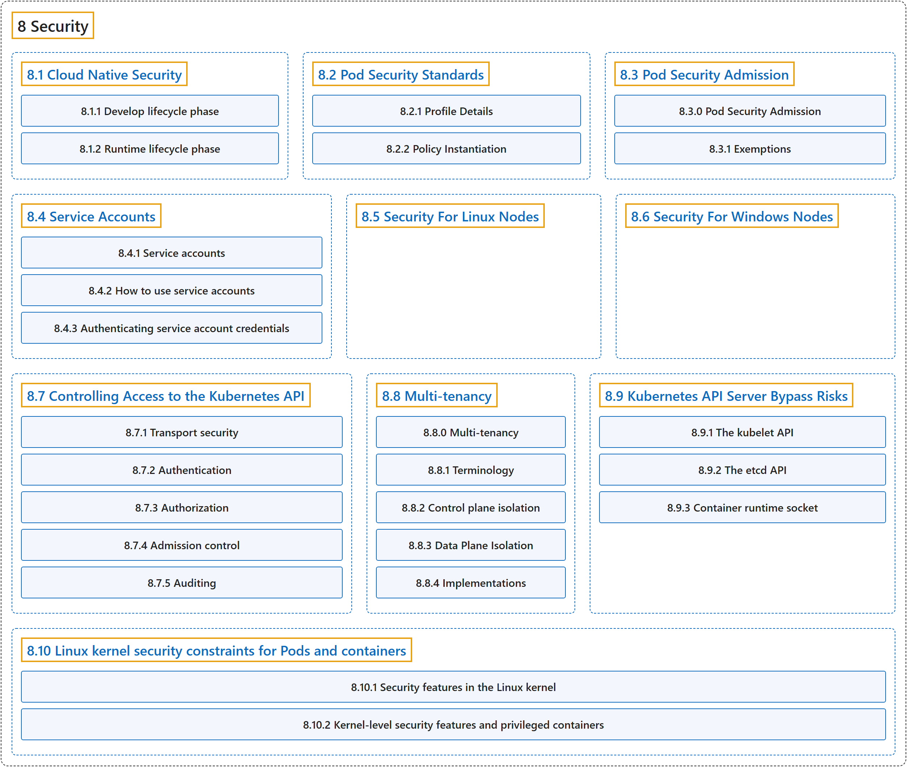

# 8 Security

## Classification

## Glossary

| Term | Definition | 中文翻译 | Source |
|---|---|---|---|
| **8 Security** 安全 | (context) "**Concepts for keeping your cloud-native workload secure.**" | （语境）**保障云原生工作负载安全的概念。** | [The Kubernetes Authors, n.d.-h, "Security", para. 1](https://kubernetes.io/docs/concepts/security/#:~:text=Concepts%20for%20keeping%20your%20cloud-native%20workload%20secure.) |
| **[8.1 Cloud Native Security](cloud-native-security.md)** 云原生安全 | (context) "**Concepts for keeping your cloud native workload secure.**" | （语境）**保障云原生工作负载安全的概念。** | [The Kubernetes Authors, n.d.-a, "Cloud Native Security", para. 1](https://kubernetes.io/docs/concepts/security/cloud-native-security/#:~:text=Concepts%20for%20keeping%20your%20cloud%20native%20workload) |
| **[8.2 Pod Security Standards](pod-security-standards.md)** Pod 安全标准 | "The Pod Security Standards **define three different *policies* to broadly cover the security spectrum**." | Pod 安全标准**定义了三种不同的*策略*，广泛覆盖安全范围**。 | [The Kubernetes Authors, n.d.-g, "Pod Security Standards", para. 2](https://kubernetes.io/docs/concepts/security/pod-security-standards/#:~:text=The%20Pod%20Security%20Standards%20define%20three%20different) |
| **[8.3 Pod Security Admission](pod-security-admission.md)** Pod 安全准入 | (context) "The Kubernetes [Pod Security Standards](https://kubernetes.io/docs/concepts/security/pod-security-standards/) **define different isolation levels for Pods**." | （语境）Kubernetes [Pod 安全标准](https://kubernetes.io/docs/concepts/security/pod-security-standards/)**为 Pod 定义了不同的隔离级别**。 | [The Kubernetes Authors, n.d.-f, "Pod Security Admission", para. 2](https://kubernetes.io/docs/concepts/security/pod-security-admission/#:~:text=The%20Kubernetes%20%5BPod%20Security%20Standards%5D%28https%3A%2F%2Fkubernetes.io%2Fdocs%2Fconcepts%2Fsecurity%2Fpod-security-standards%2F%29%20define%20different) |
| **[8.4 Service Accounts](service-accounts.md)** 服务账号 | (context) "Learn about **ServiceAccount objects in Kubernetes**." | （语境）了解 **Kubernetes 中的 ServiceAccount 对象**。 | [The Kubernetes Authors, n.d.-k, "Service Accounts", para. 1](https://kubernetes.io/docs/concepts/security/service-accounts/#:~:text=Learn%20about%20ServiceAccount%20objects%20in%20Kubernetes.) |
| **[8.5 Security For Linux Nodes](linux-security.md)** Linux 节点的安全 | (context) "This page describes **security considerations and best practices specific to the Linux operating system**." | （语境）本页介绍 **Linux 操作系统特有的安全注意事项和最佳实践**。 | [The Kubernetes Authors, n.d.-i, "Security For Linux Nodes", para. 1](https://kubernetes.io/docs/concepts/security/linux-security/#:~:text=This%20page%20describes%20security%20considerations%20and%20best) |
| **[8.6 Security For Windows Nodes](windows-security.md)** Windows 节点的安全 | (context) "This page describes **security considerations and best practices specific to the Windows operating system**." | （语境）本页介绍 **Windows 操作系统特有的安全注意事项和最佳实践**。 | [The Kubernetes Authors, n.d.-j, "Security For Windows Nodes", para. 1](https://kubernetes.io/docs/concepts/security/windows-security/#:~:text=This%20page%20describes%20security%20considerations%20and%20best) |
| **[8.7 Controlling Access to the Kubernetes API](controlling-access.md)** 控制对 Kubernetes API 的访问 | (context) "Users access the [Kubernetes API](https://kubernetes.io/docs/concepts/overview/kubernetes-api/) **using `kubectl`, client libraries, or by making REST requests**." | （语境）用户**通过 `kubectl`、客户端库或发送 REST 请求**来访问 [Kubernetes API](https://kubernetes.io/docs/concepts/overview/kubernetes-api/)。 | [The Kubernetes Authors, n.d.-b, "Controlling Access to the Kubernetes API", para. 2](https://kubernetes.io/docs/concepts/security/controlling-access/#:~:text=Users%20access%20the%20%5BKubernetes%20API%5D%28https%3A%2F%2Fkubernetes.io%2Fdocs%2Fconcepts%2Foverview%2Fkubernetes-api%2F%29%20using%20%60kubectl%60%2C) |
| **[8.8 Multi-tenancy](multi-tenancy.md)** 多租户 | (context) "**Sharing clusters saves costs and simplifies administration.**" | （语境）**共享集群可以节省成本、简化管理。** | [The Kubernetes Authors, n.d.-e, "Multi-tenancy", para. 2](https://kubernetes.io/docs/concepts/security/multi-tenancy/#:~:text=Sharing%20clusters%20saves%20costs%20and%20simplifies%20administration.) |
| **[8.9 Kubernetes API Server Bypass Risks](api-server-bypass-risks.md)** Kubernetes API 服务器旁路风险 | (context) "The Kubernetes API server is **the main point of entry to a cluster for external parties (users and services) interacting with it**." | （语境）Kubernetes API 服务器是**外部各方（用户和服务）与集群交互的主要入口**。 | [The Kubernetes Authors, n.d.-c, "Kubernetes API Server Bypass Risks", para. 2](https://kubernetes.io/docs/concepts/security/api-server-bypass-risks/#:~:text=The%20Kubernetes%20API%20server%20is%20the%20main) |
| **[8.10 Linux kernel security constraints for Pods and containers](linux-kernel-security-constraints.md)** Pod 和容器的 Linux 内核安全约束 | (context) "Overview of **Linux kernel security modules and constraints that you can use to harden your Pods and containers**." | （语境）概述**可以用来加固 Pod 和容器的 Linux 内核安全模块与约束**。 | [The Kubernetes Authors, n.d.-d, "Linux kernel security constraints for Pods and containers", para. 1](https://kubernetes.io/docs/concepts/security/linux-kernel-security-constraints/#:~:text=Overview%20of%20Linux%20kernel%20security%20modules%20and) |

## References

The Kubernetes Authors. (n.d.-a). *Cloud Native Security*. Kubernetes Documentation. Retrieved October 31, 2026, from <https://kubernetes.io/docs/concepts/security/cloud-native-security/>

The Kubernetes Authors. (n.d.-b). *Controlling Access to the Kubernetes API*. Kubernetes Documentation. Retrieved October 31, 2026, from <https://kubernetes.io/docs/concepts/security/controlling-access/>

The Kubernetes Authors. (n.d.-c). *Kubernetes API Server Bypass Risks*. Kubernetes Documentation. Retrieved October 31, 2026, from <https://kubernetes.io/docs/concepts/security/api-server-bypass-risks/>

The Kubernetes Authors. (n.d.-d). *Linux kernel security constraints for Pods and containers*. Kubernetes Documentation. Retrieved October 31, 2026, from <https://kubernetes.io/docs/concepts/security/linux-kernel-security-constraints/>

The Kubernetes Authors. (n.d.-e). *Multi-tenancy*. Kubernetes Documentation. Retrieved October 31, 2026, from <https://kubernetes.io/docs/concepts/security/multi-tenancy/>

The Kubernetes Authors. (n.d.-f). *Pod Security Admission*. Kubernetes Documentation. Retrieved October 31, 2026, from <https://kubernetes.io/docs/concepts/security/pod-security-admission/>

The Kubernetes Authors. (n.d.-g). *Pod Security Standards*. Kubernetes Documentation. Retrieved October 31, 2026, from <https://kubernetes.io/docs/concepts/security/pod-security-standards/>

The Kubernetes Authors. (n.d.-h). *Security*. Kubernetes Documentation. Retrieved October 31, 2026, from <https://kubernetes.io/docs/concepts/security/>

The Kubernetes Authors. (n.d.-i). *Security For Linux Nodes*. Kubernetes Documentation. Retrieved October 31, 2026, from <https://kubernetes.io/docs/concepts/security/linux-security/>

The Kubernetes Authors. (n.d.-j). *Security For Windows Nodes*. Kubernetes Documentation. Retrieved October 31, 2026, from <https://kubernetes.io/docs/concepts/security/windows-security/>

The Kubernetes Authors. (n.d.-k). *Service Accounts*. Kubernetes Documentation. Retrieved October 31, 2026, from <https://kubernetes.io/docs/concepts/security/service-accounts/>
