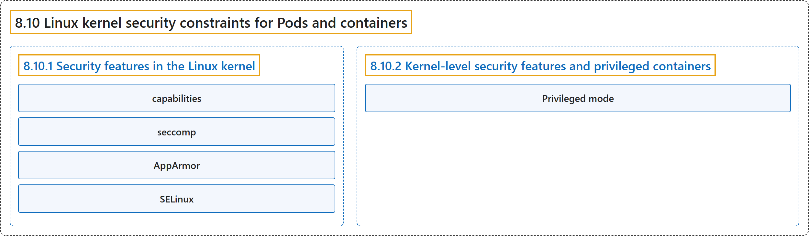

# 8.10 Linux kernel security constraints for Pods and containers

## Classification

## Glossary

| Term | Definition | 中文翻译 | Source |
|---|---|---|---|
| **8.10 Linux kernel security constraints for Pods and containers** Pod 和容器的 Linux 内核安全约束 | (context) "Overview of **Linux kernel security modules and constraints that you can use to harden your Pods and containers**." | （语境）概述**可以用来加固 Pod 和容器的 Linux 内核安全模块与约束**。 | [The Kubernetes Authors, n.d., "Linux kernel security constraints for Pods and containers", para. 1](https://kubernetes.io/docs/concepts/security/linux-kernel-security-constraints/#:~:text=Overview%20of%20Linux%20kernel%20security%20modules%20and) |
| **8.10.1 Security features in the Linux kernel** Linux 内核中的安全特性 | "Kubernetes lets you **configure and use Linux kernel features to improve isolation and harden your containerized workloads**." | Kubernetes 让你**配置并使用 Linux 内核特性，以增强隔离、加固容器化工作负载**。 | [The Kubernetes Authors, n.d., "Security features in the Linux kernel", para. 1](https://kubernetes.io/docs/concepts/security/linux-kernel-security-constraints/#:~:text=Kubernetes%20lets%20you%20configure%20and%20use%20Linux) |
| **capabilities** 权能 | "Linux uses *capabilities* to **divide the available privileges into categories**, so that processes can get the privileges required to perform specific actions without being granted all privileges." | Linux 使用*权能***把可用特权划分为若干类别**，使进程只获得执行特定操作所需的特权，而不被授予全部特权。 | [The Kubernetes Authors, n.d., "seccomp", para. 1](https://kubernetes.io/docs/concepts/security/linux-kernel-security-constraints/#:~:text=Linux%20uses%20%2Acapabilities%2A%20to%20divide%20the%20available) |
| **seccomp** seccomp | "seccomp is **a low-level security configuration that you should only configure yourself if you require fine-grained control over Linux syscalls**." | seccomp 是**一种底层安全配置，只有在你需要对 Linux 系统调用进行细粒度控制时才应自行配置**。 | [The Kubernetes Authors, n.d., "Considerations for seccomp", para. 1](https://kubernetes.io/docs/concepts/security/linux-kernel-security-constraints/#:~:text=seccomp%20is%20a%20low-level%20security%20configuration%20that) |
| **AppArmor** AppArmor | "[AppArmor](https://apparmor.net/) is **a Linux kernel security module that supplements the standard Linux user and group based permissions to confine programs to a limited set of resources**." | [AppArmor](https://apparmor.net/) 是**一个 Linux 内核安全模块，补充标准的基于用户和组的 Linux 权限，把程序限制在有限的资源集合内**。 | [The Kubernetes Authors, n.d., "AppArmor", para. 1](https://kubernetes.io/docs/concepts/security/linux-kernel-security-constraints/#:~:text=%5BAppArmor%5D%28https%3A%2F%2Fapparmor.net%2F%29%20is%20a%20Linux%20kernel%20security%20module) |
| **SELinux** SELinux | "SELinux is **a Linux kernel security module that lets you restrict the access that a specific *subject*, such as a process, has to the files on your system**." | SELinux 是**一个 Linux 内核安全模块，让你限制特定*主体*（例如进程）对系统中文件的访问**。 | [The Kubernetes Authors, n.d., "SELinux", para. 1](https://kubernetes.io/docs/concepts/security/linux-kernel-security-constraints/#:~:text=SELinux%20is%20a%20Linux%20kernel%20security%20module) |
| **8.10.2 Kernel-level security features and privileged containers** 内核级安全特性与特权容器 | "Kubernetes lets you specify that **some trusted containers can run in *privileged* mode**." | Kubernetes 允许你指定**某些受信任的容器以*特权*模式运行**。 | [The Kubernetes Authors, n.d., "Kernel-level security features and privileged containers", para. 1](https://kubernetes.io/docs/concepts/security/linux-kernel-security-constraints/#:~:text=Kubernetes%20lets%20you%20specify%20that%20some%20trusted) |
| **Privileged mode** 特权模式 | "Any container in a Pod can enable *Privileged mode* **if you set the `privileged: true` field in the [securityContext](https://kubernetes.io/docs/tasks/configure-pod-container/security-context/) field for the container**." | Pod 中任何容器，**只要在其 [securityContext](https://kubernetes.io/docs/tasks/configure-pod-container/security-context/) 字段中设置 `privileged: true`**，就可以启用*特权模式*。 | [The Kubernetes Authors, n.d., "Privileged containers", para. 1](https://kubernetes.io/docs/concepts/security/linux-kernel-security-constraints/#:~:text=Any%20container%20in%20a%20Pod%20can%20enable) |

## References

The Kubernetes Authors. (n.d.). *Linux kernel security constraints for Pods and containers*. Kubernetes Documentation. Retrieved October 31, 2026, from <https://kubernetes.io/docs/concepts/security/linux-kernel-security-constraints/>
