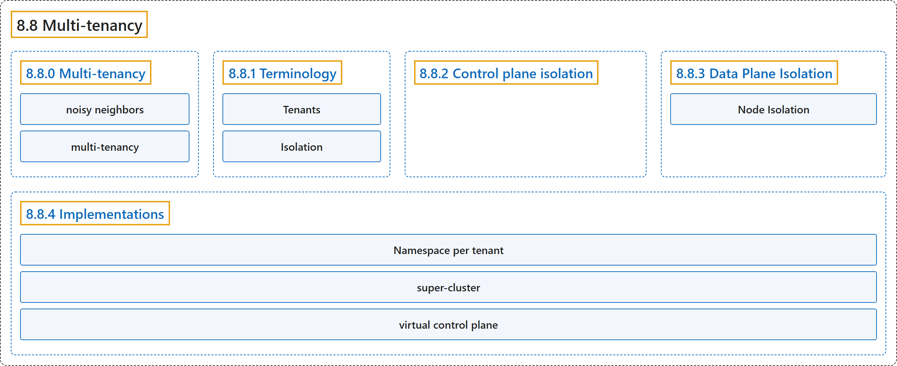

# 8.8 Multi-tenancy

## Classification

## Glossary

| Term | Definition | 中文翻译 | Source |
|---|---|---|---|
| **8.8 Multi-tenancy** 多租户 | (context) "**Sharing clusters saves costs** and **simplifies administration**." | （语境）**共享集群可以节省成本**，并**简化管理**。 | [The Kubernetes Authors, n.d., "Multi-tenancy", para. 2](https://kubernetes.io/docs/concepts/security/multi-tenancy/#:~:text=Sharing%20clusters%20saves%20costs%20and%20simplifies%20administration.) |
| **8.8.0 Multi-tenancy** 多租户 | (No definition) | （无定义） | [The Kubernetes Authors, n.d., "Multi-tenancy"](https://kubernetes.io/docs/concepts/security/multi-tenancy/#multi-tenancy) |
| **noisy neighbors** 吵闹的邻居 | (context) "However, **sharing clusters also presents challenges** such as **security, fairness, and managing *noisy neighbors***." | （语境）然而，**共享集群也带来挑战**，例如**安全、公平以及管理*吵闹的邻居***。 | [The Kubernetes Authors, n.d., "Multi-tenancy", para. 2](https://kubernetes.io/docs/concepts/security/multi-tenancy/#:~:text=However%2C%20sharing%20clusters%20also%20presents%20challenges%20such) |
| **multi-tenancy** 多租户 | "**All these types of sharing** are frequently described using **the umbrella term *multi-tenancy***." | **所有这些共享方式**常用**总称*多租户***来描述。 | [The Kubernetes Authors, n.d., "Multi-tenancy", para. 3](https://kubernetes.io/docs/concepts/security/multi-tenancy/#:~:text=All%20these%20types%20of%20sharing%20are%20frequently) |
| **8.8.1 Terminology** 术语 | (No definition) | （无定义） | [The Kubernetes Authors, n.d., "Terminology"](https://kubernetes.io/docs/concepts/security/multi-tenancy/#terminology) |
| **Tenants** 租户 | (context) "When discussing **multi-tenancy in Kubernetes**, there is **no single definition** for **a "tenant"**." | （语境）在讨论 **Kubernetes 中的多租户**时，**并没有单一的定义**来界定**一个“租户”**。 | [The Kubernetes Authors, n.d., "Tenants", para. 1](https://kubernetes.io/docs/concepts/security/multi-tenancy/#:~:text=When%20discussing%20multi-tenancy%20in%20Kubernetes%2C%20there%20is) |
| **Isolation** 隔离 | (context) "There are **several ways** to **design and build multi-tenant solutions** with Kubernetes." | （语境）有**多种方式**可以用 Kubernetes **设计和构建多租户方案**。 | [The Kubernetes Authors, n.d., "Isolation", para. 1](https://kubernetes.io/docs/concepts/security/multi-tenancy/#:~:text=There%20are%20several%20ways%20to%20design%20and) |
| **8.8.2 Control plane isolation** 控制平面隔离 | "**Control plane isolation** ensures that **different tenants cannot access or affect** each others' **Kubernetes API resources**." | **控制平面隔离**确保**不同租户无法访问或影响**彼此的 **Kubernetes API 资源**。 | [The Kubernetes Authors, n.d., "Control plane isolation", para. 1](https://kubernetes.io/docs/concepts/security/multi-tenancy/#:~:text=Control%20plane%20isolation%20ensures%20that%20different%20tenants) |
| **8.8.3 Data Plane Isolation** 数据平面隔离 | "**Data plane isolation** ensures that **pods and workloads for different tenants** are **sufficiently isolated**." | **数据平面隔离**确保**不同租户的 Pod 和工作负载**得到**充分隔离**。 | [The Kubernetes Authors, n.d., "Data Plane Isolation", para. 1](https://kubernetes.io/docs/concepts/security/multi-tenancy/#:~:text=Data%20plane%20isolation%20ensures%20that%20pods%20and) |
| **Node Isolation** 节点隔离 | "**Node isolation** is **another technique** that you can use to **isolate tenant workloads from each other**." | **节点隔离**是**另一种技术**，可用来**把租户工作负载相互隔离**。 | [The Kubernetes Authors, n.d., "Node Isolation", para. 1](https://kubernetes.io/docs/concepts/security/multi-tenancy/#:~:text=Node%20isolation%20is%20another%20technique%20that%20you) |
| **8.8.4 Implementations** 实现方式 | "There are **two primary ways** to share a Kubernetes cluster for multi-tenancy: **using Namespaces (that is, a Namespace per tenant)** or by **virtualizing the control plane (that is, virtual control plane per tenant)**." | 共享 Kubernetes 集群实现多租户主要有**两种方式**：**使用命名空间（即每租户一个命名空间）**，或**虚拟化控制平面（即每租户一个虚拟控制平面）**。 | [The Kubernetes Authors, n.d., "Implementations", para. 1](https://kubernetes.io/docs/concepts/security/multi-tenancy/#:~:text=There%20are%20two%20primary%20ways%20to%20share) |
| **Namespace per tenant** 每租户一个命名空间 | (context) "As previously mentioned, you should consider **isolating each workload** in **its own namespace**" | （语境）如前所述，你应考虑**把每个工作负载隔离**在**各自的命名空间**中 | [The Kubernetes Authors, n.d., "Namespace per tenant", para. 1](https://kubernetes.io/docs/concepts/security/multi-tenancy/#:~:text=As%20previously%20mentioned%2C%20you%20should%20consider%20isolating) |
| **super-cluster** 超级集群 | (context) "**This cluster** is often referred to as **a *super-cluster*** (or sometimes as **a *host-cluster***)." | （语境）**这个集群**常被称为**一个*超级集群***（有时也称**一个*宿主集群***）。 | [The Kubernetes Authors, n.d., "Virtual control plane per tenant", para. 2](https://kubernetes.io/docs/concepts/security/multi-tenancy/#:~:text=This%20cluster%20is%20often%20referred%20to%20as) |
| **virtual control plane** 虚拟控制平面 | "Since **a tenant’s control-plane** is **not directly associated with underlying compute resources** it is referred to as **a *virtual control plane***." | 由于**租户的控制平面**并**不直接关联底层计算资源**，它被称为**一个*虚拟控制平面***。 | [The Kubernetes Authors, n.d., "Virtual control plane per tenant", para. 2](https://kubernetes.io/docs/concepts/security/multi-tenancy/#:~:text=Since%20a%20tenant%E2%80%99s%20control-plane%20is%20not%20directly) |

## References

The Kubernetes Authors. (n.d.). *Multi-tenancy*. Kubernetes Documentation. Retrieved October 31, 2026, from <https://kubernetes.io/docs/concepts/security/multi-tenancy/>
