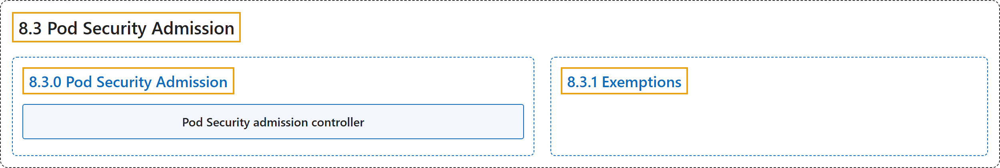

# 8.3 Pod Security Admission

## Classification

## Glossary

| Term | Definition | 中文翻译 | Source |
|---|---|---|---|
| **8.3 Pod Security Admission** Pod 安全准入 | (context) "**The Kubernetes Pod Security Standards** define **different isolation levels** for **Pods**." | （语境）**Kubernetes Pod 安全标准**定义了**不同的隔离级别**，适用于 **Pod**。 | [The Kubernetes Authors, n.d., "Pod Security Admission", para. 2](https://kubernetes.io/docs/concepts/security/pod-security-admission/#:~:text=The%20Kubernetes%20%5BPod%20Security%20Standards%5D%28https%3A%2F%2Fkubernetes.io%2Fdocs%2Fconcepts%2Fsecurity%2Fpod-security-standards%2F%29%20define%20different) |
| **8.3.0 Pod Security Admission** Pod 安全准入 | (No definition) | （无定义） | [The Kubernetes Authors, n.d., "Pod Security Admission"](https://kubernetes.io/docs/concepts/security/pod-security-admission/#pod-security-admission) |
| **Pod Security admission controller** Pod 安全准入控制器 | "Kubernetes offers **a built-in *Pod Security* admission controller** to **enforce the Pod Security Standards**." | Kubernetes 提供**一个内置的 *Pod 安全*准入控制器**，用来**执行 Pod 安全标准**。 | [The Kubernetes Authors, n.d., "Pod Security Admission", para. 3](https://kubernetes.io/docs/concepts/security/pod-security-admission/#:~:text=Kubernetes%20offers%20a%20built-in%20%2APod%20Security%2A%20%5Badmission) |
| **8.3.1 Exemptions** 豁免 | "You can **define *exemptions*** from pod security enforcement in order to **allow the creation of pods** that would have **otherwise been prohibited** due to **the policy associated with a given namespace**." | 你可以**定义*豁免***，免于 Pod 安全执行，以**允许创建一些 Pod**，这些 Pod **本来会被禁止**，依据的是**与给定命名空间关联的策略**。 | [The Kubernetes Authors, n.d., "Exemptions", para. 1](https://kubernetes.io/docs/concepts/security/pod-security-admission/#:~:text=You%20can%20define%20%2Aexemptions%2A%20from%20pod%20security) |

## References

The Kubernetes Authors. (n.d.). *Pod Security Admission*. Kubernetes Documentation. Retrieved October 31, 2026, from <https://kubernetes.io/docs/concepts/security/pod-security-admission/>
