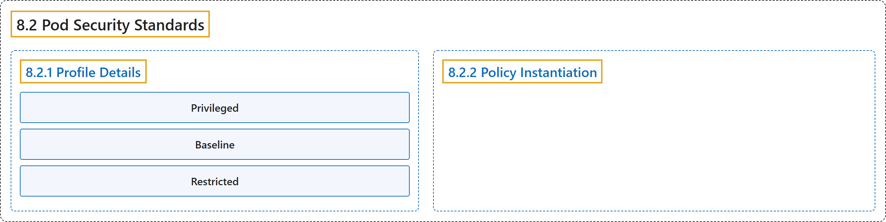

# 8.2 Pod Security Standards

## Classification

## Glossary

| Term | Definition | 中文翻译 | Source |
|---|---|---|---|
| **8.2 Pod Security Standards** Pod 安全标准 | "**The Pod Security Standards** define **three different *policies*** to **broadly cover the security spectrum**." | **Pod 安全标准**定义了**三种不同的*策略*级别**，以**广泛覆盖安全范围**。 | [The Kubernetes Authors, n.d., "Pod Security Standards", para. 2](https://kubernetes.io/docs/concepts/security/pod-security-standards/#:~:text=The%20Pod%20Security%20Standards%20define%20three%20different) |
| **8.2.1 Profile Details** 配置文件详情 | "**These policies** are ***cumulative*** and range from **highly-permissive to highly-restrictive**." | **这些策略**是***累加*的**，范围**从高度宽松到高度严格**。 | [The Kubernetes Authors, n.d., "Pod Security Standards", para. 2](https://kubernetes.io/docs/concepts/security/pod-security-standards/#:~:text=These%20policies%20are%20%2Acumulative%2A%20and%20range%20from) |
| **Privileged** Privileged | "**The *Privileged* policy** is **purposely-open**, and **entirely unrestricted**." | ***Privileged* 策略**是**有意开放**的，并且**完全不受限制**。 | [The Kubernetes Authors, n.d., "Privileged", para. 1](https://kubernetes.io/docs/concepts/security/pod-security-standards/#:~:text=The%20%2APrivileged%2A%20policy%20is%20purposely-open%2C%20and%20entirely) |
| **Baseline** Baseline | "**The *Baseline* policy** is aimed at **ease of adoption for common containerized workloads** while **preventing known privilege escalations**." | ***Baseline* 策略**旨在**便于常见容器化工作负载采用**，同时**防止已知的特权提升**。 | [The Kubernetes Authors, n.d., "Baseline", para. 1](https://kubernetes.io/docs/concepts/security/pod-security-standards/#:~:text=The%20%2ABaseline%2A%20policy%20is%20aimed%20at%20ease) |
| **Restricted** Restricted | "**The *Restricted* policy** is aimed at **enforcing current Pod hardening best practices**, at **the expense of some compatibility**." | ***Restricted* 策略**旨在**落实当前的 Pod 加固最佳实践**，代价是**牺牲部分兼容性**。 | [The Kubernetes Authors, n.d., "Restricted", para. 1](https://kubernetes.io/docs/concepts/security/pod-security-standards/#:~:text=The%20%2ARestricted%2A%20policy%20is%20aimed%20at%20enforcing) |
| **8.2.2 Policy Instantiation** 策略实例化 | "**Decoupling policy definition from policy instantiation** allows for **a common understanding and consistent language of policies across clusters**, independent of **the underlying enforcement mechanism**." | **把策略定义与策略实例化解耦**，使**各集群对策略有共同的理解和一致的语言**，而与**底层执行机制**无关。 | [The Kubernetes Authors, n.d., "Policy Instantiation", para. 1](https://kubernetes.io/docs/concepts/security/pod-security-standards/#:~:text=Decoupling%20policy%20definition%20from%20policy%20instantiation%20allows) |

## References

The Kubernetes Authors. (n.d.). *Pod Security Standards*. Kubernetes Documentation. Retrieved October 31, 2026, from <https://kubernetes.io/docs/concepts/security/pod-security-standards/>
