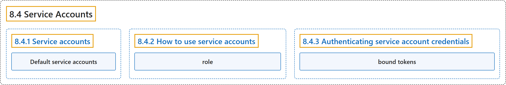

# 8.4 Service Accounts

## Classification

## Glossary

| Term | Definition | 中文翻译 | Source |
|---|---|---|---|
| **8.4 Service Accounts** 服务账号 | (context) "Learn about **ServiceAccount objects** in **Kubernetes**." | （语境）了解 **ServiceAccount 对象**在 **Kubernetes** 中的用法。 | [The Kubernetes Authors, n.d., "Service Accounts", para. 1](https://kubernetes.io/docs/concepts/security/service-accounts/#:~:text=Learn%20about%20ServiceAccount%20objects%20in%20Kubernetes.) |
| **8.4.1 Service accounts** 服务账号 | "**A service account** is **a type of non-human account** that, in Kubernetes, provides **a distinct identity in a Kubernetes cluster**." | **服务账号**是**一种非人类账号**，在 Kubernetes 中提供**集群内的一个独立身份**。 | [The Kubernetes Authors, n.d., "What are service accounts?", para. 1](https://kubernetes.io/docs/concepts/security/service-accounts/#:~:text=A%20service%20account%20is%20a%20type%20of) |
| **Default service accounts** 默认服务账号 | "When you **create a cluster**, Kubernetes **automatically creates a ServiceAccount object named `default`** for **every namespace in your cluster**." | 当你**创建集群**时，Kubernetes **自动创建一个名为 `default` 的 ServiceAccount 对象**，为**集群中的每个命名空间**各建一个。 | [The Kubernetes Authors, n.d., "Default service accounts", para. 1](https://kubernetes.io/docs/concepts/security/service-accounts/#:~:text=When%20you%20create%20a%20cluster%2C%20Kubernetes%20automatically) |
| **8.4.2 How to use service accounts** 如何使用服务账号 | (No definition) | （无定义） | [The Kubernetes Authors, n.d., "How to use service accounts"](https://kubernetes.io/docs/concepts/security/service-accounts/#how-to-use-service-accounts) |
| **role** 角色 | (context) "You **create a *role***, which **grants access**, and then ***bind* the role to your ServiceAccount**." | （语境）你**创建一个*角色***，由它**授予访问权**，再**把该角色*绑定*到 ServiceAccount**。 | [The Kubernetes Authors, n.d., "Grant permissions to a ServiceAccount", para. 1](https://kubernetes.io/docs/concepts/security/service-accounts/#:~:text=You%20create%20a%20%2Arole%2A%2C%20which%20grants%20access%2C) |
| **8.4.3 Authenticating service account credentials** 验证服务账号凭据 | "**ServiceAccounts** use **signed JSON Web Tokens (JWTs)** to **authenticate to the Kubernetes API server**, and to any other system where **a trust relationship exists**." | **ServiceAccount** 使用**签名的 JSON Web Token（JWT）**，以此**向 Kubernetes API 服务器认证**，也向任何**存在信任关系**的其他系统认证。 | [The Kubernetes Authors, n.d., "Authenticating service account credentials", para. 1](https://kubernetes.io/docs/concepts/security/service-accounts/#:~:text=ServiceAccounts%20use%20signed%20%5BJSON%20Web%20Tokens%5D%28https%3A%2F%2Fwww.rfc-editor.org%2Frfc%2Frfc7519%29%20%28JWTs%29) |
| **bound tokens** 绑定令牌 | "**The TokenRequest API** produces ***bound tokens*** for **a ServiceAccount**." | **TokenRequest API** 生成***绑定令牌***，供**一个 ServiceAccount** 使用。 | [The Kubernetes Authors, n.d., "Authenticating service account credentials", para. 7](https://kubernetes.io/docs/concepts/security/service-accounts/#:~:text=The%20TokenRequest%20API%20produces%20%2Abound%20tokens%2A%20for) |

## References

The Kubernetes Authors. (n.d.). *Service Accounts*. Kubernetes Documentation. Retrieved October 31, 2026, from <https://kubernetes.io/docs/concepts/security/service-accounts/>
