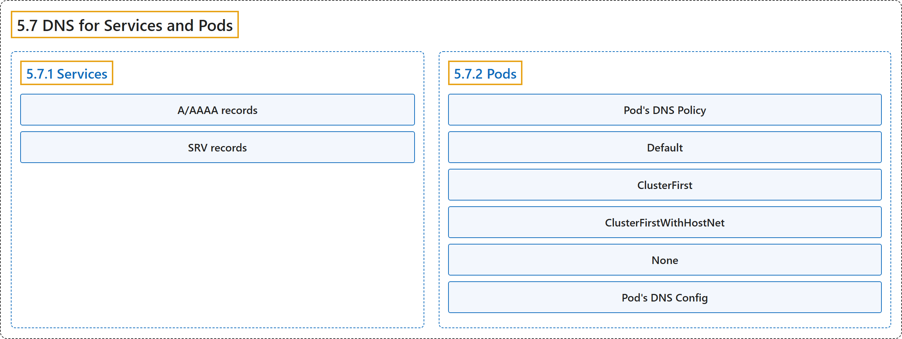

# 5.7 DNS for Services and Pods

## Classification

## Glossary

| Term | Definition | 中文翻译 | Source |
|---|---|---|---|
| **5.7 DNS for Services and Pods** Service 与 Pod 的 DNS | (context) "**Kubernetes creates DNS records** for **Services and Pods**." | （语境）**Kubernetes 会创建 DNS 记录**，对象是 **Service 和 Pod**。 | [The Kubernetes Authors, n.d., "DNS for Services and Pods", para. 2](https://kubernetes.io/docs/concepts/services-networking/dns-pod-service/#:~:text=Kubernetes%20creates%20DNS%20records%20for%20Services%20and) |
| **5.7.1 Services** Service | (No definition) | （无定义） | [The Kubernetes Authors, n.d., "Services"](https://kubernetes.io/docs/concepts/services-networking/dns-pod-service/#services) |
| **A/AAAA records** A/AAAA 记录 | ""Normal" (not headless) **Services** are **assigned DNS A and/or AAAA records**, depending on **the IP family or families of the Service**" | “普通”（非无头）**Service** 会被**分配 DNS A 和/或 AAAA 记录**，取决于 **Service 的 IP 协议族** | [The Kubernetes Authors, n.d., "A/AAAA records", para. 1](https://kubernetes.io/docs/concepts/services-networking/dns-pod-service/#:~:text=%22Normal%22%20%28not%20headless%29%20Services%20are%20assigned%20DNS) |
| **SRV records** SRV 记录 | "**SRV Records** are created for **named ports** that are part of **normal or headless services**." | **SRV 记录**为**命名端口**创建，这些端口属于**普通或无头 Service**。 | [The Kubernetes Authors, n.d., "SRV records", para. 1](https://kubernetes.io/docs/concepts/services-networking/dns-pod-service/#:~:text=SRV%20Records%20are%20created%20for%20named%20ports) |
| **5.7.2 Pods** Pod | (No definition) | （无定义） | [The Kubernetes Authors, n.d., "Pods"](https://kubernetes.io/docs/concepts/services-networking/dns-pod-service/#pods) |
| **Pod's DNS Policy** Pod 的 DNS 策略 | "**DNS policies** can be set on **a per-Pod basis**." | **DNS 策略**可以**按 Pod 逐个**设置。 | [The Kubernetes Authors, n.d., "Pod's DNS Policy", para. 1](https://kubernetes.io/docs/concepts/services-networking/dns-pod-service/#:~:text=DNS%20policies%20can%20be%20set%20on%20a) |
| **Default** Default | ""`Default`": The Pod **inherits the name resolution configuration** from **the node that the Pods run on**." | “`Default`”：Pod **继承名称解析配置**，来自**其所在的节点**。 | [The Kubernetes Authors, n.d., "Pod's DNS Policy", para. 2](https://kubernetes.io/docs/concepts/services-networking/dns-pod-service/#:~:text=%22%60Default%60%22%3A%20The%20Pod%20inherits%20the%20name%20resolution) |
| **ClusterFirst** ClusterFirst | ""`ClusterFirst`": **Any DNS query that does not match the configured cluster domain suffix**, such as "`www.kubernetes.io`", **is forwarded to an upstream nameserver by the DNS server.**" | “`ClusterFirst`”：**任何与所配置的集群域后缀不匹配的 DNS 查询**（例如“`www.kubernetes.io`”）**都由 DNS 服务器转发给上游域名服务器。** | [The Kubernetes Authors, n.d., "Pod's DNS Policy", para. 3](https://kubernetes.io/docs/concepts/services-networking/dns-pod-service/#:~:text=%22%60ClusterFirst%60%22%3A%20Any%20DNS%20query%20that%20does%20not) |
| **ClusterFirstWithHostNet** ClusterFirstWithHostNet | ""`ClusterFirstWithHostNet`": For **Pods running with hostNetwork**, you should **explicitly set its DNS policy** to "**`ClusterFirstWithHostNet`**"." | “`ClusterFirstWithHostNet`”：对**以 hostNetwork 运行的 Pod**，应**显式设置其 DNS 策略**为“**`ClusterFirstWithHostNet`**”。 | [The Kubernetes Authors, n.d., "Pod's DNS Policy", para. 4](https://kubernetes.io/docs/concepts/services-networking/dns-pod-service/#:~:text=%22%60ClusterFirstWithHostNet%60%22%3A%20For%20Pods%20running%20with%20hostNetwork%2C%20you) |
| **None** None | ""`None`": It **allows a Pod** to ignore **DNS settings from the Kubernetes environment**." | “`None`”：它**允许 Pod** 忽略**来自 Kubernetes 环境的 DNS 设置**。 | [The Kubernetes Authors, n.d., "Pod's DNS Policy", para. 5](https://kubernetes.io/docs/concepts/services-networking/dns-pod-service/#:~:text=%22%60None%60%22%3A%20It%20allows%20a%20Pod%20to%20ignore) |
| **Pod's DNS Config** Pod 的 DNS 配置 | "**Pod's DNS Config** allows users **more control on the DNS settings for a Pod**." | **Pod 的 DNS 配置**让用户**对 Pod 的 DNS 设置有更多控制**。 | [The Kubernetes Authors, n.d., "Pod's DNS Config", para. 1](https://kubernetes.io/docs/concepts/services-networking/dns-pod-service/#:~:text=Pod%27s%20DNS%20Config%20allows%20users%20more%20control) |

## References

The Kubernetes Authors. (n.d.). *DNS for Services and Pods*. Kubernetes Documentation. Retrieved October 31, 2026, from <https://kubernetes.io/docs/concepts/services-networking/dns-pod-service/>
