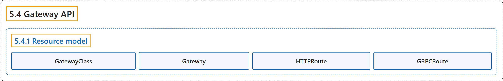

# 5.4 Gateway API

## Classification

## Glossary

| Term | Definition | 中文翻译 | Source |
|---|---|---|---|
| **5.4 Gateway API** Gateway API | "Gateway API is **a family of API kinds that provide dynamic infrastructure provisioning and advanced traffic routing**." | Gateway API 是**一组 API 类型，提供动态基础设施供应和高级流量路由**。 | [The Kubernetes Authors, n.d., "Gateway API", para. 1](https://kubernetes.io/docs/concepts/services-networking/gateway/#:~:text=Gateway%20API%20is%20a%20family%20of%20API) |
| **5.4.1 Resource model** 资源模型 | "Gateway API has **four stable API kinds**:" | Gateway API 有**四种稳定的 API 类型**： | [The Kubernetes Authors, n.d., "Resource model", para. 1](https://kubernetes.io/docs/concepts/services-networking/gateway/#:~:text=Gateway%20API%20has%20four%20stable%20API%20kinds%3A) |
| **GatewayClass** GatewayClass | (context) "Gateways can be **implemented by different controllers, often with different configurations**." | （语境）Gateway 可以**由不同的控制器实现，配置也往往不同**。 | [The Kubernetes Authors, n.d., "GatewayClass", para. 1](https://kubernetes.io/docs/concepts/services-networking/gateway/#:~:text=Gateways%20can%20be%20implemented%20by%20different%20controllers%2C) |
| **Gateway** Gateway | "A Gateway **describes an instance of traffic handling infrastructure**." | Gateway **描述一个流量处理基础设施的实例**。 | [The Kubernetes Authors, n.d., "Gateway", para. 1](https://kubernetes.io/docs/concepts/services-networking/gateway/#:~:text=A%20Gateway%20describes%20an%20instance%20of%20traffic) |
| **HTTPRoute** HTTPRoute | "The HTTPRoute kind **specifies routing behavior of HTTP requests from a Gateway listener to backend network endpoints**." | HTTPRoute 类型**指定 HTTP 请求从 Gateway 监听器到后端网络端点的路由行为**。 | [The Kubernetes Authors, n.d., "HTTPRoute", para. 1](https://kubernetes.io/docs/concepts/services-networking/gateway/#:~:text=The%20HTTPRoute%20kind%20specifies%20routing%20behavior%20of) |
| **GRPCRoute** GRPCRoute | "The GRPCRoute kind **specifies routing behavior of gRPC requests from a Gateway listener to backend network endpoints**." | GRPCRoute 类型**指定 gRPC 请求从 Gateway 监听器到后端网络端点的路由行为**。 | [The Kubernetes Authors, n.d., "GRPCRoute", para. 1](https://kubernetes.io/docs/concepts/services-networking/gateway/#:~:text=The%20GRPCRoute%20kind%20specifies%20routing%20behavior%20of) |

## References

The Kubernetes Authors. (n.d.). *Gateway API*. Kubernetes Documentation. Retrieved October 31, 2026, from <https://kubernetes.io/docs/concepts/services-networking/gateway/>
