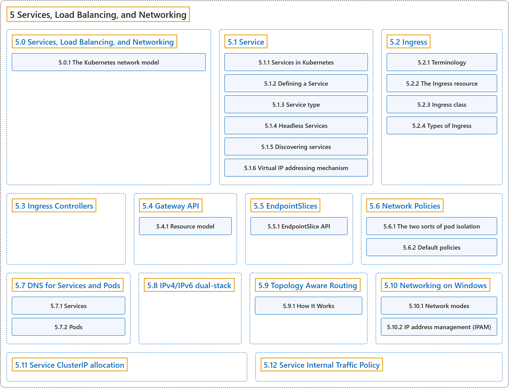

# 5 Services, Load Balancing, and Networking

## Classification

## Glossary

| Term | Definition | 中文翻译 | Source |
|---|---|---|---|
| **5 Services, Load Balancing, and Networking** 服务、负载均衡与网络 | (context) "**Concepts and resources behind networking in Kubernetes.**" | （语境）**Kubernetes 网络背后的概念和资源。** | [The Kubernetes Authors, n.d.-l, "Services, Load Balancing, and Networking", para. 1](https://kubernetes.io/docs/concepts/services-networking/#:~:text=Concepts%20and%20resources%20behind%20networking%20in%20Kubernetes.) |
| **[5.0 Services, Load Balancing, and Networking](services-networking.md)** 服务、负载均衡与网络 | (context) "**Concepts and resources behind networking in Kubernetes.**" | （语境）**Kubernetes 网络背后的概念和资源。** | [The Kubernetes Authors, n.d.-l, "Services, Load Balancing, and Networking", para. 1](https://kubernetes.io/docs/concepts/services-networking/#:~:text=Concepts%20and%20resources%20behind%20networking%20in%20Kubernetes.) |
| **[5.1 Service](service.md)** Service | "In Kubernetes, a Service is **a method for exposing a network application that is running as one or more [Pods](https://kubernetes.io/docs/concepts/workloads/pods/) in your cluster**." | 在 Kubernetes 中，Service 是**一种暴露网络应用的方法，该应用在集群中以一个或多个 [Pod](https://kubernetes.io/docs/concepts/workloads/pods/) 运行**。 | [The Kubernetes Authors, n.d.-i, "Service", para. 2](https://kubernetes.io/docs/concepts/services-networking/service/#:~:text=In%20Kubernetes%2C%20a%20Service%20is%20a%20method) |
| **[5.2 Ingress](ingress.md)** Ingress | "**An API object that manages external access to the services in a cluster, typically HTTP.**" | **一个管理从外部访问集群中服务的 API 对象，通常是 HTTP。** | [The Kubernetes Authors, n.d.-d, "Ingress", para. 2](https://kubernetes.io/docs/concepts/services-networking/ingress/#:~:text=An%20API%20object%20that%20manages%20external%20access) |
| **[5.3 Ingress Controllers](ingress-controllers.md)** Ingress 控制器 | (context) "In order for an [Ingress](https://kubernetes.io/docs/concepts/services-networking/ingress/) to work in your cluster, **there must be an *ingress controller* running**." | （语境）要让 [Ingress](https://kubernetes.io/docs/concepts/services-networking/ingress/) 在集群中工作，**必须有一个 *Ingress 控制器*在运行**。 | [The Kubernetes Authors, n.d.-e, "Ingress Controllers", para. 1](https://kubernetes.io/docs/concepts/services-networking/ingress-controllers/#:~:text=In%20order%20for%20an%20%5BIngress%5D%28https%3A%2F%2Fkubernetes.io%2Fdocs%2Fconcepts%2Fservices-networking%2Fingress%2F%29%20to%20work) |
| **[5.4 Gateway API](gateway.md)** Gateway API | "Gateway API is **a family of API kinds that provide dynamic infrastructure provisioning and advanced traffic routing**." | Gateway API 是**一组 API 类型，提供动态基础设施供应和高级流量路由**。 | [The Kubernetes Authors, n.d.-c, "Gateway API", para. 1](https://kubernetes.io/docs/concepts/services-networking/gateway/#:~:text=Gateway%20API%20is%20a%20family%20of%20API) |
| **[5.5 EndpointSlices](endpoint-slices.md)** EndpointSlice | "In Kubernetes, an EndpointSlice **contains references to a set of network endpoints**." | 在 Kubernetes 中，EndpointSlice **包含对一组网络端点的引用**。 | [The Kubernetes Authors, n.d.-b, "EndpointSlice API", para. 1](https://kubernetes.io/docs/concepts/services-networking/endpoint-slices/#:~:text=In%20Kubernetes%2C%20an%20EndpointSlice%20contains%20references%20to) |
| **[5.6 Network Policies](network-policies.md)** 网络策略 | "If you want to control traffic flow at the IP address or port level (OSI layer 3 or 4), NetworkPolicies **allow you to specify rules for traffic flow within your cluster, and also between Pods and the outside world**." | 如果你想在 IP 地址或端口层面（OSI 第 3 或第 4 层）控制流量，NetworkPolicy **让你为集群内部以及 Pod 与外部世界之间的流量指定规则**。 | [The Kubernetes Authors, n.d.-g, "Network Policies", para. 1](https://kubernetes.io/docs/concepts/services-networking/network-policies/#:~:text=If%20you%20want%20to%20control%20traffic%20flow) |
| **[5.7 DNS for Services and Pods](dns-pod-service.md)** Service 与 Pod 的 DNS | (context) "**Kubernetes creates DNS records for Services and Pods.**" | （语境）**Kubernetes 为 Service 和 Pod 创建 DNS 记录。** | [The Kubernetes Authors, n.d.-a, "DNS for Services and Pods", para. 2](https://kubernetes.io/docs/concepts/services-networking/dns-pod-service/#:~:text=Kubernetes%20creates%20DNS%20records%20for%20Services%20and) |
| **[5.8 IPv4/IPv6 dual-stack](dual-stack.md)** IPv4/IPv6 双栈 | "IPv4/IPv6 dual-stack networking **enables the allocation of both IPv4 and IPv6 addresses to [Pods](https://kubernetes.io/docs/concepts/workloads/pods/) and [Services](https://kubernetes.io/docs/concepts/services-networking/service/)**." | IPv4/IPv6 双栈网络**能够为 [Pod](https://kubernetes.io/docs/concepts/workloads/pods/) 和 [Service](https://kubernetes.io/docs/concepts/services-networking/service/) 同时分配 IPv4 和 IPv6 地址**。 | [The Kubernetes Authors, n.d.-f, "IPv4/IPv6 dual-stack", para. 2](https://kubernetes.io/docs/concepts/services-networking/dual-stack/#:~:text=IPv4%2FIPv6%20dual-stack%20networking%20enables%20the%20allocation%20of) |
| **[5.9 Topology Aware Routing](topology-aware-routing.md)** 拓扑感知路由 | "*Topology Aware Routing* provides **a mechanism to help keep network traffic within the zone where it originated**." | *拓扑感知路由*提供**一种机制，帮助把网络流量保持在其发出的可用区内**。 | [The Kubernetes Authors, n.d.-m, "Topology Aware Routing", para. 1](https://kubernetes.io/docs/concepts/services-networking/topology-aware-routing/#:~:text=%2ATopology%20Aware%20Routing%2A%20provides%20a%20mechanism%20to) |
| **[5.10 Networking on Windows](windows-networking.md)** Windows 上的网络 | (context) "Networking for Windows containers is **exposed through [CNI plugins](https://kubernetes.io/docs/concepts/extend-kubernetes/compute-storage-net/network-plugins/)**." | （语境）Windows 容器的网络**通过 [CNI 插件](https://kubernetes.io/docs/concepts/extend-kubernetes/compute-storage-net/network-plugins/)提供**。 | [The Kubernetes Authors, n.d.-h, "Container networking on Windows", para. 1](https://kubernetes.io/docs/concepts/services-networking/windows-networking/#:~:text=Networking%20for%20Windows%20containers%20is%20exposed%20through) |
| **[5.11 Service ClusterIP allocation](cluster-ip-allocation.md)** Service ClusterIP 分配 | (context) "In Kubernetes, [Services](https://kubernetes.io/docs/concepts/services-networking/service/) are **an abstract way to expose an application running on a set of Pods**." | （语境）在 Kubernetes 中，[Service](https://kubernetes.io/docs/concepts/services-networking/service/) 是**一种抽象方式，用来暴露运行在一组 Pod 上的应用**。 | [The Kubernetes Authors, n.d.-j, "Service ClusterIP allocation", para. 1](https://kubernetes.io/docs/concepts/services-networking/cluster-ip-allocation/#:~:text=In%20Kubernetes%2C%20%5BServices%5D%28https%3A%2F%2Fkubernetes.io%2Fdocs%2Fconcepts%2Fservices-networking%2Fservice%2F%29%20are%20an%20abstract%20way) |
| **[5.12 Service Internal Traffic Policy](service-traffic-policy.md)** Service 内部流量策略 | "*Service Internal Traffic Policy* **enables internal traffic restrictions to only route internal traffic to endpoints within the node the traffic originated from**." | *Service 内部流量策略* **启用内部流量限制，只把内部流量路由到流量发出节点内的端点**。 | [The Kubernetes Authors, n.d.-k, "Service Internal Traffic Policy", para. 2](https://kubernetes.io/docs/concepts/services-networking/service-traffic-policy/#:~:text=%2AService%20Internal%20Traffic%20Policy%2A%20enables%20internal%20traffic) |

## References

The Kubernetes Authors. (n.d.-a). *DNS for Services and Pods*. Kubernetes Documentation. Retrieved October 31, 2026, from <https://kubernetes.io/docs/concepts/services-networking/dns-pod-service/>

The Kubernetes Authors. (n.d.-b). *EndpointSlices*. Kubernetes Documentation. Retrieved October 31, 2026, from <https://kubernetes.io/docs/concepts/services-networking/endpoint-slices/>

The Kubernetes Authors. (n.d.-c). *Gateway API*. Kubernetes Documentation. Retrieved October 31, 2026, from <https://kubernetes.io/docs/concepts/services-networking/gateway/>

The Kubernetes Authors. (n.d.-d). *Ingress*. Kubernetes Documentation. Retrieved October 31, 2026, from <https://kubernetes.io/docs/concepts/services-networking/ingress/>

The Kubernetes Authors. (n.d.-e). *Ingress Controllers*. Kubernetes Documentation. Retrieved October 31, 2026, from <https://kubernetes.io/docs/concepts/services-networking/ingress-controllers/>

The Kubernetes Authors. (n.d.-f). *IPv4/IPv6 dual-stack*. Kubernetes Documentation. Retrieved October 31, 2026, from <https://kubernetes.io/docs/concepts/services-networking/dual-stack/>

The Kubernetes Authors. (n.d.-g). *Network Policies*. Kubernetes Documentation. Retrieved October 31, 2026, from <https://kubernetes.io/docs/concepts/services-networking/network-policies/>

The Kubernetes Authors. (n.d.-h). *Networking on Windows*. Kubernetes Documentation. Retrieved October 31, 2026, from <https://kubernetes.io/docs/concepts/services-networking/windows-networking/>

The Kubernetes Authors. (n.d.-i). *Service*. Kubernetes Documentation. Retrieved October 31, 2026, from <https://kubernetes.io/docs/concepts/services-networking/service/>

The Kubernetes Authors. (n.d.-j). *Service ClusterIP allocation*. Kubernetes Documentation. Retrieved October 31, 2026, from <https://kubernetes.io/docs/concepts/services-networking/cluster-ip-allocation/>

The Kubernetes Authors. (n.d.-k). *Service Internal Traffic Policy*. Kubernetes Documentation. Retrieved October 31, 2026, from <https://kubernetes.io/docs/concepts/services-networking/service-traffic-policy/>

The Kubernetes Authors. (n.d.-l). *Services, Load Balancing, and Networking*. Kubernetes Documentation. Retrieved October 31, 2026, from <https://kubernetes.io/docs/concepts/services-networking/>

The Kubernetes Authors. (n.d.-m). *Topology Aware Routing*. Kubernetes Documentation. Retrieved October 31, 2026, from <https://kubernetes.io/docs/concepts/services-networking/topology-aware-routing/>
