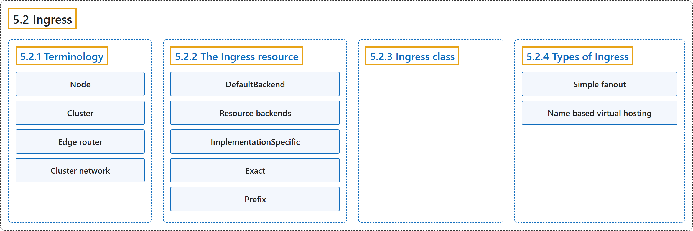

# 5.2 Ingress

## Classification

## Glossary

| Term | Definition | 中文翻译 | Source |
|---|---|---|---|
| **5.2 Ingress** Ingress | "**An API object that manages external access to the services in a cluster, typically HTTP.**" | **一个管理从外部访问集群中服务的 API 对象，通常是 HTTP。** | [The Kubernetes Authors, n.d., "Ingress", para. 2](https://kubernetes.io/docs/concepts/services-networking/ingress/#:~:text=An%20API%20object%20that%20manages%20external%20access) |
| **5.2.1 Terminology** 术语 | "For clarity, **this guide defines the following terms**:" | 为清楚起见，**本指南定义以下术语**： | [The Kubernetes Authors, n.d., "Terminology", para. 1](https://kubernetes.io/docs/concepts/services-networking/ingress/#:~:text=For%20clarity%2C%20this%20guide%20defines%20the%20following) |
| **Node** 节点 | "Node: **A worker machine in Kubernetes, part of a cluster.**" | 节点：**Kubernetes 中的工作机器，是集群的一部分。** | [The Kubernetes Authors, n.d., "Terminology", para. 2](https://kubernetes.io/docs/concepts/services-networking/ingress/#:~:text=Node%3A%20A%20worker%20machine%20in%20Kubernetes%2C%20part) |
| **Cluster** 集群 | "Cluster: **A set of Nodes that run containerized applications managed by Kubernetes.**" | 集群：**一组运行由 Kubernetes 管理的容器化应用的节点。** | [The Kubernetes Authors, n.d., "Terminology", para. 3](https://kubernetes.io/docs/concepts/services-networking/ingress/#:~:text=Cluster%3A%20A%20set%20of%20Nodes%20that%20run) |
| **Edge router** 边缘路由器 | "Edge router: **A router that enforces the firewall policy for your cluster.**" | 边缘路由器：**为集群执行防火墙策略的路由器。** | [The Kubernetes Authors, n.d., "Terminology", para. 4](https://kubernetes.io/docs/concepts/services-networking/ingress/#:~:text=Edge%20router%3A%20A%20router%20that%20enforces%20the) |
| **Cluster network** 集群网络 | "Cluster network: **A set of links, logical or physical, that facilitate communication within a cluster** according to the Kubernetes [networking model](https://kubernetes.io/docs/concepts/cluster-administration/networking/)." | 集群网络：**一组逻辑或物理的链路，按照 Kubernetes [网络模型](https://kubernetes.io/docs/concepts/cluster-administration/networking/)促进集群内的通信。** | [The Kubernetes Authors, n.d., "Terminology", para. 5](https://kubernetes.io/docs/concepts/services-networking/ingress/#:~:text=Cluster%20network%3A%20A%20set%20of%20links%2C%20logical) |
| **5.2.2 The Ingress resource** Ingress 资源 | (No definition) | （无定义） | [The Kubernetes Authors, n.d., "The Ingress resource"](https://kubernetes.io/docs/concepts/services-networking/ingress/#the-ingress-resource) |
| **DefaultBackend** 默认后端 | "An Ingress with no rules **sends all traffic to a single default backend**" | 没有规则的 Ingress **把所有流量发送到单个默认后端** | [The Kubernetes Authors, n.d., "DefaultBackend", para. 1](https://kubernetes.io/docs/concepts/services-networking/ingress/#:~:text=An%20Ingress%20with%20no%20rules%20sends%20all) |
| **Resource backends** 资源后端 | "A `Resource` backend is **an ObjectRef to another Kubernetes resource within the same namespace as the Ingress object**." | `Resource` 后端是**一个指向与 Ingress 对象位于同一命名空间的另一个 Kubernetes 资源的 ObjectRef**。 | [The Kubernetes Authors, n.d., "Resource backends", para. 1](https://kubernetes.io/docs/concepts/services-networking/ingress/#:~:text=A%20%60Resource%60%20backend%20is%20an%20ObjectRef%20to) |
| **ImplementationSpecific** ImplementationSpecific | "`ImplementationSpecific`: With this path type, **matching is up to the IngressClass**." | `ImplementationSpecific`：使用这种路径类型时，**如何匹配由 IngressClass 决定**。 | [The Kubernetes Authors, n.d., "Path types", para. 2](https://kubernetes.io/docs/concepts/services-networking/ingress/#:~:text=%60ImplementationSpecific%60%3A%20With%20this%20path%20type%2C%20matching%20is) |
| **Exact** Exact | "`Exact`: **Matches the URL path exactly and with case sensitivity.**" | `Exact`：**精确匹配 URL 路径，区分大小写。** | [The Kubernetes Authors, n.d., "Path types", para. 3](https://kubernetes.io/docs/concepts/services-networking/ingress/#:~:text=%60Exact%60%3A%20Matches%20the%20URL%20path%20exactly%20and) |
| **Prefix** Prefix | "`Prefix`: **Matches based on a URL path prefix split by `/`.**" | `Prefix`：**按以 `/` 分隔的 URL 路径前缀进行匹配。** | [The Kubernetes Authors, n.d., "Path types", para. 4](https://kubernetes.io/docs/concepts/services-networking/ingress/#:~:text=%60Prefix%60%3A%20Matches%20based%20on%20a%20URL%20path) |
| **5.2.3 Ingress class** Ingress 类 | "Ingresses can be **implemented by different controllers, often with different configuration**." | Ingress 可以**由不同的控制器实现，配置也往往不同**。 | [The Kubernetes Authors, n.d., "Ingress class", para. 1](https://kubernetes.io/docs/concepts/services-networking/ingress/#:~:text=Ingresses%20can%20be%20implemented%20by%20different%20controllers%2C) |
| **5.2.4 Types of Ingress** Ingress 的类型 | (No definition) | （无定义） | [The Kubernetes Authors, n.d., "Types of Ingress"](https://kubernetes.io/docs/concepts/services-networking/ingress/#types-of-ingress) |
| **Simple fanout** 简单扇出 | "A fanout configuration **routes traffic from a single IP address to more than one Service, based on the HTTP URI being requested**." | 扇出配置**根据所请求的 HTTP URI，把来自单个 IP 地址的流量路由到多个 Service**。 | [The Kubernetes Authors, n.d., "Simple fanout", para. 1](https://kubernetes.io/docs/concepts/services-networking/ingress/#:~:text=A%20fanout%20configuration%20routes%20traffic%20from%20a) |
| **Name based virtual hosting** 基于名称的虚拟主机 | "Name-based virtual hosts **support routing HTTP traffic to multiple host names at the same IP address**." | 基于名称的虚拟主机**支持把 HTTP 流量路由到同一 IP 地址上的多个主机名**。 | [The Kubernetes Authors, n.d., "Name based virtual hosting", para. 1](https://kubernetes.io/docs/concepts/services-networking/ingress/#:~:text=Name-based%20virtual%20hosts%20support%20routing%20HTTP%20traffic) |

## References

The Kubernetes Authors. (n.d.). *Ingress*. Kubernetes Documentation. Retrieved October 31, 2026, from <https://kubernetes.io/docs/concepts/services-networking/ingress/>
