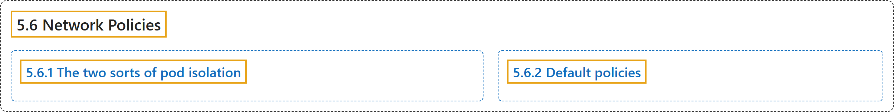

# 5.6 Network Policies

## Classification

## Glossary

| Term | Definition | 中文翻译 | Source |
|---|---|---|---|
| **5.6 Network Policies** 网络策略 | "If you want to control traffic flow at the IP address or port level (OSI layer 3 or 4), NetworkPolicies **allow you to specify rules for traffic flow within your cluster, and also between Pods and the outside world**." | 如果你想在 IP 地址或端口层面（OSI 第 3 或第 4 层）控制流量，NetworkPolicy **让你为集群内部以及 Pod 与外部世界之间的流量指定规则**。 | [The Kubernetes Authors, n.d., "Network Policies", para. 1](https://kubernetes.io/docs/concepts/services-networking/network-policies/#:~:text=If%20you%20want%20to%20control%20traffic%20flow) |
| **5.6.1 The two sorts of pod isolation** 两种 Pod 隔离 | "There are **two sorts of isolation for a pod: isolation for egress, and isolation for ingress**." | Pod 有**两种隔离：出站隔离和入站隔离**。 | [The Kubernetes Authors, n.d., "The two sorts of pod isolation", para. 1](https://kubernetes.io/docs/concepts/services-networking/network-policies/#:~:text=There%20are%20two%20sorts%20of%20isolation%20for) |
| **5.6.2 Default policies** 默认策略 | "By default, if no policies exist in a namespace, **then all ingress and egress traffic is allowed to and from pods in that namespace**." | 默认情况下，如果命名空间中不存在任何策略，**则该命名空间中 Pod 的所有入站和出站流量都被允许**。 | [The Kubernetes Authors, n.d., "Default policies", para. 1](https://kubernetes.io/docs/concepts/services-networking/network-policies/#:~:text=By%20default%2C%20if%20no%20policies%20exist%20in) |

## References

The Kubernetes Authors. (n.d.). *Network Policies*. Kubernetes Documentation. Retrieved October 31, 2026, from <https://kubernetes.io/docs/concepts/services-networking/network-policies/>
