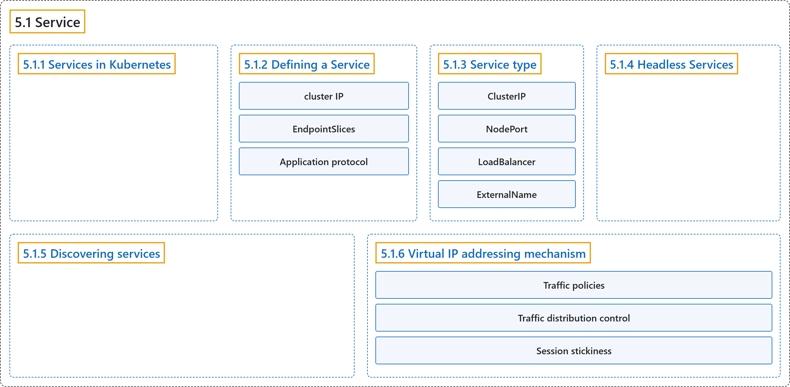

# 5.1 Service

## Classification

## Glossary

| Term | Definition | 中文翻译 | Source |
|---|---|---|---|
| **5.1 Service** Service | "In Kubernetes, a Service is **a method for exposing a network application** that is **running as one or more Pods in your cluster**." | 在 Kubernetes 中，Service 是**一种暴露网络应用的方法**，该应用**在集群中以一个或多个 Pod 运行**。 | [The Kubernetes Authors, n.d., "Service", para. 2](https://kubernetes.io/docs/concepts/services-networking/service/#:~:text=In%20Kubernetes%2C%20a%20Service%20is%20a%20method) |
| **5.1.1 Services in Kubernetes** Kubernetes 中的 Service | "The Service API, part of Kubernetes, is **an abstraction** to help you **expose groups of Pods over a network**." | Service API 是 Kubernetes 的一部分，是**一种抽象**，帮助你**通过网络暴露一组 Pod**。 | [The Kubernetes Authors, n.d., "Services in Kubernetes", para. 1](https://kubernetes.io/docs/concepts/services-networking/service/#:~:text=The%20Service%20API%2C%20part%20of%20Kubernetes%2C%20is) |
| **5.1.2 Defining a Service** 定义 Service | "**A Service** is **an object** (the same way that a Pod or a ConfigMap is an object)." | **Service** 是**一个对象**（就像 Pod 或 ConfigMap 是对象一样）。 | [The Kubernetes Authors, n.d., "Defining a Service", para. 1](https://kubernetes.io/docs/concepts/services-networking/service/#:~:text=A%20Service%20is%20an%20%5Bobject%5D%28https%3A%2F%2Fkubernetes.io%2Fdocs%2Fconcepts%2Foverview%2Fworking-with-objects%2F%23kubernetes-objects%29%20%28the%20same) |
| **cluster IP** 集群 IP | "Kubernetes assigns this Service **an IP address (the *cluster IP*)**, that is used by **the virtual IP address mechanism**." | Kubernetes 为这个 Service 分配**一个 IP 地址（即*集群 IP*）**，供**虚拟 IP 地址机制**使用。 | [The Kubernetes Authors, n.d., "Defining a Service", para. 5](https://kubernetes.io/docs/concepts/services-networking/service/#:~:text=Kubernetes%20assigns%20this%20Service%20an%20IP%20address) |
| **EndpointSlices** EndpointSlice | "EndpointSlices are **objects** that represent **a subset (a *slice*) of the backing network endpoints for a Service**." | EndpointSlice 是**对象**，代表 **Service 后端网络端点的一个子集（一个*切片*）**。 | [The Kubernetes Authors, n.d., "EndpointSlices", para. 1](https://kubernetes.io/docs/concepts/services-networking/service/#:~:text=%5BEndpointSlices%5D%28https%3A%2F%2Fkubernetes.io%2Fdocs%2Fconcepts%2Fservices-networking%2Fendpoint-slices%2F%29%20are%20objects%20that%20represent%20a%20subset) |
| **Application protocol** 应用协议 | "The `appProtocol` field provides a way to **specify an application protocol** for **each Service port**." | `appProtocol` 字段提供一种方式来**指定应用协议**，针对**每个 Service 端口**。 | [The Kubernetes Authors, n.d., "Application protocol", para. 1](https://kubernetes.io/docs/concepts/services-networking/service/#:~:text=The%20%60appProtocol%60%20field%20provides%20a%20way%20to) |
| **5.1.3 Service type** Service 类型 | (No definition) | （无定义） | [The Kubernetes Authors, n.d., "Service type"](https://kubernetes.io/docs/concepts/services-networking/service/#service-type) |
| **ClusterIP** ClusterIP | "This default Service type **assigns an IP address** from **a pool of IP addresses that your cluster has reserved for that purpose**." | 这种默认的 Service 类型**分配一个 IP 地址**，来自**集群为此预留的 IP 地址池**。 | [The Kubernetes Authors, n.d., "type: ClusterIP", para. 1](https://kubernetes.io/docs/concepts/services-networking/service/#:~:text=This%20default%20Service%20type%20assigns%20an%20IP) |
| **NodePort** NodePort | "If you set the `type` field to `NodePort`, **the Kubernetes control plane allocates a port** from **a range specified by `--service-node-port-range` flag** (default: 30000-32767)." | 如果把 `type` 字段设为 `NodePort`，**Kubernetes 控制平面会分配一个端口**，来自 **`--service-node-port-range` 标志指定的范围**（默认：30000-32767）。 | [The Kubernetes Authors, n.d., "type: NodePort", para. 1](https://kubernetes.io/docs/concepts/services-networking/service/#:~:text=If%20you%20set%20the%20%60type%60%20field%20to) |
| **LoadBalancer** LoadBalancer | "On cloud providers which support external load balancers, **setting the `type` field to `LoadBalancer`** provisions **a load balancer for your Service**." | 在支持外部负载均衡器的云服务商上，**把 `type` 字段设为 `LoadBalancer`** 会为 Service 供应**一个负载均衡器**。 | [The Kubernetes Authors, n.d., "type: LoadBalancer", para. 1](https://kubernetes.io/docs/concepts/services-networking/service/#:~:text=On%20cloud%20providers%20which%20support%20external%20load) |
| **ExternalName** ExternalName | "Services of type ExternalName **map a Service** to **a DNS name**, not to a typical selector such as `my-service` or `cassandra`." | ExternalName 类型的 Service **把 Service 映射**到**一个 DNS 名称**，而不是映射到 `my-service` 或 `cassandra` 这类常见的选择算符。 | [The Kubernetes Authors, n.d., "type: ExternalName", para. 1](https://kubernetes.io/docs/concepts/services-networking/service/#:~:text=Services%20of%20type%20ExternalName%20map%20a%20Service) |
| **5.1.4 Headless Services** 无头 Service | "In this case, you can create what are termed ***headless Services***, by **explicitly specifying `"None"` for the cluster IP address (`.spec.clusterIP`)**." | 这种情况下，你可以创建所谓的***无头 Service***，方法是**为集群 IP 地址（`.spec.clusterIP`）显式指定 `"None"`**。 | [The Kubernetes Authors, n.d., "Headless Services", para. 1](https://kubernetes.io/docs/concepts/services-networking/service/#:~:text=In%20this%20case%2C%20you%20can%20create%20what) |
| **5.1.5 Discovering services** 发现服务 | "For clients running inside your cluster, Kubernetes supports **two primary modes of finding a Service**: **environment variables and DNS**." | 对于集群内运行的客户端，Kubernetes 支持**两种主要的服务发现方式**：**环境变量和 DNS**。 | [The Kubernetes Authors, n.d., "Discovering services", para. 1](https://kubernetes.io/docs/concepts/services-networking/service/#:~:text=For%20clients%20running%20inside%20your%20cluster%2C%20Kubernetes) |
| **5.1.6 Virtual IP addressing mechanism** 虚拟 IP 寻址机制 | (No definition) | （无定义） | [The Kubernetes Authors, n.d., "Virtual IP addressing mechanism"](https://kubernetes.io/docs/concepts/services-networking/service/#virtual-ip-addressing-mechanism) |
| **Traffic policies** 流量策略 | "You can set the `.spec.internalTrafficPolicy` and `.spec.externalTrafficPolicy` fields to **control how Kubernetes routes traffic** to **healthy (“ready”) backends**." | 你可以设置 `.spec.internalTrafficPolicy` 和 `.spec.externalTrafficPolicy` 字段，**控制 Kubernetes 如何把流量路由**到**健康（“就绪”）的后端**。 | [The Kubernetes Authors, n.d., "Traffic policies", para. 1](https://kubernetes.io/docs/concepts/services-networking/service/#:~:text=You%20can%20set%20the%20%60.spec.internalTrafficPolicy%60%20and%20%60.spec.externalTrafficPolicy%60) |
| **Traffic distribution control** 流量分布控制 | "The `.spec.trafficDistribution` field provides **another way** to **influence traffic routing within a Kubernetes Service**." | `.spec.trafficDistribution` 字段提供了**另一种方式**，用来**影响 Kubernetes Service 内的流量路由**。 | [The Kubernetes Authors, n.d., "Traffic distribution control", para. 1](https://kubernetes.io/docs/concepts/services-networking/service/#:~:text=The%20%60.spec.trafficDistribution%60%20field%20provides%20another%20way%20to) |
| **Session stickiness** 会话粘性 | "If you want to make sure that **connections from a particular client are passed to the same Pod each time**, you can **configure session affinity based on the client's IP address**." | 如果你想确保**某个客户端的连接每次都被转发到同一个 Pod**，可以**基于客户端 IP 地址配置会话亲和性**。 | [The Kubernetes Authors, n.d., "Session stickiness", para. 1](https://kubernetes.io/docs/concepts/services-networking/service/#:~:text=If%20you%20want%20to%20make%20sure%20that) |

## References

The Kubernetes Authors. (n.d.). *Service*. Kubernetes Documentation. Retrieved October 31, 2026, from <https://kubernetes.io/docs/concepts/services-networking/service/>
