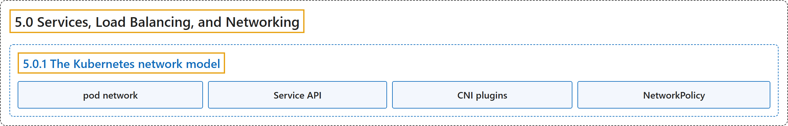

# 5.0 Services, Load Balancing, and Networking

## Classification

## Glossary

| Term | Definition | 中文翻译 | Source |
|---|---|---|---|
| **5.0 Services, Load Balancing, and Networking** 服务、负载均衡与网络 | (context) "**Concepts and resources behind networking in Kubernetes.**" | （语境）**Kubernetes 网络背后的概念和资源。** | [The Kubernetes Authors, n.d., "Services, Load Balancing, and Networking", para. 1](https://kubernetes.io/docs/concepts/services-networking/#:~:text=Concepts%20and%20resources%20behind%20networking%20in%20Kubernetes.) |
| **5.0.1 The Kubernetes network model** Kubernetes 网络模型 | "The Kubernetes network model is **built out of several pieces**:" | Kubernetes 网络模型**由若干部分构成**： | [The Kubernetes Authors, n.d., "The Kubernetes network model", para. 1](https://kubernetes.io/docs/concepts/services-networking/#:~:text=The%20Kubernetes%20network%20model%20is%20built%20out) |
| **pod network** Pod 网络 | "The *pod network* (also called a cluster network) **handles communication between pods**." | *Pod 网络*（也称集群网络）**处理 Pod 之间的通信**。 | [The Kubernetes Authors, n.d., "The Kubernetes network model", para. 3](https://kubernetes.io/docs/concepts/services-networking/#:~:text=The%20%2Apod%20network%2A%20%28also%20called%20a%20cluster) |
| **Service API** Service API | "The [Service](https://kubernetes.io/docs/concepts/services-networking/service/) API **lets you provide a stable (long lived) IP address or hostname for a service implemented by one or more backend pods**" | [Service](https://kubernetes.io/docs/concepts/services-networking/service/) API **让你为由一个或多个后端 Pod 实现的服务提供一个稳定（长期存在）的 IP 地址或主机名** | [The Kubernetes Authors, n.d., "The Kubernetes network model", para. 4](https://kubernetes.io/docs/concepts/services-networking/#:~:text=The%20%5BService%5D%28https%3A%2F%2Fkubernetes.io%2Fdocs%2Fconcepts%2Fservices-networking%2Fservice%2F%29%20API%20lets%20you%20provide%20a) |
| **CNI plugins** CNI 插件 | (context) "to interact with the pod network implementation, **so these implementations are often called *CNI plugins***." | （语境）与 Pod 网络实现交互，**因此这些实现常被称为 *CNI 插件***。 | [The Kubernetes Authors, n.d., "The Kubernetes network model", para. 10](https://kubernetes.io/docs/concepts/services-networking/#:~:text=to%20interact%20with%20the%20pod%20network%20implementation%2C) |
| **NetworkPolicy** NetworkPolicy | "[NetworkPolicy](https://kubernetes.io/docs/concepts/services-networking/network-policies/) is **a built-in Kubernetes API that allows you to control traffic between pods, or between pods and the outside world**" | [NetworkPolicy](https://kubernetes.io/docs/concepts/services-networking/network-policies/) 是**一个内置的 Kubernetes API，让你控制 Pod 之间、或 Pod 与外部世界之间的流量** | [The Kubernetes Authors, n.d., "The Kubernetes network model", para. 6](https://kubernetes.io/docs/concepts/services-networking/#:~:text=%5BNetworkPolicy%5D%28https%3A%2F%2Fkubernetes.io%2Fdocs%2Fconcepts%2Fservices-networking%2Fnetwork-policies%2F%29%20is%20a%20built-in%20Kubernetes%20API%20that) |

## References

The Kubernetes Authors. (n.d.). *Services, Load Balancing, and Networking*. Kubernetes Documentation. Retrieved October 31, 2026, from <https://kubernetes.io/docs/concepts/services-networking/>
