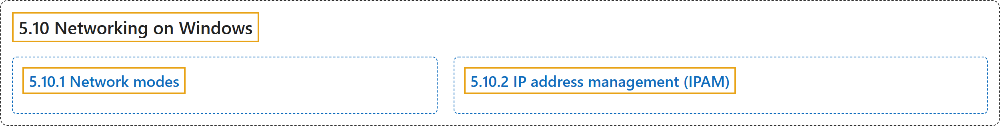

# 5.10 Networking on Windows

## Classification

## Glossary

| Term | Definition | 中文翻译 | Source |
|---|---|---|---|
| **5.10 Networking on Windows** Windows 上的网络 | (context) "Networking for Windows containers is **exposed through [CNI plugins](https://kubernetes.io/docs/concepts/extend-kubernetes/compute-storage-net/network-plugins/)**." | （语境）Windows 容器的网络**通过 [CNI 插件](https://kubernetes.io/docs/concepts/extend-kubernetes/compute-storage-net/network-plugins/)提供**。 | [The Kubernetes Authors, n.d., "Container networking on Windows", para. 1](https://kubernetes.io/docs/concepts/services-networking/windows-networking/#:~:text=Networking%20for%20Windows%20containers%20is%20exposed%20through) |
| **5.10.1 Network modes** 网络模式 | "Windows supports **five different networking drivers/modes**:" | Windows 支持**五种不同的网络驱动/模式**： | [The Kubernetes Authors, n.d., "Network modes", para. 1](https://kubernetes.io/docs/concepts/services-networking/windows-networking/#:~:text=Windows%20supports%20five%20different%20networking%20drivers%2Fmodes%3A) |
| **5.10.2 IP address management (IPAM)** IP 地址管理（IPAM） | (context) "The following IPAM options **are supported on Windows**:" | （语境）以下 IPAM 选项**在 Windows 上受支持**： | [The Kubernetes Authors, n.d., "IP address management (IPAM)", para. 1](https://kubernetes.io/docs/concepts/services-networking/windows-networking/#:~:text=The%20following%20IPAM%20options%20are%20supported%20on) |

## References

The Kubernetes Authors. (n.d.). *Networking on Windows*. Kubernetes Documentation. Retrieved October 31, 2026, from <https://kubernetes.io/docs/concepts/services-networking/windows-networking/>
