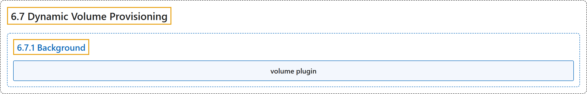

# 6.7 Dynamic Volume Provisioning

## Classification

## Glossary

| Term | Definition | 中文翻译 | Source |
|---|---|---|---|
| **6.7 Dynamic Volume Provisioning** 动态卷供应 | "**Dynamic volume provisioning** allows **storage volumes to be created on-demand**." | **动态卷供应**允许**按需创建存储卷**。 | [The Kubernetes Authors, n.d., "Dynamic Volume Provisioning", para. 1](https://kubernetes.io/docs/concepts/storage/dynamic-provisioning/#:~:text=Dynamic%20volume%20provisioning%20allows%20storage%20volumes%20to) |
| **6.7.1 Background** 背景 | (No definition) | （无定义） | [The Kubernetes Authors, n.d., "Background"](https://kubernetes.io/docs/concepts/storage/dynamic-provisioning/#background) |
| **volume plugin** 卷插件 | (context) "A cluster administrator can define as many `StorageClass` objects as needed, **each specifying a *volume plugin* (aka *provisioner*)** that **provisions a volume** and the set of parameters to pass to that provisioner when provisioning." | （语境）集群管理员可以按需定义任意多个 `StorageClass` 对象，**每个都指定一个*卷插件***（又称*供应者*），由它负责**供应卷**，以及供应时传给该供应者的参数。 | [The Kubernetes Authors, n.d., "Background", para. 1](https://kubernetes.io/docs/concepts/storage/dynamic-provisioning/#:~:text=A%20cluster%20administrator%20can%20define%20as%20many) |

## References

The Kubernetes Authors. (n.d.). *Dynamic Volume Provisioning*. Kubernetes Documentation. Retrieved October 31, 2026, from <https://kubernetes.io/docs/concepts/storage/dynamic-provisioning/>
