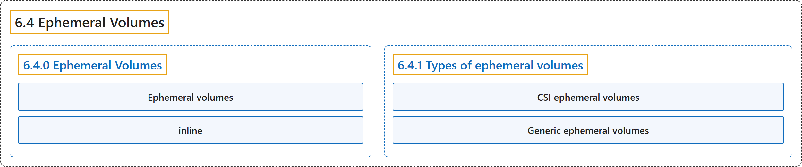

# 6.4 Ephemeral Volumes

## Classification

## Glossary

| Term | Definition | 中文翻译 | Source |
|---|---|---|---|
| **6.4 Ephemeral Volumes** 临时卷 | (context) "Some applications need **additional storage** but **don't care whether that data is stored persistently across restarts**." | （语境）有些应用需要**额外的存储**，但**不在乎这些数据在重启后是否持久保存**。 | [The Kubernetes Authors, n.d., "Ephemeral Volumes", para. 2](https://kubernetes.io/docs/concepts/storage/ephemeral-volumes/#:~:text=Some%20applications%20need%20additional%20storage%20but%20don%27t) |
| **6.4.0 Ephemeral Volumes** 临时卷 | (No definition) | （无定义） | [The Kubernetes Authors, n.d., "Ephemeral Volumes"](https://kubernetes.io/docs/concepts/storage/ephemeral-volumes/#ephemeral-volumes) |
| **Ephemeral volumes** 临时卷 | (context) "***Ephemeral volumes*** are **designed for these use cases**." | （语境）***临时卷***就是**为这些用例设计的**。 | [The Kubernetes Authors, n.d., "Ephemeral Volumes", para. 4](https://kubernetes.io/docs/concepts/storage/ephemeral-volumes/#:~:text=%2AEphemeral%20volumes%2A%20are%20designed%20for%20these%20use) |
| **inline** 内联 | "Ephemeral volumes are **specified *inline* in the Pod spec**, which **simplifies application deployment and management**." | 临时卷**在 Pod 规约中*内联*指定**，从而**简化应用的部署和管理**。 | [The Kubernetes Authors, n.d., "Ephemeral Volumes", para. 5](https://kubernetes.io/docs/concepts/storage/ephemeral-volumes/#:~:text=Ephemeral%20volumes%20are%20specified%20%2Ainline%2A%20in%20the) |
| **6.4.1 Types of ephemeral volumes** 临时卷的类型 | "Kubernetes supports **several different kinds of ephemeral volumes** for **different purposes**:" | Kubernetes 支持**多种不同的临时卷**，用于**不同的目的**： | [The Kubernetes Authors, n.d., "Types of ephemeral volumes", para. 1](https://kubernetes.io/docs/concepts/storage/ephemeral-volumes/#:~:text=Kubernetes%20supports%20several%20different%20kinds%20of%20ephemeral) |
| **CSI ephemeral volumes** CSI 临时卷 | "**CSI ephemeral volumes** *must* **be provided by third-party CSI storage drivers**." | **CSI 临时卷**必须**由第三方 CSI 存储驱动提供**。 | [The Kubernetes Authors, n.d., "Types of ephemeral volumes", para. 8](https://kubernetes.io/docs/concepts/storage/ephemeral-volumes/#:~:text=CSI%20ephemeral%20volumes%20%2Amust%2A%20be%20provided%20by) |
| **Generic ephemeral volumes** 通用临时卷 | "Generic ephemeral volumes are **similar to `emptyDir` volumes** in the sense that they **provide a per-pod directory for scratch data that is usually empty after provisioning**." | 通用临时卷**与 `emptyDir` 卷类似**，都**为每个 Pod 提供一个临时数据目录，供应后通常为空**。 | [The Kubernetes Authors, n.d., "Generic ephemeral volumes", para. 1](https://kubernetes.io/docs/concepts/storage/ephemeral-volumes/#:~:text=Generic%20ephemeral%20volumes%20are%20similar%20to%20%60emptyDir%60) |

## References

The Kubernetes Authors. (n.d.). *Ephemeral Volumes*. Kubernetes Documentation. Retrieved October 31, 2026, from <https://kubernetes.io/docs/concepts/storage/ephemeral-volumes/>
