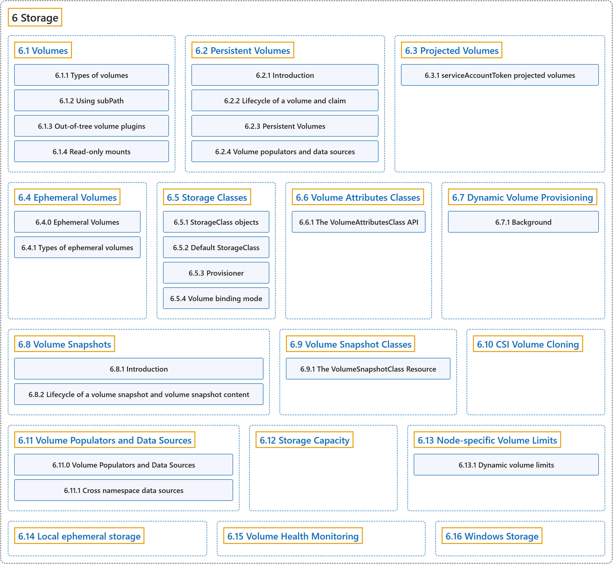

# 6 Storage

## Classification

## Glossary

| Term | Definition | 中文翻译 | Source |
|---|---|---|---|
| **6 Storage** 存储 | "Ways to provide both **long-term and temporary storage** to **Pods in your cluster**." | 提供**长期和临时存储**给**集群中的 Pod** 的方式。 | [The Kubernetes Authors, n.d.-h, "Storage", para. 1](https://kubernetes.io/docs/concepts/storage/#:~:text=Ways%20to%20provide%20both%20long-term%20and%20temporary) |
| **[6.1 Volumes](volumes.md)** 卷 | "Kubernetes *volumes* **provide a way for containers in a Pod** to **access and share data via the filesystem**." | Kubernetes *卷* **为 Pod 中的容器提供一种方式**，用来**通过文件系统访问和共享数据**。 | [The Kubernetes Authors, n.d.-p, "Volumes", para. 1](https://kubernetes.io/docs/concepts/storage/volumes/#:~:text=Kubernetes%20%2Avolumes%2A%20provide%20a%20way%20for%20containers) |
| **[6.2 Persistent Volumes](persistent-volumes.md)** 持久卷 | (context) "**Managing storage** is **a distinct problem from managing compute instances**." | （语境）**管理存储**是**一个与管理计算实例截然不同的问题**。 | [The Kubernetes Authors, n.d.-f, "Introduction", para. 1](https://kubernetes.io/docs/concepts/storage/persistent-volumes/#:~:text=Managing%20storage%20is%20a%20distinct%20problem%20from) |
| **[6.3 Projected Volumes](projected-volumes.md)** 投射卷 | "**A `projected` volume** maps **several existing volume sources into the same directory**." | **`projected` 卷**会把**若干现有卷源映射到同一个目录**。 | [The Kubernetes Authors, n.d.-g, "Introduction", para. 1](https://kubernetes.io/docs/concepts/storage/projected-volumes/#:~:text=A%20%60projected%60%20volume%20maps%20several%20existing%20volume) |
| **[6.4 Ephemeral Volumes](ephemeral-volumes.md)** 临时卷 | (context) "Some applications need **additional storage** but **don't care whether that data is stored persistently across restarts**." | （语境）有些应用需要**额外的存储**，但**不在乎这些数据在重启后是否持久保存**。 | [The Kubernetes Authors, n.d.-c, "Ephemeral Volumes", para. 2](https://kubernetes.io/docs/concepts/storage/ephemeral-volumes/#:~:text=Some%20applications%20need%20additional%20storage%20but%20don%27t) |
| **[6.5 Storage Classes](storage-classes.md)** 存储类 | "**A StorageClass** provides a way for administrators to **describe the *classes* of storage they offer**." | **StorageClass** 提供一种方式，让管理员**描述他们提供的存储*类别***。 | [The Kubernetes Authors, n.d.-j, "Storage Classes", para. 2](https://kubernetes.io/docs/concepts/storage/storage-classes/#:~:text=A%20StorageClass%20provides%20a%20way%20for%20administrators) |
| **[6.6 Volume Attributes Classes](volume-attributes-classes.md)** 卷属性类 | "**A VolumeAttributesClass** provides a way for administrators to **describe the mutable "classes" of storage they offer**." | **VolumeAttributesClass** 提供一种方式，让管理员**描述他们提供的可变存储类别**。 | [The Kubernetes Authors, n.d.-k, "Volume Attributes Classes", para. 3](https://kubernetes.io/docs/concepts/storage/volume-attributes-classes/#:~:text=A%20VolumeAttributesClass%20provides%20a%20way%20for%20administrators) |
| **[6.7 Dynamic Volume Provisioning](dynamic-provisioning.md)** 动态卷供应 | "**Dynamic volume provisioning** allows **storage volumes to be created on-demand**." | **动态卷供应**允许**按需创建存储卷**。 | [The Kubernetes Authors, n.d.-b, "Dynamic Volume Provisioning", para. 1](https://kubernetes.io/docs/concepts/storage/dynamic-provisioning/#:~:text=Dynamic%20volume%20provisioning%20allows%20storage%20volumes%20to) |
| **[6.8 Volume Snapshots](volume-snapshots.md)** 卷快照 | "In Kubernetes, **a *VolumeSnapshot*** represents **a snapshot of a volume on a storage system**." | 在 Kubernetes 中，**VolumeSnapshot**（卷快照）代表**存储系统上一个卷的快照**。 | [The Kubernetes Authors, n.d.-o, "Volume Snapshots", para. 1](https://kubernetes.io/docs/concepts/storage/volume-snapshots/#:~:text=In%20Kubernetes%2C%20a%20%2AVolumeSnapshot%2A%20represents%20a%20snapshot) |
| **[6.9 Volume Snapshot Classes](volume-snapshot-classes.md)** 卷快照类 | "**VolumeSnapshotClass** provides a way to **describe the "classes" of storage when provisioning a volume snapshot**." | **VolumeSnapshotClass** 提供一种方式，**在供应卷快照时描述存储的类别**。 | [The Kubernetes Authors, n.d.-n, "Introduction", para. 1](https://kubernetes.io/docs/concepts/storage/volume-snapshot-classes/#:~:text=VolumeSnapshotClass%20provides%20a%20way%20to%20describe%20the) |
| **[6.10 CSI Volume Cloning](volume-pvc-datasource.md)** CSI 卷克隆 | "**The CSI Volume Cloning feature** adds support for **specifying existing PVCs in the `dataSource` field** to indicate a user would like to **clone a Volume**." | **CSI 卷克隆功能**支持**在 `dataSource` 字段中指定现有的 PVC**，表示用户想要**克隆一个卷**。 | [The Kubernetes Authors, n.d.-a, "Introduction", para. 1](https://kubernetes.io/docs/concepts/storage/volume-pvc-datasource/#:~:text=The%20%5BCSI%5D%28https%3A%2F%2Fkubernetes.io%2Fdocs%2Fconcepts%2Fstorage%2Fvolumes%2F%23csi%29%20Volume%20Cloning%20feature%20adds%20support) |
| **[6.11 Volume Populators and Data Sources](volume-populators-and-data-sources.md)** 卷填充器与数据源 | (context) "When you create a PersistentVolumeClaim, **the volume that Kubernetes provisions for it** normally **starts empty**." | （语境）当你创建 PersistentVolumeClaim 时，**Kubernetes 为它供应的卷**通常**一开始是空的**。 | [The Kubernetes Authors, n.d.-m, "Volume Populators and Data Sources", para. 2](https://kubernetes.io/docs/concepts/storage/volume-populators-and-data-sources/#:~:text=When%20you%20create%20a%20%5BPersistentVolumeClaim%5D%28https%3A%2F%2Fkubernetes.io%2Fdocs%2Fconcepts%2Fstorage%2Fpersistent-volumes%2F%23persistentvolumeclaims%29%2C%20the%20volume) |
| **[6.12 Storage Capacity](storage-capacity.md)** 存储容量 | "**Storage capacity** is **limited** and may **vary depending on the node on which a pod runs**:" | **存储容量**是**有限的**，并且可能**因 Pod 所在的节点而不同**： | [The Kubernetes Authors, n.d.-i, "Storage Capacity", para. 1](https://kubernetes.io/docs/concepts/storage/storage-capacity/#:~:text=Storage%20capacity%20is%20limited%20and%20may%20vary) |
| **[6.13 Node-specific Volume Limits](storage-limits.md)** 节点特定的卷数限制 | (context) "**Cloud providers like Google, Amazon, and Microsoft** typically have **a limit on how many volumes can be attached to a Node**." | （语境）**Google、Amazon 和 Microsoft 等云服务商**通常**对一个节点可挂接的卷数量有上限**。 | [The Kubernetes Authors, n.d.-e, "Node-specific Volume Limits", para. 2](https://kubernetes.io/docs/concepts/storage/storage-limits/#:~:text=Cloud%20providers%20like%20Google%2C%20Amazon%2C%20and%20Microsoft) |
| **[6.14 Local ephemeral storage](ephemeral-storage.md)** 本地临时存储 | "**Nodes have local ephemeral storage**, **backed by locally-attached writeable devices or, sometimes, by RAM**." | **节点拥有本地临时存储**，它**由本地挂接的可写设备支持，有时也由内存支持**。 | [The Kubernetes Authors, n.d.-d, "Local ephemeral storage", para. 1](https://kubernetes.io/docs/concepts/storage/ephemeral-storage/#:~:text=Nodes%20have%20local%20ephemeral%20storage%2C%20backed%20by) |
| **[6.15 Volume Health Monitoring](volume-health-monitoring.md)** 卷健康监控 | "**CSI volume health monitoring** lets a CSI driver **report health problems with a volume or with its storage backend directly to Kubernetes**." | **CSI 卷健康监控**让 CSI 驱动**把卷或其存储后端的健康问题直接报告给 Kubernetes**。 | [The Kubernetes Authors, n.d.-l, "Volume Health Monitoring", para. 3](https://kubernetes.io/docs/concepts/storage/volume-health-monitoring/#:~:text=CSI%20volume%20health%20monitoring%20lets%20a%20%5BCSI%5D%28https%3A%2F%2Fkubernetes.io%2Fdocs%2Fconcepts%2Fstorage%2Fvolumes%2F%23csi%29) |
| **[6.16 Windows Storage](windows-storage.md)** Windows 存储 | (context) "Windows has **a layered filesystem driver** to **mount container layers** and **create a copy filesystem based on NTFS**." | （语境）Windows 有**一个分层文件系统驱动**，用来**挂载容器层**并**创建基于 NTFS 的副本文件系统**。 | [The Kubernetes Authors, n.d.-q, "Persistent storage", para. 1](https://kubernetes.io/docs/concepts/storage/windows-storage/#:~:text=Windows%20has%20a%20layered%20filesystem%20driver%20to) |

## References

The Kubernetes Authors. (n.d.-a). *CSI Volume Cloning*. Kubernetes Documentation. Retrieved October 31, 2026, from <https://kubernetes.io/docs/concepts/storage/volume-pvc-datasource/>

The Kubernetes Authors. (n.d.-b). *Dynamic Volume Provisioning*. Kubernetes Documentation. Retrieved October 31, 2026, from <https://kubernetes.io/docs/concepts/storage/dynamic-provisioning/>

The Kubernetes Authors. (n.d.-c). *Ephemeral Volumes*. Kubernetes Documentation. Retrieved October 31, 2026, from <https://kubernetes.io/docs/concepts/storage/ephemeral-volumes/>

The Kubernetes Authors. (n.d.-d). *Local ephemeral storage*. Kubernetes Documentation. Retrieved October 31, 2026, from <https://kubernetes.io/docs/concepts/storage/ephemeral-storage/>

The Kubernetes Authors. (n.d.-e). *Node-specific Volume Limits*. Kubernetes Documentation. Retrieved October 31, 2026, from <https://kubernetes.io/docs/concepts/storage/storage-limits/>

The Kubernetes Authors. (n.d.-f). *Persistent Volumes*. Kubernetes Documentation. Retrieved October 31, 2026, from <https://kubernetes.io/docs/concepts/storage/persistent-volumes/>

The Kubernetes Authors. (n.d.-g). *Projected Volumes*. Kubernetes Documentation. Retrieved October 31, 2026, from <https://kubernetes.io/docs/concepts/storage/projected-volumes/>

The Kubernetes Authors. (n.d.-h). *Storage*. Kubernetes Documentation. Retrieved October 31, 2026, from <https://kubernetes.io/docs/concepts/storage/>

The Kubernetes Authors. (n.d.-i). *Storage Capacity*. Kubernetes Documentation. Retrieved October 31, 2026, from <https://kubernetes.io/docs/concepts/storage/storage-capacity/>

The Kubernetes Authors. (n.d.-j). *Storage Classes*. Kubernetes Documentation. Retrieved October 31, 2026, from <https://kubernetes.io/docs/concepts/storage/storage-classes/>

The Kubernetes Authors. (n.d.-k). *Volume Attributes Classes*. Kubernetes Documentation. Retrieved October 31, 2026, from <https://kubernetes.io/docs/concepts/storage/volume-attributes-classes/>

The Kubernetes Authors. (n.d.-l). *Volume Health Monitoring*. Kubernetes Documentation. Retrieved October 31, 2026, from <https://kubernetes.io/docs/concepts/storage/volume-health-monitoring/>

The Kubernetes Authors. (n.d.-m). *Volume Populators and Data Sources*. Kubernetes Documentation. Retrieved October 31, 2026, from <https://kubernetes.io/docs/concepts/storage/volume-populators-and-data-sources/>

The Kubernetes Authors. (n.d.-n). *Volume Snapshot Classes*. Kubernetes Documentation. Retrieved October 31, 2026, from <https://kubernetes.io/docs/concepts/storage/volume-snapshot-classes/>

The Kubernetes Authors. (n.d.-o). *Volume Snapshots*. Kubernetes Documentation. Retrieved October 31, 2026, from <https://kubernetes.io/docs/concepts/storage/volume-snapshots/>

The Kubernetes Authors. (n.d.-p). *Volumes*. Kubernetes Documentation. Retrieved October 31, 2026, from <https://kubernetes.io/docs/concepts/storage/volumes/>

The Kubernetes Authors. (n.d.-q). *Windows Storage*. Kubernetes Documentation. Retrieved October 31, 2026, from <https://kubernetes.io/docs/concepts/storage/windows-storage/>
